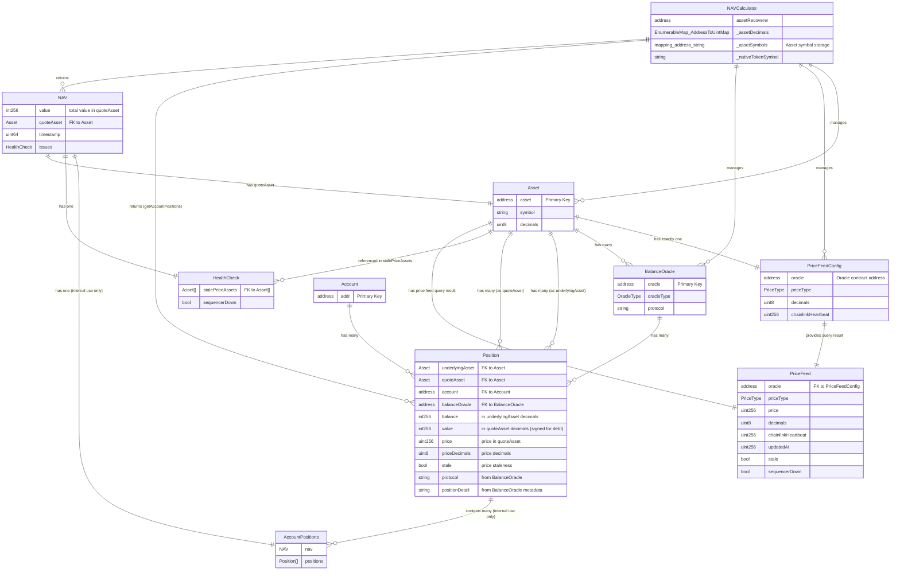

# BalanceOracle Simplification and Naming Refactor

This document details all changes in the refactor to simplify the balance oracle structure, improve naming consistency, and optimize position building.

## Table of Contents

1. [Proposed Architectural Changes](#proposed-architectural-changes)
2. [Proposed Schema Redefinitions](#proposed-schema-redefinitions)
3. [Summary of Changes](#summary-of-changes)
4. [Detailed Changes](#detailed-changes)
5. [Entity Relationship Diagram](#entity-relationship-diagram)
6. [Migration Guide](#migration-guide)
7. [Breaking Changes](#breaking-changes)

---

## Proposed Architectural Changes

### Function Organization and Balance Oracle Processing

The BalanceOracle can still be useful to identify positions and populate that information, but it should be processed differently with a clearer separation of concerns.

#### Proposed Function Structure

**All functions below are in BalanceOracle/Adapter Context** (not NAVCalculator):

**External Functions** (Public API on BalanceOracle adapters):
```solidity
// Get balances from this specific balance oracle
// When asset != address(0), returns a single balance value directly (more gas-efficient)
// When asset == address(0), returns arrays of all assets and their balances
function getOracleBalance(
    address account,
    address asset  // optional filter, address(0) for all assets
) external view returns (
    address[] memory assets,  // Empty array when asset != address(0)
    int256[] memory amounts  // Empty array when asset != address(0)
) {
    if (asset != address(0)) {
        // Return single balance directly - caller should use getOracleBalanceForAsset() instead
        // This function signature maintained for backward compatibility
        return (new address[](0), new int256[](0));
    }
    // ... return all assets and balances
}

// Get single balance for a specific asset (gas-optimized version)
function getOracleBalanceForAsset(
    address account,
    address asset
) external view returns (int256 balance);

// Get positions from this specific balance oracle
function getOraclePositions(
    address account,
    address asset  // optional filter, address(0) for all assets
) external view returns (
    Position[] memory positions
);
```

**Note**: The "Oracle" prefix indicates these functions operate on a specific oracle/adapter, not system-wide aggregation.

**Internal Functions** (Processing Pipeline in BalanceOracle adapters):
```solidity
// Fetch protocol-specific data for an account
function _fetchAccountProtocolData(
    address account,
    address asset,
    address balanceOracle
) internal view returns (
    ProtocolData memory  // Protocol-specific struct
);

// Build Position array from processed protocol data
function _buildPositions(
    address account,
    ProtocolData[] memory protocolData
) internal view returns (
    Position[] memory positions
);

// Filter positions by asset
function _filterPositionsByAsset(
    Position[] memory positions,
    address asset
) internal pure returns (
    Position memory position  // Single position or empty
);

// Filter balances by asset
function _filterBalancesByAsset(
    address[] memory assets,
    int256[] memory amounts,
    address asset
) internal pure returns (
    int256 amount
);
```

**ProtocolData Struct** (Internal to BalanceOracle adapters):
- `ProtocolData` is **adapter-specific** - each adapter defines its own structure
- Each BalanceOracle adapter (AaveV3Instance, CompoundV3Comet, etc.) can define `ProtocolData` with fields specific to their protocol
- Used internally by `_fetchAccountProtocolData()` to structure protocol-specific data
- Not part of public API - purely internal processing structure
- **Polymorphism**: Each adapter implements its own `_fetchAccountProtocolData()` that returns its specific `ProtocolData` struct type. The `_buildPositions()` function in each adapter handles its own `ProtocolData` structure.
- Example: Aave adapter might include `suppliedAmount`, `borrowedAmount`, `rewards`, while Compound adapter might have different fields

**In NAVCalculator Context** (system-wide aggregation):
```solidity
// Get all balances for an account - aggregates from ALL oracles in the system
function getBalances(
    address account,
    address asset  // optional filter, address(0) for all assets
) external view returns (
    address[] memory assets,
    int256[] memory amounts  // Signed to support negative balances (debt)
);

// Get all positions for an account - aggregates from ALL oracles in the system
// Renamed from getPositions/getAllPositions - returns Position[] array
function getAccountPositions(
    address account,
    address quoteAsset  // quote currency for valuation
) external view returns (
    Position[] memory positions
);

// Get positions for a specific asset - aggregates from ALL oracles for that asset
function getAccountPositionsForAsset(
    address account,
    address asset,  // specific asset to filter by
    address quoteAsset  // quote currency for valuation
) external view returns (
    Position[] memory positions
);

// Get NAV for an account - aggregates from ALL oracles (replaces deprecated getTotalNAV)
function getAccountNav(
    address account,
    address baseAsset  // quote currency (baseAsset = quoteAsset)
) external view returns (
    NAV memory nav
);

// Get all assets at once
function getAssets() external view returns (
    Asset[] memory assets
);

// Get asset count (for chunked queries)
function getAssetsCount() external view returns (
    uint256 count
);

// Get NAV for a range of assets (chunked query)
// @param from Starting asset index (inclusive, from _assetDecimals enumeration)
// @param to Ending asset index (inclusive, from _assetDecimals enumeration)
// @dev Validates that from <= to and both indices are within asset count bounds
// @dev Reverts with InvalidArguments if indices are out of range or from > to
function getAccountNavForRange(
    address account,
    uint256 from,  // Starting asset index (inclusive)
    uint256 to     // Ending asset index (inclusive)
) external view returns (
    NAV memory nav
);

// Get all balance oracles configured for a specific asset
function getAssetBalanceOracles(
    address asset
) external view returns (
    BalanceOracle[] memory balanceOracles
);
```

**Deprecated Functions**:
- `getTotalNAV()` - **DEPRECATED**, replaced by `getAccountNav()` and `getAccountNavForRange()`

**Key Distinction**:
- **BalanceOracle functions** (with "Oracle" prefix): Operate on a **specific balance oracle/adapter** (oracle-specific view)
  - `getOracleBalance()`: Balances from one oracle
  - `getOraclePositions()`: Positions from one oracle
- **NAVCalculator functions** (no prefix): Aggregate from **all balance oracles** in the system (system-wide view)
  - `getBalances()`: Aggregates balances from all oracles (no pricing)
  - `getAccountPositions()`: Aggregates positions from all oracles, adds pricing (returns Position[] array) - **renamed from `getPositions()`/`getAllPositions()`**
  - `getAccountPositionsForAsset()`: Aggregates positions for a specific asset from all oracles, adds pricing
  - `getAccountNav()`: Returns NAV only (no positions array) - **replaces deprecated `getTotalNAV()`**
  - `getAccountNavForRange()`: Returns NAV for a range of assets (chunked query)
  - `getAssets()`: Returns all assets at once (Asset[] array)
  - `getAssetsCount()`: Returns total asset count (for chunking)
  - `getAssetBalanceOracles()`: Returns all balance oracles configured for a specific asset
- NAVCalculator loops through all assets and their balance oracles, calling oracle-specific functions to collect data

**Internal Functions** (Processing Pipeline):
```solidity
// Fetch protocol-specific data for an account
function _fetchAccountProtocolData(
    address account,
    address asset,
    address balanceOracle
) internal view returns (
    ProtocolData memory  // Protocol-specific struct
);

// Build Position array from processed protocol data
function _buildPositions(
    address account,
    ProtocolData[] memory protocolData
) internal view returns (
    Position[] memory positions
);

// Filter positions by asset
function _filterPositionsByAsset(
    Position[] memory positions,
    address asset
) internal pure returns (
    Position memory position  // Single position or empty
);

// Filter balances by asset
function _filterBalancesByAsset(
    address[] memory assets,
    int256[] memory amounts,
    address asset
) internal pure returns (
    int256 amount
);
```

#### Pricing Optimization Strategy

After building all Positions in NAVCalculator, add asset pricing to each position using cached `PriceFeed` query results. This can be optimized by:

1. **Keeping assets with positions in memory**: Instead of fetching price for each position individually, collect all unique assets first
2. **Fetch prices once per asset**: Query price oracle once per unique asset
3. **Cache prices in memory**: Store prices in a mapping or struct array
4. **Reference cached prices**: Each Position references the cached price data

**Optimized Processing Flow** for `getAccountPositions()` in NAVCalculator (using PriceFeed directly):
```solidity
function getAccountPositions(address account, address quoteAsset) external view returns (Position[] memory) {
    // This function aggregates positions from ALL balance oracles in the system
    // Renamed from getPositions()/getAllPositions() - returns Position[] array
    
    // 1. Validate quoteAsset has PriceFeedConfig
    if (priceFeedConfigs[quoteAsset].oracle == address(0)) {
        revert PriceFeedNotSet(quoteAsset);
    }
    
    // 2. Pre-allocate arrays for positions (use balanceOracleTotalCount as max size)
    Position[] memory tempPositions = new Position[](balanceOracleTotalCount);
    uint256 positionCount = 0;
    
    // 3. Loop through all assets with balance oracles
    address[] memory assets = _getAllAssets();
    
    // 4. For each asset, loop through all its balance oracles
    for (uint i = 0; i < assets.length; i++) {
        address asset = assets[i];
        uint256 oracleCount = balanceOracleCountFor(asset);
        
        for (uint j = 0; j < oracleCount; j++) {
            // 5. Get oracle address
            (address oracle, OracleType oracleType) = balanceOracleAt(asset, j);
            
            // 6. Call getOraclePositions() on the oracle adapter (BalanceOracle context)
            // Each oracle adapter implements getOraclePositions() which uses its internal functions
            if (oracleType == OracleType.Custom) {
                Position[] memory oraclePositions = IBalanceOracleCustom(oracle).getOraclePositions(account, asset);
                // Copy positions to temp array
                for (uint k = 0; k < oraclePositions.length; k++) {
                    tempPositions[positionCount] = oraclePositions[k];
                    positionCount++;
                }
            } else {
                // For ERC20/Native, build position directly
                int256 balance = balanceOf(asset, j, account);
                if (balance != 0) {
                    // Build Position and add to temp array
                    Position memory pos = _buildSimplePosition(asset, oracle, balance, account);
                    tempPositions[positionCount] = pos;
                    positionCount++;
                }
            }
        }
    }
    
    // 7. Resize to actual count
    Position[] memory allPositions = new Position[](positionCount);
    for (uint i = 0; i < positionCount; i++) {
        allPositions[i] = tempPositions[i];
    }
    
    // 8. Collect unique assets from all positions
    address[] memory assetsWithPositions = _extractUniqueAssets(allPositions);
    
    // 9. Fetch prices once per asset (optimized) - use PriceFeed directly
    mapping(address => PriceFeed) memory priceFeeds;  // Keyed by asset address
    for (uint i = 0; i < assetsWithPositions.length; i++) {
        address asset = assetsWithPositions[i];
        priceFeeds[asset] = _fetchPriceFeed(asset);  // Returns PriceFeed query result
    }
    
    // 10. Attach pricing to positions from cached PriceFeed and calculate values
    for (uint i = 0; i < allPositions.length; i++) {
        address asset = allPositions[i].underlyingAsset.asset;
        PriceFeed memory priceFeed = priceFeeds[asset];
        allPositions[i].price = priceFeed.price;
        allPositions[i].priceDecimals = priceFeed.decimals;
        allPositions[i].stale = priceFeed.stale;
        allPositions[i].quoteAsset = Asset({
            asset: quoteAsset,
            symbol: _assetSymbols[quoteAsset],
            decimals: _assetDecimals[quoteAsset]
        });
        
        // Calculate value: Convert balance (in underlying asset) to value (in quote asset)
        // Use existing helper functions:
        // 1. Convert balance to USD: _toUsd(balance, underlyingAssetDecimals, usdPrice, usdPriceDecimals)
        // 2. Convert USD to quoteAsset: _fromUsd(usdValue, quoteAssetPrice, quoteAssetPriceDecimals, quoteAssetDecimals)
        // If quoteAsset is USD (address(0)): value = _toUsd(balance, underlyingAssetDecimals, price, priceDecimals)
        if (quoteAsset == address(0)) {
            // USD quote: direct conversion
            allPositions[i].value = _toUsd(
                allPositions[i].balance,
                allPositions[i].underlyingAsset.decimals,
                priceFeed.price,
                priceFeed.decimals
            );
        } else {
            // Non-USD quote: convert via USD
            PriceFeed memory quotePriceFeed = priceFeeds[quoteAsset];
            int256 usdValue = _toUsd(
                allPositions[i].balance,
                allPositions[i].underlyingAsset.decimals,
                priceFeed.price,
                priceFeed.decimals
            );
            allPositions[i].value = _fromUsd(
                usdValue,
                quotePriceFeed.price,
                quotePriceFeed.decimals,
                allPositions[i].quoteAsset.decimals
            );
        }
    }
    
    // 11. Return positions array
    return allPositions;
}
```

**Processing Flow** for `getAccountPositionsForAsset()` in NAVCalculator:
```solidity
function getAccountPositionsForAsset(
    address account,
    address asset,
    address quoteAsset
) external view returns (Position[] memory) {
    // This function aggregates positions for a SPECIFIC asset from ALL balance oracles
    
    // 1. Validate quoteAsset has PriceFeedConfig (early validation)
    if (priceFeedConfigs[quoteAsset].oracle == address(0)) {
        revert PriceFeedNotSet(quoteAsset);
    }
    
    // 2. Get all balance oracles for this asset
    uint256 oracleCount = balanceOracleCountFor(asset);
    
    // 3. Pre-allocate array for positions
    Position[] memory tempPositions = new Position[](oracleCount);
    uint256 positionCount = 0;
    
    // 4. For each oracle, get positions for this asset
    for (uint j = 0; j < oracleCount; j++) {
        (address oracle, OracleType oracleType) = balanceOracleAt(asset, j);
        
        if (oracleType == OracleType.Custom) {
            Position[] memory oraclePositions = IBalanceOracleCustom(oracle).getOraclePositions(account, asset);
            // Copy positions to temp array
            for (uint k = 0; k < oraclePositions.length; k++) {
                tempPositions[positionCount] = oraclePositions[k];
                positionCount++;
            }
        } else {
            // For ERC20/Native, build position directly
            int256 balance = balanceOf(asset, j, account);
            if (balance != 0) {
                // Build Position and add to temp array
                Position memory pos = _buildSimplePosition(asset, oracle, balance, account);
                tempPositions[positionCount] = pos;
                positionCount++;
            }
        }
    }
    
    // 5. Resize to actual count
    Position[] memory assetPositions = new Position[](positionCount);
    for (uint i = 0; i < positionCount; i++) {
        assetPositions[i] = tempPositions[i];
    }
    
    // 6. Fetch price for this asset (optimized - single fetch)
    PriceFeed memory priceFeed = _fetchPriceFeed(asset);
    PriceFeed memory quotePriceFeed = _fetchPriceFeed(quoteAsset);
    
    // 7. Attach pricing to positions and calculate values
    for (uint i = 0; i < assetPositions.length; i++) {
        assetPositions[i].price = priceFeed.price;
        assetPositions[i].priceDecimals = priceFeed.decimals;
        assetPositions[i].stale = priceFeed.stale;
        assetPositions[i].quoteAsset = Asset({
            asset: quoteAsset,
            symbol: _assetSymbols[quoteAsset],
            decimals: _assetDecimals[quoteAsset]
        });
        
        // Calculate value (same logic as getAccountPositions)
        if (quoteAsset == address(0)) {
            assetPositions[i].value = _toUsd(
                assetPositions[i].balance,
                assetPositions[i].underlyingAsset.decimals,
                priceFeed.price,
                priceFeed.decimals
            );
        } else {
            int256 usdValue = _toUsd(
                assetPositions[i].balance,
                assetPositions[i].underlyingAsset.decimals,
                priceFeed.price,
                priceFeed.decimals
            );
            assetPositions[i].value = _fromUsd(
                usdValue,
                quotePriceFeed.price,
                quotePriceFeed.decimals,
                assetPositions[i].quoteAsset.decimals
            );
        }
    }
    
    return assetPositions;
}
```

**Processing Flow** for `getAssets()` in NAVCalculator:
```solidity
function getAssets() external view returns (Asset[] memory) {
    // Returns all assets configured in the system
    uint256 count = _assetDecimals.length();
    Asset[] memory assets = new Asset[](count);
    
    for (uint i = 0; i < count; i++) {
        (address assetAddr, uint8 decimals) = _assetDecimals.at(i);
        assets[i] = Asset({
            asset: assetAddr,
            decimals: decimals,
            symbol: _assetSymbols[assetAddr]  // If symbol storage exists
        });
    }
    
    return assets;
}
```

**Processing Flow** for `getAssetBalanceOracles()` in NAVCalculator:
```solidity
function getAssetBalanceOracles(address asset) external view returns (BalanceOracle[] memory) {
    // Returns all balance oracles configured for a specific asset
    uint256 count = balanceOracleCountFor(asset);
    BalanceOracle[] memory oracles = new BalanceOracle[](count);
    
    for (uint i = 0; i < count; i++) {
        (address oracle, OracleType oracleType) = balanceOracleAt(asset, i);
        BalanceOracle memory balanceOracle = balanceOracles[asset][i];  // Get stored struct
        oracles[i] = balanceOracle;
    }
    
    return oracles;
}
```

**Processing Flow** for `getBalances()` in NAVCalculator:
```solidity
function getBalances(address account, address asset) external view returns (
    address[] memory assets,
    int256[] memory amounts
) {
    // This function aggregates balances from ALL balance oracles in the system
    
    // 1. Determine which assets to process
    address[] memory assetsToProcess = asset == address(0) ? _getAllAssets() : [asset];
    
    // 2. Pre-allocate arrays with maximum possible size (all assets)
    // Use two-pass approach: first count, then populate
    uint256 maxSize = assetsToProcess.length;
    address[] memory tempAssets = new address[](maxSize);
    int256[] memory tempAmounts = new int256[](maxSize);
    uint256 count = 0;
    
    // 3. For each asset, loop through all its balance oracles
    for (uint i = 0; i < assetsToProcess.length; i++) {
        address assetAddr = assetsToProcess[i];
        uint256 oracleCount = balanceOracleCountFor(assetAddr);
        int256 totalBalance = 0;
        
        for (uint j = 0; j < oracleCount; j++) {
            // 4. Get oracle address
            (address oracle, OracleType oracleType) = balanceOracleAt(assetAddr, j);
            
            // 5. Get balance from this oracle
            if (oracleType == OracleType.Custom) {
                // Use optimized function for single asset query
                int256 balance = IBalanceOracleCustom(oracle).getOracleBalanceForAsset(account, assetAddr);
                totalBalance += balance;
            } else {
                // For ERC20/Native, get balance directly
                int256 balance = balanceOf(assetAddr, j, account);
                totalBalance += balance;  // Sum all balances (can be negative)
            }
        }
        
        // Include asset if it has any balance (positive or negative)
        if (totalBalance != 0) {
            tempAssets[count] = assetAddr;
            tempAmounts[count] = totalBalance;
            count++;
        }
    }
    
    // 4. Resize arrays to actual count
    address[] memory resultAssets = new address[](count);
    int256[] memory resultAmounts = new int256[](count);
    
    for (uint i = 0; i < count; i++) {
        resultAssets[i] = tempAssets[i];
        resultAmounts[i] = tempAmounts[i];
    }
    
    return (resultAssets, resultAmounts);
}
```

**Note**: `PriceFeed` (query result) is used directly for caching, keyed by asset address. No separate `AssetPrice` struct needed since `PriceFeed` already contains all necessary price information.

### Error Handling Strategy

**Oracle Call Failures**:
- **Custom Oracle Failures**: If `getOraclePositions()` or `getOracleBalanceForAsset()` reverts, the entire query reverts (fail-fast approach)
- **Price Oracle Failures**: If price feed query fails, the position is marked as `stale = true` and value calculation may be skipped or set to 0
- **Balance Query Failures**: For ERC20/Native oracles, if `balanceOf()` fails, the balance is treated as 0 (no position created)

**Missing Configurations**:
- **Missing PriceFeedConfig**: Reverts with `PriceFeedNotSet(address asset)` error
- **Missing Asset Registration**: Reverts with `AssetNotFound()` error
- **Missing BalanceOracle**: Returns empty arrays/zero balances (not an error, just no data)

**Invalid Parameters**:
- **Invalid Asset Address**: Reverts with `InvalidArguments()` or `AssetNotFound()`
- **Invalid Range Indices**: In `getAccountNavForRange()`, validates `from <= to` and both indices are within bounds, reverts with `InvalidArguments()` if invalid
- **Array Length Mismatches**: Reverts with `InvalidArgumentsWithContext()` with descriptive message

**Partial Failures**:
- If one oracle fails but others succeed, the entire query reverts (atomic operation)
- If one asset's price is stale, only that position is marked stale, others continue normally
- Sequencer downtime affects all positions globally (all marked as affected by sequencer issue)

#### Benefits of This Architecture

1. **Clear separation of concerns**:
   - External functions: Simple, focused API
   - Internal functions: Reusable processing steps

2. **Better testability**: Each internal function can be tested independently

3. **Optimized pricing**: Fetch prices once per asset, not per position

4. **Flexible filtering**: Optional asset filter at API level

5. **Protocol-agnostic processing**: `_fetchAccountProtocolData()` can handle different protocol types

6. **Efficient memory usage**: Cache prices in memory, reference from positions

#### BalanceOracle Adapter Invariants

**Critical Invariant**: BalanceOracle adapters must return balances with decimal precision matching the underlying asset's registered decimals.

- **Requirement**: When `balanceOf(asset, account)` is called on a custom oracle adapter, the returned `int256 balance` must be in the same decimal precision as the asset's registered decimals
- **Rationale**: Incorrect decimal scaling causes value calculation errors. For example, if USDC (6 decimals) balance is returned with 18 decimals, the value will be 10^12 times too large
- **Testing**: All custom oracle adapters must be tested to ensure they return correctly scaled balances for assets with different decimal configurations (6, 8, 18 decimals)
- **Examples**:
  - USDC (6 decimals): 1000 USDC should return `1000 * 10^6 = 1_000_000`
  - WETH (18 decimals): 1 WETH should return `1 * 10^18 = 1_000_000_000_000_000_000`
  - WBTC (8 decimals): 0.5 WBTC should return `0.5 * 10^8 = 50_000_000`
- **Validation**: This invariant should be tested in unit tests for each adapter implementation

#### Function Naming Convention

**BalanceOracle/Adapter Context** (functions with "Oracle" prefix):
- Functions on `IBalanceOracleCustom` adapters (e.g., AaveV3Instance, CompoundV3Comet)
- All operate on **this specific oracle's perspective**
- Oracle-specific view of positions and balances
- `getOracleBalance()` and `getOraclePositions()` are external functions on adapters
- Internal functions (`_fetchAccountProtocolData()`, `_buildPositions()`, etc.) are used by adapters to process their protocol-specific data

**NAVCalculator Context** (functions without prefix - system-wide):
- Functions on `NAVCalculator` contract
- Aggregate data from **all balance oracles** in the system
- System-wide view of all positions/balances for an account
- `getBalances()`: Aggregates balances from all oracles (no pricing)
- `getAccountPositions()`: Aggregates positions from all oracles, adds pricing (returns Position[] array) - **renamed from `getPositions()`/`getAllPositions()`**
- Loops through all assets and their balance oracles
- For each oracle, calls `getOraclePositions()` or `getOracleBalance()` to get oracle-specific data
- Aggregates all results

**Naming Pattern**:
- `getOracle*()` = Oracle-specific (BalanceOracle adapter context)
- `get*()` = System-wide aggregation (NAVCalculator context)

#### Migration Path

This architectural change can be implemented incrementally:

1. **Phase 1**: Add new internal functions alongside existing code in BalanceOracle adapters
2. **Phase 2**: Add `getOracleBalance()` and `getOraclePositions()` to BalanceOracle adapters
3. **Phase 3**: Refactor `getAccountPositions()` (formerly `getPositions()`/`getAllPositions()`) to use adapter functions and aggregate from all oracles
4. **Phase 4**: Add `getBalances()` to NAVCalculator for system-wide balance aggregation
5. **Phase 5**: Optimize pricing with PriceFeed caching (using mapping keyed by asset address)
6. **Phase 6**: Deprecate old internal functions if needed

---

## Proposed Schema Redefinitions

### New Schema Structure

The following schema redefinitions are proposed to simplify and improve the data structures:

#### 1. Asset Struct
```solidity
struct Asset {
    address asset;
    string symbol;
    uint8 decimals;
}
```
**Changes**: Added `symbol` field for human-readable asset identification.

**Storage**: Asset symbols are stored in a mapping `mapping(address => string) _assetSymbols` in NAVCalculator. Symbols are:
- For ERC20 tokens: Fetched from `IERC20Metadata(asset).symbol()` and cached in storage
- For native tokens: Stored in `_nativeTokenSymbol` (set via `setNativeTokenSymbol()`)
- Symbols are stored when assets are registered or when first accessed
- If `symbol()` call fails, the symbol is stored as empty string

#### 2. HealthCheck Struct (New)
```solidity
struct HealthCheck {
    Asset[] stalePriceAssets;
    bool sequencerDown;
}
```
**Purpose**: Groups all health-related information together for better organization.

#### 3. NAV Struct
```solidity
struct NAV {
    int256 value;
    Asset quoteAsset;
    uint64 timestamp;
    HealthCheck issues;
}
```
**Changes**:
- `usd` → `value` (more generic, supports any quote currency)
- Added `quoteAsset` (Asset struct) to specify the quote currency
- **Constraint**: The `quoteAsset` must have a PriceFeedConfig configured (required for value calculation)
- Removed `block` field
- `stalePriceAssets` and `sequencerDown` moved to `HealthCheck issues`

#### 4. OracleType Enum
```solidity
enum OracleType {
    ERC20,
    Native,
    Custom
}
```
**Changes**: Renamed from `BalanceType` to `OracleType` for simplicity and clarity.

#### 5. BalanceOracle Struct
```solidity
struct BalanceOracle {
    address oracle;
    OracleType oracleType;
    string protocol;
}
```
**Changes**:
- `balanceType` → `oracleType` (field renamed for clarity)
- `oracleType` now uses `OracleType` enum (simpler name)
- Added `protocol` field (for classification/organization)

#### 6. Position Struct (Redesigned)
```solidity
struct Position {
    // Balance
    Asset underlyingAsset;
    address balanceOracle;  // FK to BalanceOracle
    int256 balance;  // Represented in underlying asset decimals
    
    // Value
    Asset quoteAsset;  // Must have PriceFeedConfig configured
    int256 value;  // Represented in quote asset decimals (signed to support negative values for debt)

    // Pricing     
    uint256 price;
    uint8 priceDecimals; // In QuoteAsset
    bool stale;
    
    // Metadata
    string protocol;
    string positionDetail;
}
```
**Changes**:
- **Flattened structure**: No longer split into `PositionCore` and `PositionPricing`
- **Asset references**: Uses `Asset` struct for both `underlyingAsset` and `quoteAsset`
- **Simplified pricing**: Direct `price`, `priceDecimals`, and `stale` fields
- **Metadata**: `position` → `positionDetail` for clarity
- **Removed**: `positionType`, `assetSymbol`, `assetDecimals`, `quoteCurrencySymbol`, `quoteCurrencyDecimals`, `rate`, `rateDecimals`, `sequencerDown`

**Constraints**:
- `quoteAsset` must have a PriceFeedConfig configured (required for position valuation)

**Benefits**:
- Simpler, flatter structure
- All position data in one place
- Clear separation of balance vs value
- Asset information embedded via Asset struct

#### 7. AccountPositions Struct
```solidity
struct AccountPositions {
    NAV nav;
    Position[] positions;
}
```
**Purpose**: Aggregated response containing NAV summary and all positions for an account.
**Note**: This struct is no longer used as a return type. `getAccountPositions()` returns `Position[]` directly. This struct may be kept for internal use or removed if not needed.

---

## Summary of Changes

### 1. Remove `balanceOraclesWithMetadata()` Function and Struct

The `BalanceOracleWithMetadata` struct and `balanceOraclesWithMetadata()` function are removed entirely. Balance oracles are query mechanisms, not position representations, so there's no meaningful metadata to return at the oracle level.

**Rationale**: 
- Balance oracles are query mechanisms, not positions
- There may not be any position for a given oracle/asset/account combination
- Metadata belongs in Position struct, not Oracle struct
- No metadata to return at oracle level

### 2. Remove `positionType` from Position Struct

The `positionType` field is removed from `Position` struct. The protocol string is sufficient for identification.

**Rationale**: 
- `positionType` is irrelevant - protocol string can identify the oracle
- Reduces unnecessary complexity
- Protocol name is sufficient for distinguishing oracles

### 3. Rename Functions for Consistency

**Price Functions** (singular - one per asset):
- `setPriceOracle()` → `setPriceFeed()`
- `unsetPriceOracle()` → `unsetPriceFeed()`

**Balance Functions** (plural - multiple per asset):
- `setBalanceOracle()` → `addBalanceOracle()`
- `unsetBalanceOracle()` → `removeBalanceOracle()`

**Rationale**: 
- Price feeds are singular (one per asset) → "set/unset" makes sense
- Balance oracles are plural (multiple per asset) → "add/remove" is more appropriate

### 4. Update Events

**Price Events**:
- `PriceOracleSet` → `PriceFeedSet`
- `PriceOracleRemoved` → `PriceFeedUnset`

**Balance Events**:
- `BalanceOracleSet` → `BalanceOracleAdded`
- `BalanceOracleUnset` → `BalanceOracleRemoved`

### 5. Optimize Pricing

Prices are fetched once per asset (not per position) and cached in memory, then reused when building each position's pricing fields.

**Rationale**: 
- Reduces redundant price oracle calls
- Lowers gas costs
- Improves performance

---

## Detailed Changes

### Files Modified

#### 1. `src/balances/IBalances.sol`

**Removed**:
- `BalanceOracleWithMetadata` struct
- `balanceOraclesWithMetadata()` function

**Updated**:
- Event names: `BalanceOracleSet` → `BalanceOracleAdded`, `BalanceOracleUnset` → `BalanceOracleRemoved`

#### 2. `src/balances/Balances.sol`

**Removed**:
- `balanceOraclesWithMetadata()` public function
- `_balanceOracleWithMetadata()` internal function (or refactored to return `PositionMetadata` directly)

**Renamed**:
- `_setBalanceOracle()` → `_addBalanceOracle()`
- `_unsetBalanceOracle()` → `_removeBalanceOracle()`

**Updated**:
- Event emissions to use new event names

#### 3. `src/prices/IPrices.sol` and `src/prices/Prices.sol`

**Renamed**:
- `PriceOracle` struct → `PriceFeedConfig` struct (stored oracle configuration)
- `_setPriceOracle()` → `_setPriceFeed()`
- `_unsetPriceOracle()` / `_removePriceOracle()` → `_unsetPriceFeed()`

**Updated**:
- Event names: `PriceOracleSet` → `PriceFeedSet`, `PriceOracleRemoved` → `PriceFeedUnset`
- Storage mapping: `priceOracles` → `priceFeedConfigs` (or keep `priceOracles` for backward compatibility)
- **Naming clarity**: `PriceFeedConfig` = stored config, `PriceFeed` = query result

#### 4. `src/nav/INAVCalculator.sol`

**Renamed**:
- `setPriceOracle()` → `setPriceFeed()`
- `unsetPriceOracle()` → `unsetPriceFeed()`
- `setBalanceOracle()` → `addBalanceOracle()`
- `unsetBalanceOracle()` → `removeBalanceOracle()`

**Removed**:
- `positionType` field from `Position` struct

#### 5. `src/nav/NAVCalculator.sol`

**Renamed**:
- Function implementations to match interface changes

**Deprecated**:
- `getTotalNAV()` - **DEPRECATED**, replaced by `getAccountNav()` and `getAccountNavForRange()`

**Updated**:
- `getAccountPositions()` (formerly `getPositions()`/`getAllPositions()`):
  - Renamed from `getPositions()`/`getAllPositions()` to `getAccountPositions()`
  - Returns `Position[]` array directly (no AccountPositions wrapper)
  - Removed usage of `BalanceOracleWithMetadata`
  - Calls `getOraclePositions()` on each adapter to get oracle-specific positions
  - Aggregates positions from all oracles
  - Direct metadata extraction from oracle when building `Position`
  - Removed `positionType` from `Position` construction
  - **Optimized pricing**: Fetch prices once per asset, cache in memory, reuse for all positions
- `getBalances()` (new):
  - Aggregates balances from all oracles
  - Calls `getOracleBalance()` on each adapter
  - Returns simple balance arrays (no pricing)

**Added**:
- `getAccountNav()`: Returns NAV for account in specified baseAsset (replaces `getTotalNAV()`)
- `getAccountPositionsForAsset()`: Returns Position[] array for a specific asset (filters by asset)
- `getAssets()`: Returns Asset[] array of all configured assets
- `getAssetsCount()`: Returns total asset count (for chunking)
- `getAccountNavForRange()`: Returns NAV for a range of assets (chunked query, replaces `_readPositionsRange()`)
- `getAssetBalanceOracles()`: Returns BalanceOracle[] array for a specific asset

#### 6. `src/balances/IBalanceOracleCustom.sol`

**Updated**:
- `PositionMetadata` struct: `positionType` can be removed or ignored (kept for backward compatibility but not used)
- **Documentation**: Add invariant requirement that `balanceOf()` must return balances in the same decimal precision as the asset's registered decimals

#### 7. Test Files

**Updated**:
- All tests using `balanceOraclesWithMetadata()` need to be updated or removed
- All tests using renamed functions need updates
- All tests referencing `positionType` need updates
- **New tests required**: Invariant tests for all BalanceOracle adapters verifying decimal precision correctness
  - Test each adapter with assets of different decimal configurations
  - Verify returned balances match expected decimal scaling
  - Test both positive and negative balance cases

---

## Entity Relationship Diagram

### Complete ERD with All Structs (Proposed Schema)



### Relationship Cardinalities

#### 1. Asset → PriceFeedConfig: **1:1** (One-to-One)
- Each Asset has exactly **one** Price Feed Configuration
- Price Feed Config is unique per Asset
- **Storage**: Stored in `mapping(address asset => PriceFeedConfig) priceFeedConfigs` (keyed by asset address)
- **Function**: `setPriceFeed()` / `unsetPriceFeed()`
- **Rationale**: Price is asset-level, not position-level

#### 2. Asset → BalanceOracle: **1:N** (One-to-Many)
- Each Asset can have **multiple** Balance Oracles
- Multiple oracles allow tracking different positions (e.g., Aave supply, Aave borrow, Compound supply)
- **Functions**: `addBalanceOracle()` / `removeBalanceOracle()`
- **Rationale**: Different protocols/positions need separate balance sources

#### 3. Asset → Position: **1:N** (One-to-Many, as underlyingAsset)
- Each Asset can have **multiple** Position instances (as underlying asset)
- Positions represent actual balances for different accounts/oracles
- **Rationale**: Multiple accounts can hold positions in the same asset

#### 4. BalanceOracle → Position: **1:N** (One-to-Many)
- Each Balance Oracle can have **multiple** Position instances
- Each Position is specific to an Account
- A Position is created when `balanceOf(asset, oracle, account) != 0`
- Position stores `balanceOracle` address and extracts `protocol` and `positionDetail` from oracle metadata
- **Rationale**: Same oracle can track balances for multiple accounts

#### 5. Account → Position: **1:N** (One-to-Many)
- Each Account can have **multiple** Position instances
- Positions across different Assets and Oracles
- **Rationale**: Accounts can hold positions in multiple assets via multiple oracles

#### 5a. Asset → Position (as underlyingAsset): **1:N** (One-to-Many)
- Each Asset can be the underlying asset for **multiple** Positions
- Position stores `underlyingAsset` as Asset struct (includes symbol and decimals)
- **Rationale**: Multiple accounts can hold positions in the same asset

#### 5b. Asset → Position (as quoteAsset): **1:N** (One-to-Many)
- Each Asset can be the quote asset for **multiple** Positions
- **Constraint**: The quoteAsset **must have a PriceFeedConfig configured** (required for position valuation)
- Position stores `quoteAsset` as Asset struct (includes symbol and decimals)
- Position `value` is denominated in `quoteAsset` decimals
- **Rationale**: Positions can be valued in different quote currencies, but the quote currency must have price data available

#### 6. Position → AccountPositions: **N:1** (Many-to-One)
- Multiple Positions are aggregated into one AccountPositions
- **Rationale**: AccountPositions contains all positions for an account
- **Note**: Position is now a flat struct (no longer split into PositionCore and PositionPricing)

#### 7. NAV → AccountPositions: **1:1** (One-to-One)
- Each AccountPositions has exactly **one** NAV
- NAV contains the total value in quote currency and health status
- **Rationale**: NAV is the summary of all positions

#### 8. NAV → HealthCheck: **1:1** (One-to-One)
- Each NAV has exactly **one** HealthCheck
- HealthCheck groups stale price assets and sequencer status
- **Rationale**: Health information is grouped for better organization

#### 9. NAV → Asset: **1:1** (One-to-One, via quoteAsset)
- Each NAV references exactly **one** Asset as the quote currency
- **Constraint**: The quoteAsset **must have a PriceFeedConfig configured** (required for value calculation)
- **Rationale**: NAV value is denominated in a specific quote currency, which requires price data

#### 10. PriceFeedConfig → PriceFeed (Query Result): **1:1** (One-to-One)
- PriceFeed query result is obtained from PriceFeedConfig
- Contains current price, staleness, and sequencer status
- **Rationale**: Query result represents the current state of a PriceFeedConfig
- **Naming**: `PriceFeedConfig` = stored configuration, `PriceFeed` = query result

#### 11. Asset → PriceFeed (Query Result): **1:1** (One-to-One, Cached)
- PriceFeed query results are cached per asset during position building
- Used to optimize pricing by fetching prices once per asset
- Cached in `mapping(address => PriceFeed)` keyed by asset address
- **Rationale**: Avoid redundant price oracle calls when building multiple positions for the same asset
- **Note**: PriceFeed (query result) is used directly for caching, no separate AssetPrice struct needed
- **Source**: Query result from PriceFeedConfig for the asset

### Key Insights

1. **Price Feed is singular**: Only one price source per asset (makes sense - price is asset-level, not position-level)

2. **Balance Oracles are plural**: Multiple balance sources per asset (allows tracking different protocols/positions)

3. **Positions are composite entities**: Each Position is uniquely identified by the combination of (Account, Asset, BalanceOracle)

4. **Position existence is dynamic**: A Position only exists when there's a non-zero balance for that (Account, Asset, BalanceOracle) combination

5. **Position metadata comes from Oracle**: The `protocol` and `positionDetail` fields in Position are extracted from the BalanceOracle's `positionMetadata()` when the position is built

6. **Position is a flat structure**: Position combines balance and pricing data in a single struct (no longer split into PositionCore and PositionPricing)

7. **Asset information is embedded**: Both `underlyingAsset` and `quoteAsset` use the Asset struct, which includes symbol and decimals

8. **Health information is grouped**: HealthCheck struct groups stale price assets and sequencer status for better organization

9. **NAV supports any quote currency**: NAV uses `value` and `quoteAsset` instead of hardcoded USD, making it more flexible. **Note**: The quoteAsset must have a PriceFeedConfig configured.

10. **QuoteAsset constraint**: An Asset can only be used as a quoteAsset if it has a PriceFeedConfig configured. This ensures price data is available for value calculations.

11. **Position is self-contained**: Position includes all necessary data (balance, value, pricing, metadata) in a single flat struct

12. **PriceFeed caching for optimization**: PriceFeed query results are cached per asset (using `mapping(address => PriceFeed)`) to avoid redundant oracle calls when processing multiple positions. No separate AssetPrice struct needed.

13. **QuoteAsset validation**: When setting a quoteAsset (in NAV or Position), the system must validate that the Asset has a PriceFeedConfig configured, otherwise the operation should fail

14. **PriceFeed naming clarity**: 
    - `PriceFeedConfig` = stored oracle configuration (address, type, decimals, heartbeat)
    - `PriceFeed` = query result (current price, staleness, updatedAt)

15. **Asset symbol storage**: Asset symbols are stored in `mapping(address => string) _assetSymbols` in NAVCalculator, cached when assets are registered or first accessed

### QuoteAsset Validation

**When**: Validation occurs at query time when:
- Calling `getAccountNav(account, baseAsset)` - validates `baseAsset` has PriceFeedConfig
- Calling `getAccountPositions(account, quoteAsset)` - validates `quoteAsset` has PriceFeedConfig
- Calling `getAccountPositionsForAsset(account, asset, quoteAsset)` - validates `quoteAsset` has PriceFeedConfig
- Calling `getAccountNavForRange(account, from, to)` - validates quoteAsset (if used) has PriceFeedConfig
- Building Position structs with `quoteAsset` field
- Calculating NAV with a specific quote currency

**How**: 
- Check if `priceFeedConfigs[quoteAsset].oracle != address(0)` 
- Or if keeping old mapping name: `priceOracles[quoteAsset].oracle != address(0)`
- This ensures a price oracle is configured for the quote currency

**Error**: 
- Should throw `PriceFeedNotSet(address asset)` error if validation fails
- Error should indicate which asset is missing the PriceFeedConfig
- Error is thrown before any processing begins to avoid wasted gas

**Location**: 
- **Entry point validation** (early in function, before processing):
  - In `getAccountNav()` function - first line after parameter validation
  - In `getAccountPositions()` function - first line after parameter validation
  - In `getAccountPositionsForAsset()` function - first line after parameter validation
  - In `getAccountNavForRange()` function - if quoteAsset parameter is used
- **Position building validation** (when setting quoteAsset in Position struct):
  - In `_buildPositions()` internal functions when creating Position structs
  - Before calculating position value

**Rationale**: 
- QuoteAsset is used to calculate values, so it must have price data available
- Validation at query time ensures data integrity without requiring upfront setup validation
- Clear error messages help users understand what's missing
- Early validation prevents wasted gas on invalid queries

### Example Scenario

For Asset = USDC:

- **1 Price Feed**: Chainlink USDC/USD price feed
- **3 Balance Oracles**: 
  - Aave V3 Supply Oracle
  - Aave V3 Borrow Oracle  
  - Compound V3 Supply Oracle
- **Multiple Positions** (per account):
  - Account A: USDC in Aave Supply (balance: 1000, value in USD)
  - Account A: USDC in Aave Borrow (balance: -500, value in USD)
  - Account B: USDC in Compound Supply (balance: 2000, value in USD)
  - Account B: USDC in Aave Supply (balance: 500, value in USD)

In this example:
- Asset USDC has **1 Price Feed**
- Asset USDC has **3 Balance Oracles**
- Asset USDC has **4 Position instances** total (across 2 accounts)
- Each Balance Oracle has **1-2 Position instances** (depending on which accounts have balances)
- All Positions use USD as quoteAsset (via Asset struct)

---

## Migration Guide

### For Contract Users

#### 1. Function Renames

**Price Functions**:
```solidity
// OLD
navCalculator.setPriceOracle(asset, oracle, priceType, heartbeat);
navCalculator.unsetPriceOracle(asset);

// NEW
navCalculator.setPriceFeed(asset, oracle, priceType, heartbeat);
navCalculator.unsetPriceFeed(asset);
```

**Balance Functions**:
```solidity
// OLD
navCalculator.setBalanceOracle(asset, oracle, balanceType);
navCalculator.unsetBalanceOracle(asset, oracle);

// NEW
navCalculator.addBalanceOracle(asset, oracle, oracleType);  // balanceType → oracleType
navCalculator.removeBalanceOracle(asset, oracle);
```

#### 2. Removed Functions

```solidity
// OLD - NO LONGER EXISTS
IBalances.BalanceOracleWithMetadata[] memory oracles = 
    balances.balanceOraclesWithMetadata(asset);

// NEW - Use these instead
address[] memory oracles = balances.balanceOracles(asset);
// Or get individual oracle with type:
(address oracle, IBalances.OracleType oracleType) = 
    balances.balanceOracleAt(asset, idx);
```

#### 3. Function Renames and New Functions

**Get Positions**:
```solidity
// OLD - DEPRECATED
AccountPositions memory accountPositions = navCalculator.getAllPositions(account, quoteCurrency);
// or
AccountPositions memory accountPositions = navCalculator.getPositions(account, quoteAsset);

// NEW - Returns Position[] directly (renamed from getAllPositions/getPositions)
Position[] memory positions = navCalculator.getAccountPositions(account, quoteAsset);

// NEW - Get positions for a specific asset
Position[] memory assetPositions = navCalculator.getAccountPositionsForAsset(
    account, 
    asset, 
    quoteAsset
);
```

**Get Assets**:
```solidity
// NEW - Get all assets at once
Asset[] memory assets = navCalculator.getAssets();

// NEW - Get balance oracles for a specific asset
BalanceOracle[] memory oracles = navCalculator.getAssetBalanceOracles(asset);
```

**NAV Functions**:
```solidity
// OLD - DEPRECATED
NAV memory nav = navCalculator.getTotalNAV(account);

// NEW - Get NAV for account
NAV memory nav = navCalculator.getAccountNav(account, baseAsset);

// NEW - Get NAV for range (chunked query)
uint256 assetCount = navCalculator.getAssetsCount();
NAV memory nav = navCalculator.getAccountNavForRange(account, 0, assetCount - 1);
```

#### 4. Struct Changes

**Position** - Complete redesign (flattened structure):
```solidity
// OLD (split into PositionCore and PositionPricing)
struct PositionCore {
    address asset;
    string assetSymbol;
    uint8 assetDecimals;
    string protocol;
    string position;
    string positionType;  // REMOVED
    int256 balance;
}

struct PositionPricing {
    address quoteCurrency;
    string quoteCurrencySymbol;
    uint8 quoteCurrencyDecimals;
    int256 value;
    uint256 rate;
    uint8 rateDecimals;
    bool stale;
    bool sequencerDown;
}

struct VerbosePosition {
    PositionCore core;
    PositionPricing pricing;
}

// NEW (flat structure)
struct Position {
    // Balance
    Asset underlyingAsset;
    int256 balance;  // Represented in underlying asset decimals
    
    // Value
    Asset quoteAsset;
    uint256 value;  // Represented in quote asset decimals

    // Pricing     
    uint256 price;
    uint8 priceDecimals; // In QuoteAsset
    bool stale;
    
    // Metadata
    string protocol;
    string positionDetail;
}
```

**NAV** - Redesigned with HealthCheck and quoteAsset:
```solidity
// OLD
struct NAV {
    uint64 block;
    uint64 timestamp;
    int256 usd;
    address[] stalePriceAssets;
    bool sequencerDown;
}

// NEW
struct NAV {
    int256 value;
    Asset quoteAsset;
    uint64 timestamp;
    HealthCheck issues;
}

struct HealthCheck {
    Asset[] stalePriceAssets;
    bool sequencerDown;
}
```

**Asset** - Added symbol field:
```solidity
// OLD
struct Asset {
    address addr;
    uint8 decimals;
}

// NEW
struct Asset {
    address asset;
    string symbol;
    uint8 decimals;
}
```

**BalanceOracle** - Added protocol field, renamed enum:
```solidity
// OLD (deprecated enum and field names)
enum BalanceType { ERC20, Native, Custom }  // OLD: Renamed to OracleType
struct BalanceOracle {
    address oracle;
    BalanceType balanceType;  // OLD: Renamed to oracleType
}

// NEW
enum OracleType { ERC20, Native, Custom }  // NEW: Simpler name
struct BalanceOracle {
    address oracle;
    OracleType oracleType;  // NEW: Field renamed from balanceType to oracleType
    string protocol;
}
```

#### 5. Event Changes

**Price Events**:
```solidity
// OLD
event PriceOracleSet(address indexed asset, address indexed oracle, ...);
event PriceOracleRemoved(address indexed asset);

// NEW
event PriceFeedSet(address indexed asset, address indexed oracle, ...);
event PriceFeedUnset(address indexed asset);
```

**Balance Events**:
```solidity
// OLD
event BalanceOracleSet(address indexed asset, address indexed oracle, ...);
event BalanceOracleUnset(address indexed asset, address oracle);

// NEW
event BalanceOracleAdded(address indexed asset, address indexed oracle, ...);
event BalanceOracleRemoved(address indexed asset, address oracle);
```

### For Off-Chain Listeners

Update event listeners to use new event names:
- `PriceOracleSet` → `PriceFeedSet`
- `PriceOracleRemoved` → `PriceFeedUnset`
- `BalanceOracleSet` → `BalanceOracleAdded`
- `BalanceOracleUnset` → `BalanceOracleRemoved`

### For Custom Oracle Implementations

The `positionMetadata()` function can still return `positionType`, but it will be ignored when building positions. For future compatibility, consider removing `positionType` from your `PositionMetadata` struct.

---

## Breaking Changes

### Summary

This refactor introduces **breaking changes** that require updates to:

1. ✅ All code calling renamed functions
2. ✅ All code using `balanceOraclesWithMetadata()`
3. ✅ All code reading `Position.positionType`
4. ✅ All off-chain event listeners
5. ✅ All test files

### Impact Assessment

**High Impact**:
- Function renames affect all integration code
- Event name changes affect all off-chain listeners
- **Schema redesign**: Position struct completely changed (flattened from PositionCore + PositionPricing)
- **NAV struct redesign**: Now includes HealthCheck and quoteAsset
- **Asset struct change**: Added symbol field, renamed `addr` to `asset`
- **BalanceOracle struct change**: Added protocol field, enum renamed

**Medium Impact**:
- Removed `balanceOraclesWithMetadata()` function (alternative functions available)
- Internal function renames (only affect contract internals)

**Low Impact**:
- Pricing optimization (internal change, no API impact)
- HealthCheck grouping (organizational change, data still available)

### Backward Compatibility

**Not backward compatible** - This is a breaking change that requires:
- Contract upgrade (if using proxy pattern)
- Integration code updates
- Event listener updates
- Test updates

---

## Implementation Checklist

### Phase 1: Core Refactoring
- [ ] Update `IBalances.sol` - Remove struct and function
- [ ] Update `Balances.sol` - Remove function, rename internals, update events
- [ ] Update `IPrices.sol` - Rename functions and events
- [ ] Update `Prices.sol` - Rename functions and events
- [ ] Update `INAVCalculator.sol` - Rename functions, remove `positionType`
- [ ] Update `NAVCalculator.sol` - Rename functions, remove `positionType` usage
- [ ] Update `IBalanceOracleCustom.sol` - Document `positionType` deprecation

### Phase 2: Schema Redefinitions
- [ ] Implement new `Asset` struct with `symbol` field
- [ ] Add `mapping(address => string) _assetSymbols` storage for Asset symbols
- [ ] Implement symbol caching logic (fetch from ERC20 or use native token symbol)
- [ ] Implement new `HealthCheck` struct
- [ ] Redesign `NAV` struct with `quoteAsset` and `HealthCheck`
- [ ] Add validation: quoteAsset must have PriceFeedConfig configured
- [ ] Rename `PriceOracle` struct to `PriceFeedConfig` (stored configuration)
- [ ] Rename `PriceData` to `PriceFeed` (query result struct)
- [ ] Update storage mapping `priceOracles` → `priceFeedConfigs` (or keep for compatibility)
- [ ] Rename `BalanceType` to `OracleType` (simpler name)
- [ ] Add `protocol` field to `BalanceOracle` struct (for oracle-level protocol identification)
- [ ] Redesign `Position` struct (flattened from PositionCore + PositionPricing)
- [ ] Change `Position.value` to `int256` (signed for debt positions)
- [ ] Add validation: Position.quoteAsset must have PriceFeedConfig configured
- [ ] Implement quoteAsset validation logic in `getAccountNav()`, `getAccountPositions()`, `getAccountPositionsForAsset()`, and `getAccountNavForRange()`
- [ ] Add `PriceFeedNotSet(address asset)` error for validation failures
- [ ] Update all struct usages throughout codebase

### Phase 3: Architectural Improvements
- [ ] Use `PriceFeed` (query result) directly for price caching (no separate AssetPrice struct needed)
- [ ] Implement `_fetchAccountProtocolData()` internal function (adapter-specific, each adapter defines its own ProtocolData struct)
- [ ] Implement `getAccountPositions()` function (returns Position[] only, uses pre-allocated arrays)
- [ ] Implement `getAccountPositionsForAsset()` function (asset-specific positions, uses pre-allocated arrays)
- [ ] Implement value calculation logic using `_toUsd()` and `_fromUsd()` helpers
- [ ] Implement `getAssets()` function (returns Asset[] array)
- [ ] Implement `getAssetBalanceOracles()` function (returns BalanceOracle[] for an asset)
- [ ] Implement `_buildPositions()` internal function (adapter-specific, handles its own ProtocolData structure)
- [ ] Implement `_filterPositionsByAsset()` internal function
- [ ] Implement `_filterBalancesByAsset()` internal function
- [ ] Add `getOracleBalance()` external function to BalanceOracle adapters (oracle-specific, returns arrays)
- [ ] Add `getOracleBalanceForAsset()` external function to BalanceOracle adapters (returns int256 directly, gas-optimized)
- [ ] Add `getOraclePositions()` external function to BalanceOracle adapters (oracle-specific)
- [ ] Refactor `getAccountPositions()` (rename from `getPositions()`/`getAllPositions()`) to use adapter functions and aggregate from all oracles
- [ ] Add `getBalances()` external function to NAVCalculator (system-wide aggregation, uses two-pass array allocation)
- [ ] Optimize pricing: fetch prices once per asset, cache in memory mapping
- [ ] Add error handling: fail-fast for oracle call failures, early validation for missing configs
- [ ] Add parameter validation for `getAccountNavForRange()` (validate from <= to and bounds)
- [ ] Document ProtocolData polymorphism: each adapter implements its own structure

### Phase 4: Testing and Documentation
- [ ] Update all test files for renamed functions
- [ ] Update all test files for new structs
- [ ] Add tests for new internal functions
- [ ] Add tests for pricing optimization
- [ ] **Add invariant tests for BalanceOracle adapters**: Test that `balanceOf(asset, account)` returns balances with decimals matching the asset's registered decimals
  - Test for all custom oracle adapters (AaveV3Instance, CompoundV3Comet, etc.)
  - Test with assets having different decimal configurations (6, 8, 18 decimals)
  - Verify that returned balance values are correctly scaled for the asset's decimals
  - Test both positive and negative (debt) balances
  - Document the invariant: "BalanceOracle adapters must return balances in the same decimal precision as the underlying asset"
- [ ] Update `CONTRACT_ERD.md` with new ERD
- [ ] Update all documentation

---

## Questions or Issues?

If you encounter any issues during migration or have questions about the refactor, please refer to the plan document or contact the development team.
