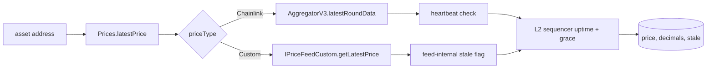

# Price Adapters: Architecture and Integration

This is the price-side counterpart to [`src/balances/BALANCE_ADAPTERS.md`](../src/balances/BALANCE_ADAPTERS.md). It describes the `Prices` abstract registry, the `IPriceFeedCustom` interface, the existing per-asset custom adapters, and how to add a new one.

---

## 1. Overview

The price system gives `NAVCalculator` a single price for any asset, in some "USD-like" unit. There are two kinds of feeds:

- **Chainlink**: `priceType = Chainlink`. Direct read of `AggregatorV3Interface.latestRoundData()`. Staleness = `block.timestamp - updatedAt > chainlinkHeartbeat`.
- **Custom**: `priceType = Custom`. A standalone contract implementing `IPriceFeedCustom` that derives a price (e.g., `sDAI` → `(DAI/USD) × (sDAI/DAI)`; `wstETH` → `(stETH-per-wstETH) × (stETH/USD)`). The contract is responsible for its own staleness logic (and typically piggy-backs on its underlying Chainlink feeds for it).

Both kinds register through the same path on `NAVCalculator`. Both are subject to the **L2 sequencer uptime** check when a sequencer feed is set on `Prices`.

So: **`Prices` is the registry; per-asset custom contracts are the building blocks.**

---

## 2. Price flow: from asset to price



Steps in code (`src/prices/Prices.sol`):

1. **Lookup** — `priceOracles[asset]` returns `PriceFeedConfig { priceFeed, decimals, chainlinkHeartbeat, priceType }`. Reverts if unset.
2. **Fetch** — Chainlink branch reads `latestRoundData()`; Custom branch calls `getLatestPrice()` on the configured feed (returns `(uint256 price, bool stale)`).
3. **Heartbeat / freshness** — Chainlink branch flags `stale = block.timestamp - updatedAt > chainlinkHeartbeat`. Custom branch uses the contract's own `stale` flag.
4. **L2 sequencer** — Top-level `latestPrice()` ORs in `checkL2SequencerUptime()`: stale if the sequencer is down or within `chainlinkL2SequencerGracePeriod` (default 1 hour) of recovery. On L1, the sequencer feed is the zero address and this check is a no-op.
5. **Return** — `(int256 price, uint8 decimals, bool stale)`. Sign is positive in practice (Chainlink prices are positive; custom feeds cast from `uint256`).

---

## 3. Data structures

### 3.1 PriceFeedConfig (registered config)

Defined in `IPrices`.

| Field | Type | Description |
|---|---|---|
| `priceFeed` | `address` | Chainlink aggregator or custom contract (`IPriceFeedCustom`). |
| `decimals` | `uint8` | Decimals of the returned price. Pinned at registration from the feed itself. |
| `chainlinkHeartbeat` | `uint256` | Heartbeat in seconds. Required for Chainlink, ignored for custom. |
| `priceType` | `PriceType` | Enum `{ Chainlink, Custom }`. |

### 3.2 Custom feed return shape

`IPriceFeedCustom.getLatestPrice()` returns `(uint256 price, bool stale)`. Convention: when *any* underlying input is non-positive or stale, the feed should return `(0, true)` rather than reverting. This keeps NAV calculation robust (the position is just flagged stale, not a failed call).

---

## 4. Prices contract (registry behavior)

`Prices` is an abstract contract used by NAVCalculator. It maintains:

- **Per-asset feed config:** `mapping(address => PriceFeedConfig) public priceOracles`.
- **L2 sequencer state:** `chainlinkL2SequencerUptimeFeed` and `chainlinkL2SequencerGracePeriod` (default 1 hour). Set once via `__Prices_init` at NAV initialization.

Internal API (used by NAVCalculator):

- `_setPriceFeed(asset, priceFeed, chainlinkHeartbeat, priceType)` — checks support, reads decimals from the feed, stores `PriceFeedConfig`. Heartbeat must be non-zero for Chainlink.
- `_unsetPriceFeed(asset)` — removes entry; subsequent `latestPrice` reverts with `PriceFeedNotSet`.
- `checkPriceOracleSupport(asset, priceFeed, priceType)` — public; ERC165 check for custom, sanity round-data fetch for Chainlink.

`NAVCalculator` exposes `registerAsset(asset, oracle, priceType, chainlinkHeartbeat)` (MANAGER) which combines `_setPriceFeed` with adding the asset to the Balances asset registry.

---

## 5. IPriceFeedCustom

Every custom feed must implement this interface (and ERC165).

| Method | Purpose |
|---|---|
| `getLatestPrice()` | Returns `(uint256 price, bool stale)`. Price is in `decimals()` precision. |
| `decimals()` | Returns the number of decimals the price is expressed in. Pinned at construction. |
| `underlyingAssetSupported()` | Returns the asset address this feed prices. Single asset per feed (1:1 contract-to-asset). |
| `supportsInterface(bytes4)` | Must return `true` for `type(IPriceFeedCustom).interfaceId` and `IERC165`. |

Conventions:

- **Always favor an existing Chainlink feed for the dollar leg** of the price (e.g., DAI/USD, stETH/USD, USDC/USD). Don't roll your own dollar oracle.
- **Read on-chain rates directly** (sDAI's `chi`, wstETH's `stEthPerToken`, rETH's `getExchangeRate`, etc.) rather than going through an off-chain oracle when the rate is canonical and cheap.
- **Return `(0, true)` on any failure or staleness path.** Don't revert.
- **All inputs are immutable.** No setters. New feed = redeploy.

---

## 6. How NAVCalculator uses prices

For each `PositionBalance` returned by an oracle, NAVCalculator:

1. Calls `latestPrice(asset)` on the price registry.
2. Gets `(price, decimals, stale)`. If stale, the asset is added to `NAV.stalePriceAssets`; the position still contributes to NAV using the last-known price (consumers decide what to do with stale).
3. Computes `value = amount × price` (sign by `isDebt`).
4. If `quoteAsset != address(0)`, divides by `latestPrice(quoteAsset)` so NAV is denominated in the quote currency.

So custom feeds are **building blocks** for value computation. Their staleness flags propagate into `NAV.stalePriceAssets` so callers can decide the right policy.

---

## 7. Implemented custom feeds

All in `src/prices/protocols/`. Pattern is one file per asset; L2-specific variants get a `_L2_` infix.

### Yield-bearing stable wrappers (rate × USD-feed)

| Feed | Asset | Underlying inputs |
|---|---|---|
| `sDAI_Price` | sDAI | DAI/USD Chainlink × DSR `pot.chi()` (RAY-scaled) |
| `sUSDS_Price` | sUSDS | USDS/USD Chainlink × Sky savings rate |
| `sUSDe_Price` | sUSDe | USDe/USD Chainlink × Ethena vault share rate |
| `sXDAI_Price` | sXDAI | xDAI/USD Chainlink × Gnosis savings rate (Gnosis Chain only) |
| `syrupUSDC_Price`, `syrupUSDC_L2_Price` | syrupUSDC | USDC/USD Chainlink × Maple syrup rate |

### Liquid (re)staking tokens

| Feed | Asset | Underlying inputs |
|---|---|---|
| `cbETH_Price`, `cbETH_L2_Price` | cbETH | cbETH-per-ETH rate × ETH/USD |
| `wstETH_Price`, `wstETH_L2_Price` | wstETH | `stEthPerToken` × stETH/USD |
| `rETH_Price` | rETH | `getExchangeRate` × ETH/USD |
| `rsETH_Price`, `rsETH_L2_Price` | rsETH | rsETH-per-ETH rate × ETH/USD |
| `eETH_Price` | eETH | eETH-per-ETH × ETH/USD |
| `weETH_Price`, `weETH_L2_Price` | weETH | weETH-per-eETH × eETH/USD chain |
| `ezETH_Price`, `ezETH_L2_Price` | ezETH | Renzo reporter rate × ETH/USD |

### Other derived

| Feed | Asset | Notes |
|---|---|---|
| `LDO_Price` | LDO | Composite (cross-rate) |
| `ETHPlus_Price` | ETH+ | Reserve Protocol RToken; basket-derived rate × USD |
| `CrossRate_Price` | generic | Generic helper: A/B × B/C from two Chainlink feeds (used when no direct A/USD feed exists) |

`_L2_` variants exist for assets where the canonical rate lives on L1. They typically read a Chainlink-secured rate feed on the L2 (rather than calling the L1 rate-provider directly) and inherit the L2 sequencer check via `Prices`.

---

## 8. How to create a new custom price feed

Detailed walkthrough lives at [`./howto/add-price-feed.md`](./howto/add-price-feed.md). Quick checklist:

### 8.1 Contract layout

1. Create `src/prices/protocols/<Asset>_Price.sol` (suffix `_L2_Price` for L2-specific variants).
2. Implement `IPriceFeedCustom` and `IERC165`.
3. Pin every input as `immutable` in the constructor: token address, dollar-leg Chainlink feed, rate provider, heartbeats.
4. Use `OracleArgumentChecks` (`src/utils/OracleArgumentChecks.sol`) for constructor validation: `assertERC20Address`, `assertChainlinkOracle`, `assertNotZeroNumber`, `assertNonZeroAddress`.
5. In `getLatestPrice`:
   - Read Chainlink leg first; bail out with `(0, true)` if `price <= 0`.
   - Apply heartbeat: if `block.timestamp - updatedAt > heartbeat`, set `stale = true`.
   - Read on-chain rate. If non-positive or out-of-range, return `(0, true)`.
   - Combine and rescale to the target decimals (use `RATIO_DECIMALS` constants when the rate has its own scale).
6. `decimals()` returns the pinned decimals (typically the Chainlink feed's decimals).
7. `underlyingAssetSupported()` returns the token address.

### 8.2 Tests

- Unit test under `test/prices/protocols/<Asset>_Price.t.sol` with mocked Chainlink + rate provider:
  - Happy path: known inputs → expected output.
  - Negative Chainlink price → `(0, true)`.
  - Stale heartbeat → `stale = true` but `price` still reflects the last value.
  - Zero or negative rate → `(0, true)`.
- Fork test under `test/prices/protocols/fork/<Asset>_Price.fork.t.sol` against the real feed at a pinned block — assert the price is within a reasonable range and not stale.

### 8.3 Registration

Once deployed, register via `NAVCalculator.registerAsset(asset, customFeed, PriceType.Custom, 0)` (MANAGER role). The chain config under `script/config/chains/<chainId>.json` should hold the asset entry; `script/deploy/03_RegisterAssets.s.sol` reads it and calls `registerAsset`.

---

## 9. Configuration and use

### 9.1 Asset registration

Per-chain config lives at `script/config/chains/<chainId>.json` under the `assets` and `priceFeeds` blocks (see [`script/config/CONFIG_GUIDE.md`](../script/config/CONFIG_GUIDE.md) for the schema). For a custom feed, the entry typically looks like:

```json
{
  "address": "0x...sDAI",
  "symbol": "sDAI",
  "priceFeed": "0x...sDAI_PriceOracle",
  "priceType": "Custom",
  "chainlinkHeartbeat": 0
}
```

`03_RegisterAssets.s.sol` reads these and calls `NAVCalculator.registerAsset`.

### 9.2 Adding the same asset on multiple chains

Each chain has its own `priceFeed` deployment. L2 variants use `*_L2_Price` so the L1 rate provider isn't called from the wrong chain. Pick the right variant based on where the rate canonically lives.

### 9.3 Updating a feed

Custom feeds are immutable. To change inputs (e.g., new Chainlink feed address), redeploy and call `NAVCalculator.setPriceFeed(asset, newFeed, ...)`. Old feed stays on-chain; nothing references it after the switch.

---

## 10. Quick reference

- **Interface:** `src/prices/IPriceFeedCustom.sol`
- **Registry:** `src/prices/Prices.sol` and `src/prices/IPrices.sol`
- **Config:** `priceOracles[asset]` → `PriceFeedConfig`
- **Existing feeds:** `src/prices/protocols/`
- **Walkthrough:** [`./howto/add-price-feed.md`](./howto/add-price-feed.md)
- **Cross-reference:** [`src/balances/BALANCE_ADAPTERS.md`](../src/balances/BALANCE_ADAPTERS.md) (balance side of the same architecture)
