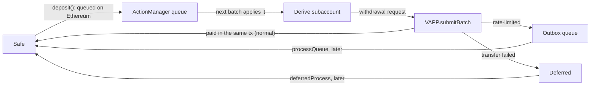

# Derive in-flight value: plan

Goal: a fund's NAV must never be struck while value is between its Safe and Derive. PR #372 counts the Safe's
tokens and the attested Derive subaccounts; value in between is in neither, so a NAV taken at that moment is low.
For a fund an under-report is not safe either: a low share price shortchanges redeemers and gives new subscribers
too many shares.

Decision: **skip the settlement window while anything is in flight; do not value in-flight amounts.** One offchain
check (the preflight), run by the settlement guard immediately before it settles, reading only Ethereum.

Source design: `/Users/ismael/karpatkey/code/derive-spike/docs/specs/derive-nav-attestation.md` §3-§4 (outside
this repo). Its §3 outbox adapter is dropped (see "Why no outbox adapter"); its §4 settlement rule is implemented
here, corrected where the verified sources disagree with it.

## How value moves between a Safe and Derive

- **Deposit.** The Safe calls `deposit()` on Derive's ActionManager. The tokens leave the Safe at once; the deposit
  is credited to the subaccount only when a later batch consumes the queued action. In between, it is in neither leg.
- **Withdrawal, normal case.** A batch debits the subaccount and, in the same `submitBatch` transaction, the outbox
  pays the Safe. Nothing is ever in between.
- **Withdrawal, rate-limited.** The outbox has a token bucket per resolved (recipient, asset). If it is empty, the
  batch still debits the subaccount but parks the payment in a queue, paid later by anyone calling `processQueue`
  as the bucket refills. While parked, it is in neither leg.
- **Withdrawal, deferred.** If the transfer cannot be made, the outbox stores only a hash and pays later through
  `deferredProcess`. In neither leg meanwhile.
- **Never counted twice.** A withdrawal's debit is in a committed batch before any payout reaches the Safe, and a
  new batch zeroes older attestations (`test_nextBatch_readsZero`). In-flight value can only be missing.
- **Only settlement matters.** ADR 0031 decision 3: the Derive leg is written in the settlement transaction and
  reads 0 between settlements anyway.

## Why no outbox adapter

The spec's §3 adapter would read the outbox queue and report the Safe's parked withdrawals as a locked position, so
a settlement could go ahead while one waits. It is dropped:

- **It covers an uncommon, bounded case.** Since deployment, 187 of about 6,081 payouts were queued (about 3%), in
  18 of the ~57 7,200-block days, all in the global bucket, each paid within 1,882 blocks (about 6.3 h; median 225, about 45 min);
  five were deferred, all since paid (Facts). The adapter only buys the ability to settle while one of the fund's own
  withdrawals waits; without it that window is skipped and the next one is used, at worst about 6 h later so far.
- **The queue is shared, which makes it hostile to read.** Buckets fall back to a global `(0,0)` bucket that any
  Derive user's throttled withdrawals land in. Walking it unbounded lets a third party push it past the gas stipend:
  `AdapterGasExhausted` then reverts every `getAccountNav`, not just the settlement. Walking it bounded returns a
  partial sum that NAVCalculator accepts silently (it swallows adapter reverts and has no notion of "partial").
- **Entries can be stranded.** An entry stays in the bucket chosen at enqueue time; if Derive later gives the Safe
  its own limit, `bucketKey(safe, asset)` points elsewhere and an adapter reading the current key misses it.
- **Cost.** A new contract, its deployment and NAV registration, for the case above.

Mitigation for the delay it would have avoided: ask Derive for a per-fund bucket (`setBucketLimit`) sized to the
fund's flows (every queued entry so far sat in the shared global bucket), and do not withdraw large amounts right
before a NAV strike. Revisit the adapter if skipped windows happen in practice.

## Facts (checked 2026-11-27 on mainnet and in the verified sources)

| Fact | Evidence |
|---|---|
| Proxies: VAPP `0xd330145C17fB6EF2a21ACf1275Ce683A305F58BB`, WithdrawalOutbox `0x7c743D79C9C595cE332314503d84cBBb4E85FA63` (impl `0xda213f6af45a7d6dc728bab03fa4a1d81ff2b418`), OnchainActionManager `0xE366CcA474968e33b777E13905829A3b800CFAD3` (impl `0x42fd440db1b84e95b4ab6a8ec5fc3073b1c0a4e5`) | EIP-1967 implementation slot of each proxy; sources at `https://sourcify.dev/server/v2/contract/1/<impl>?fields=sources` |
| Normal withdrawals are paid inside `VAPP.submitBatch` (VAPP-only `executeWithdrawals`), in token units | tx `0x9a9efb137717c96b30fea29ffbfd083e0f0a95ccfd34ed2f075c0be9b767a287`: USDC `Transfer` and `WithdrawalPaid.paid` both `0x49c1288194` |
| In one day, every payout came in a batch and none waited: blocks 26,500,489-26,507,688 hold 181 `WithdrawalPaid` in 109 transactions, all `submitBatch` (selector `0xcaf85453`) sent to the VAPP, and zero `WithdrawalEnqueued` and zero `WithdrawalDeferred`. One day is a sample, not a rate | `cast logs` on the outbox over that range in 1,200-block chunks, then `eth_getTransactionByHash` on each transaction |
| Since deployment (blocks 26,097,577-26,507,752): 187 `WithdrawalEnqueued` (blocks 26,142,399-26,485,885, 138 recipients, all in bucket `(0,0)`), every one later paid in full, after 225 blocks median, 1,110 at p90, 1,882 at most; 6,081 `WithdrawalPaid`; 5 `WithdrawalDeferred` (`deferredWithdrawalId` = 5), all with `deferredWithdrawals(id) == 0` | One whole-range `eth_getLogs` per event on Alchemy, 2026-11-27; first `WithdrawalPaid` with `remaining == 0` per id |
| A queue entry keeps the raw `recipient` and `asset` and stays in the bucket chosen at enqueue time (`WithdrawalEnqueued.bucketRecipient/bucketAsset`); `queueEntry → (bytes32 id, address asset, uint64 accountId, address recipient, uint128 remainingAmount)`, token units | Outbox `_resolveBucket`, `setBucketLimit`, `_computePay`, `_payOut` |
| A deferred withdrawal is unpaid iff `deferredWithdrawals(deferredId) != 0`; `deferredProcess` deletes it. `consumed(id)` is replay protection, true for every deferred withdrawal. Queued entries can also be diverted to deferred. In `WithdrawalDeferred`, `recipient` is not indexed | Outbox `_admit` (sets `consumed` before `_divertToDeferred`), `processQueue` path, `deferredProcess` |
| Ethereum-queued actions have ids `publicAccHistory.length - 1`; `VAPP.consumedPublicAccIndex()` is the next id to consume. Action `id` is pending iff `consumedPublicAccIndex() <= id < publicHeadIndex()`. `actionId` is indexed in `PublicActionQueued` | ActionManager `_appendPublic`; VAPP `submitBatch` |
| Not usable: `oldestPendingActionTime` returns a timestamp, and 0 both for "nothing pending" and for actions queued before time-stamping | ActionManager source |

## Global constraints

- Fail closed. Any pending item, any read failure, any ambiguity: exit non-zero and the window is skipped (spec §4:
  "Do not settle on a partial NAV").
- No new trust. The preflight reads only Ethereum state and logs. Derive's API may be printed for operators but
  never decides the verdict.
- Repo conventions: Python standard library only; `unittest` passing plain and under `python3 -O`; reuse the proof
  script's transport (`eth()`), no second RPC helper.

## Task 1: settlement in-flight preflight

Exit 0: nothing is in flight. Exit 1: something is; skip the window. Exit 2: a read failed; skip the window.

- Add a `--preflight SAFE` mode to `script/test/derive-celestia-proof.py`. All reads pin one block (`--block`,
  default the head). Output JSON `{ok, block, pendingActions[], queued[], deferred[], reasons[]}`. Log scans go in
  chunks (the public node stalls on wide ranges); `--eth-rpc` takes an archive node.
- Checks:
  1. **Pending actions.** For ids in `[consumedPublicAccIndex(), publicHeadIndex())`, fetch `PublicActionQueued` by
     indexed `actionId`; fail on any with `sender == SAFE` and type in {`DEPOSIT_TYPE`,
     `DEPOSIT_TO_NEW_SUBACCOUNT_TYPE`, `WITHDRAWAL_TYPE`}. Failing on a withdrawal request is conservative (its value
     is still in the attested subaccount until its batch); the docstring says so, so nobody removes it.
  2. **Queued withdrawals.** Scan `WithdrawalEnqueued` from the outbox deployment block for `recipient == SAFE`; for
     each, read its entry in the bucket it was enqueued in (`bucketRecipient`, `bucketAsset`, `queueIndex`); fail if
     the entry is at or after the bucket's head with `remainingAmount > 0`. Reading the enqueue-time bucket, not the
     current `bucketKey`, is what makes stranded entries visible.
  3. **Unpaid deferred withdrawals.** Scan `WithdrawalDeferred` from the outbox deployment block, decode `recipient`
     from data, and fail on any for `SAFE` with `deferredWithdrawals(deferredId) != 0`.
- Docstring also states the limits: the check runs before the settlement transaction, not inside it, so the guard
  must run it immediately before signing; and a deposit's `fallbackRecipient` receives the funds if Derive cannot
  apply it (the check clears once the action is consumed), so funds must use their own wallet as fallback.
- Tests in `script/test/test_derive_celestia_proof.py` (already in the CI `preflight` job; no new step), offline
  with a stubbed `eth()`: each check passing and failing; the action at exactly `consumedPublicAccIndex` is pending;
  a queued entry behind the bucket head (already paid) passes; an entry in a bucket other than the current
  `bucketKey` fails; a processed deferred withdrawal passes; a read error gives exit 2.
- Done: suite passes plain and `-O`; one live run against mainnet for a Safe with nothing pending prints `ok`.

## Task 2: docs

- ADR 0031: add a decision "In-flight value" with the flow and the "Why no outbox adapter" reasoning above, mark
  which rows of its Problem table this closes, and add to Before acceptance: "6. One deposit and one withdrawal of
  dust: record queue-to-batch time, confirm the payout in a `submitBatch` transaction, and see the preflight fail
  then pass. Ask Derive for a per-fund withdrawal bucket sized to the fund's flows."
- `/Users/ismael/karpatkey/code/derive-spike/docs/specs/derive-nav-attestation.md`: note at the top that §1-§2 are
  superseded by ADR 0031, §3 is dropped and §4 is implemented by this plan, with its corrections.

## Task 3: real-transfer measurement (operator, after Task 1)

With the fund's dust: one deposit and one withdrawal. Run the preflight during each (expect exit 1, then 0 once
consumed), confirm the withdrawal is paid in a `submitBatch` transaction, and record the times in ADR 0031.

## Phase 2: subscriptions on HyperEVM, HYPE bridged both ways

The fund's shares are subscribed and redeemed on HyperEVM; Derive is reached from Ethereum. Every subscription
deployed to Derive crosses HyperEVM → Ethereum → Derive, every redemption the reverse. Decision (2026-11-27):
**option A**, the fund's figure is combined offchain by the operator from both chains at pinned blocks; the Derive
leg is computed on Ethereum. Relaying the attested value to HyperEVM (option B) is deferred.

| Fact | Evidence |
|---|---|
| The Portfolio Safe is the same address on both chains, `0x8c79753aad88183f5747c91684d6c0cbfcb27476` | `eth_getCode` non-empty on both; HyperEVM balance 0.072169747 HYPE, 0 WHYPE (`0x5555…5555`) on 2026-11-27 |
| HYPE crosses over LayerZero V2: HyperEVM native OFT adapter `0x1e0470ef72d029bdc87d3b8543fb62fc04db9670` (eid 30367, `token()` = 0, locks native HYPE) ↔ Ethereum HYPE OFT `0x0762365e088Fb8D285b295d782BB7b23690713e2` (eid 30101, `token()` = itself, mint/burn); each is the other's `peers()` | `cast call` on both chains |
| Events: `OFTSent(bytes32 indexed guid, uint32 dstEid, address indexed fromAddress, uint256 amountSentLD, uint256 amountReceivedLD)` on the source, `OFTReceived(bytes32 indexed guid, uint32 srcEid, address indexed toAddress, uint256 amountReceivedLD)` on the destination; the guid pairs them | `OFTReceived` topic `0xefed6d35…` in Ethereum receipts below |
| Real path: 0.12 HYPE sent from the HyperEVM Safe at HyperEVM block 51,693,622 (`0x0c6e…297c`, `OFTSent` dstEid 30101), arrived at the Ethereum Safe at block 26,450,116 (`0xd095…cb5a`, srcEid 30367) 65 s later; Derive action 8651 (type 2, deposit to new subaccount) queued at 26,450,176; applied by the batch the NAV fork test pins, 26,450,225. Then 1.17 HYPE: sent at 52,030,071 (`0x2ff2…c849`), arrived at 26,477,611 (`0xba70…41f6`); action 9615 (type 1) queued at 26,478,173. No `OFTSent` from the Safe on Ethereum yet | `OFTSent` in the HyperEVM receipts; `OFTReceived` logs filtered by `toAddress`; `PublicActionQueued` filtered by `sender` |
| Log scans on HyperEVM need Alchemy's endpoint (`hyperliquid-mainnet.g.alchemy.com`, a filtered 1,000,000-block `eth_getLogs` in about 0.3 s). The public `rpc.hyperliquid.xyz/evm` times out on 10,000 blocks, and one of two filtered 1,000-block queries timed out after 90 s | `cast logs` timings, 2026-11-27 |

**When a transfer is counted.** The operator reads each chain at a pinned block (`pE`, `pH`). A transfer is counted
on its source chain iff it was sent after the source pin (the tokens were still there), and on its destination
iff it was received at or before the destination pin. Exactly once is correct; both is a **double count** (sent
after the source pin, received before the destination pin: possible because the two reads are not simultaneous);
neither is **in flight**. The check fails on any transfer of the Safe not counted exactly once.

**Scan bound.** Log scans start one block after the previous settlement's pins (`--since-eth`, `--since-hyperevm`):
that settlement's check proved every transfer at or before them was counted exactly once. The check refuses
(exit 2) unless `since <= pin <= head` on each chain, so swapped or future bounds cannot scan nothing. The first
settlement uses bounds before the Safe's first transfer: for hype-split, a scan of both chains from block 0 found only
HyperEVM sends at 51,693,622 and 52,030,071 and Ethereum receipts at 26,450,116 and 26,477,611 (2026-11-27).

## Task 4: two-chain preflight

- `--preflight SAFE` gains `--hyperevm-rpc`, `--hyperevm-block` (pin, default head), `--since-eth`,
  `--since-hyperevm` and `--hyperevm-log-chunk` (default 1,000,000, Alchemy). Without `--hyperevm-rpc` it behaves as
  today; with it, both `since` pins are required.
- Reads `OFTSent` from the Safe and `OFTReceived` to the Safe on both chains, from the `since` blocks to each chain's
  head (a transfer received after the pin still has to be classified), pairs them by guid, and classifies each by
  the rule above. A send from the Safe whose receipt went to another address is a payout, not fund value: counted at
  the source until sent. While unreceived its recipient is unknown, so it is classified like a transfer to the Safe
  (in flight if sent at or before the source pin). A send to a chain other than these two is refused once at or
  before the pin, in every later run too. `--hyperevm-block` and the `since` flags without `--hyperevm-rpc` are an
  error.
- Output adds `holdings` at the pins (HyperEVM native HYPE + WHYPE, Ethereum HYPE OFT, in wei) and `transfers[]`
  with `{guid, from, to, amount, sentBlock, receivedBlock, verdict}`; reasons for every `in flight` and `double count`.
- Done: offline tests; live run for the hype-split Safe prints `ok`.

## Task 5: lifecycle simulation (offline, CI)

Two fake chains plus Derive's queues step through one cycle: subscribe on HyperEVM → bridge to Ethereum → Derive
deposit → batch applies it → withdrawal paid in the batch → a second withdrawal queued, then paid → bridge back →
redeem. At every step: the verdict (settle or skip), and that holdings + Derive leg never count a unit twice and equal
the true fund total whenever the verdict is settle. Also the double-count case: pins straddling a transfer. Edge
cases: other users' traffic on both OFTs, an inflow from someone else, WHYPE, a later `since`, an upper-case guid,
an unsupported destination, broken reads and bad bounds (exit 2), and the CLI flag wiring.

## Task 6: replay of the real path (network, by hand)

A test class skipped unless `DERIVE_LIVE=1` and archive RPCs are configured, pinning the real 0.12 HYPE path:
before the HyperEVM send (settle), mid-bridge (skip), arrived at 26,450,116 (settle), action 8651 queued at
26,450,176 (skip), applied at 26,450,225 (settle), plus pins straddling the transfer (skip, double count).

## Out of scope

- Valuing in-flight amounts (pending deposits exist only in event data; parked withdrawals: see "Why no outbox
  adapter").
- The settlement guard contract and its wiring; this plan supplies the check it calls.
- Relaying the Derive figure to HyperEVM (option B) and proving Ethereum state there.
- Sizing the outbox bucket with Derive (requested in Task 2's acceptance item, decided by Derive).
- Native ETH and perps.
