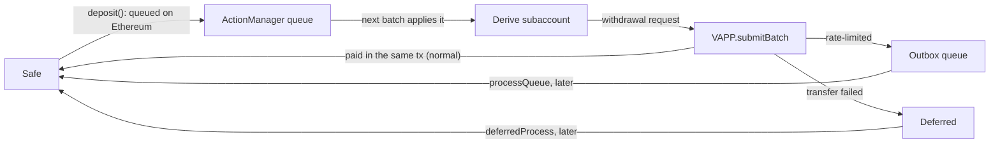

# Derive in-flight value: plan

Goal: a fund's NAV must never be struck while value is between its Safe and Derive. PR #372 counts the Safe's
tokens and the attested Derive subaccounts; value in between is in neither, so a NAV taken at that moment is low.
For a fund an under-report is not safe either: a low share price shortchanges redeemers and gives new subscribers
too many shares.

Decision: **skip the settlement window while anything is in flight; do not value in-flight amounts.** One offchain
check (the preflight), run by the settlement guard immediately before it settles, reading only Ethereum.

Source design: `/Users/ismael/karpatkey/code/derive-spike/docs/specs/derive-nav-attestation.md` §3-§4 (outside
this repo). Its §3 outbox adapter is dropped (see "Why no outbox adapter"); its §4 settlement rule is implemented
here, corrected where the verified sources disagree with it.

## How value moves between a Safe and Derive

- **Deposit.** The Safe calls `deposit()` on Derive's ActionManager. The tokens leave the Safe at once; the deposit
  is credited to the subaccount only when a later batch consumes the queued action. In between, it is in neither leg.
- **Withdrawal, normal case.** A batch debits the subaccount and, in the same `submitBatch` transaction, the outbox
  pays the Safe. Nothing is ever in between.
- **Withdrawal, rate-limited.** The outbox has a token bucket per resolved (recipient, asset). If it is empty, the
  batch still debits the subaccount but parks the payment in a queue, paid later by anyone calling `processQueue`
  as the bucket refills. While parked, it is in neither leg.
- **Withdrawal, deferred.** If the transfer cannot be made, the outbox stores only a hash and pays later through
  `deferredProcess`. In neither leg meanwhile.
- **Never counted twice.** A withdrawal's debit is in a committed batch before any payout reaches the Safe, and a
  new batch zeroes older attestations (`test_nextBatch_readsZero`). In-flight value can only be missing.
- **Only settlement matters.** ADR 0031 decision 3: the Derive leg is written in the settlement transaction and
  reads 0 between settlements anyway.

## Why no outbox adapter

The spec's §3 adapter would read the outbox queue and report the Safe's parked withdrawals as a locked position, so
a settlement could go ahead while one waits. It is dropped:

- **It covers a rare case.** Normal withdrawals never sit in the queue (Facts). The adapter only buys the ability to
  settle while one of the fund's own withdrawals is rate-limited; without it that window is skipped and the next
  one is used.
- **The queue is shared, which makes it hostile to read.** Buckets fall back to a global `(0,0)` bucket that any
  Derive user's throttled withdrawals land in. Walking it unbounded lets a third party push it past the gas stipend:
  `AdapterGasExhausted` then reverts every `getAccountNav`, not just the settlement. Walking it bounded returns a
  partial sum that NAVCalculator accepts silently (it swallows adapter reverts and has no notion of "partial").
- **Entries can be stranded.** An entry stays in the bucket chosen at enqueue time; if Derive later gives the Safe
  its own limit, `bucketKey(safe, asset)` points elsewhere and an adapter reading the current key misses it.
- **Cost.** A new contract, its deployment and NAV registration, for the case above.

Mitigation for the delay it would have avoided: ask Derive for a per-fund bucket (`setBucketLimit`) sized to the
fund's flows, and do not withdraw large amounts right before a NAV strike. Revisit the adapter only if skipped
windows happen in practice.

## Facts (checked 2026-11-27 on mainnet and in the verified sources)

| Fact | Evidence |
|---|---|
| Proxies: VAPP `0xd330145C17fB6EF2a21ACf1275Ce683A305F58BB`, WithdrawalOutbox `0x7c743D79C9C595cE332314503d84cBBb4E85FA63` (impl `0xda213f6af45a7d6dc728bab03fa4a1d81ff2b418`), OnchainActionManager `0xE366CcA474968e33b777E13905829A3b800CFAD3` (impl `0x42fd440db1b84e95b4ab6a8ec5fc3073b1c0a4e5`) | EIP-1967 implementation slot of each proxy; sources at `https://sourcify.dev/server/v2/contract/1/<impl>?fields=sources` |
| Normal withdrawals are paid inside `VAPP.submitBatch` (VAPP-only `executeWithdrawals`), in token units | tx `0x9a9efb137717c96b30fea29ffbfd083e0f0a95ccfd34ed2f075c0be9b767a287`: USDC `Transfer` and `WithdrawalPaid.paid` both `0x49c1288194` |
| In one day, every payout came in a batch and none waited: blocks 26,500,489-26,507,688 hold 181 `WithdrawalPaid` in 109 transactions, all `submitBatch` (selector `0xcaf85453`) sent to the VAPP; a ~7,200-block scan a few hours earlier found zero `WithdrawalEnqueued` and zero `WithdrawalDeferred`. One day is a sample, not a rate | `cast logs` on the outbox in 1,200-block chunks, then `eth_getTransactionByHash` on each transaction |
| A queue entry keeps the raw `recipient` and `asset` and stays in the bucket chosen at enqueue time (`WithdrawalEnqueued.bucketRecipient/bucketAsset`); `queueEntry → (bytes32 id, address asset, uint64 accountId, address recipient, uint128 remainingAmount)`, token units | Outbox `_resolveBucket`, `setBucketLimit`, `_computePay`, `_payOut` |
| A deferred withdrawal is unpaid iff `deferredWithdrawals(deferredId) != 0`; `deferredProcess` deletes it. `consumed(id)` is replay protection, true for every deferred withdrawal. Queued entries can also be diverted to deferred. In `WithdrawalDeferred`, `recipient` is not indexed | Outbox `_admit` (sets `consumed` before `_divertToDeferred`), `processQueue` path, `deferredProcess` |
| Ethereum-queued actions have ids `publicAccHistory.length - 1`; `VAPP.consumedPublicAccIndex()` is the next id to consume. Action `id` is pending iff `consumedPublicAccIndex() <= id < publicHeadIndex()`. `actionId` is indexed in `PublicActionQueued` | ActionManager `_appendPublic`; VAPP `submitBatch` |
| Not usable: `oldestPendingActionTime` returns a timestamp, and 0 both for "nothing pending" and for actions queued before time-stamping | ActionManager source |

## Global constraints

- Fail closed. Any pending item, any read failure, any ambiguity: exit non-zero and the window is skipped (spec §4:
  "Do not settle on a partial NAV").
- No new trust. The preflight reads only Ethereum state and logs. Derive's API may be printed for operators but
  never decides the verdict.
- Repo conventions: Python standard library only; `unittest` passing plain and under `python3 -O`; reuse the proof
  script's transport (`eth()`), no second RPC helper.

## Task 1: settlement in-flight preflight

Exit 0: nothing is in flight. Exit 1: something is; skip the window. Exit 2: a read failed; skip the window.

- Add a `--preflight SAFE` mode to `script/test/derive-celestia-proof.py`. All reads pin one block (`--block`,
  default the head). Output JSON `{ok, block, pendingActions[], queued[], deferred[], reasons[]}`. Log scans go in
  chunks (the public node stalls on wide ranges); `--eth-rpc` takes an archive node.
- Checks:
  1. **Pending actions.** For ids in `[consumedPublicAccIndex(), publicHeadIndex())`, fetch `PublicActionQueued` by
     indexed `actionId`; fail on any with `sender == SAFE` and type in {`DEPOSIT_TYPE`,
     `DEPOSIT_TO_NEW_SUBACCOUNT_TYPE`, `WITHDRAWAL_TYPE`}. Failing on a withdrawal request is conservative (its value
     is still in the attested subaccount until its batch); the docstring says so, so nobody removes it.
  2. **Queued withdrawals.** Scan `WithdrawalEnqueued` from the outbox deployment block for `recipient == SAFE`; for
     each, read its entry in the bucket it was enqueued in (`bucketRecipient`, `bucketAsset`, `queueIndex`); fail if
     the entry is at or after the bucket's head with `remainingAmount > 0`. Reading the enqueue-time bucket, not the
     current `bucketKey`, is what makes stranded entries visible.
  3. **Unpaid deferred withdrawals.** Scan `WithdrawalDeferred` from the outbox deployment block, decode `recipient`
     from data, and fail on any for `SAFE` with `deferredWithdrawals(deferredId) != 0`.
- Docstring also states the limits: the check runs before the settlement transaction, not inside it, so the guard
  must run it immediately before signing; and a deposit's `fallbackRecipient` receives the funds if Derive cannot
  apply it (the check clears once the action is consumed), so funds must use their own wallet as fallback.
- Tests in `script/test/test_derive_celestia_proof.py` (already in the CI `preflight` job; no new step), offline
  with a stubbed `eth()`: each check passing and failing; the action at exactly `consumedPublicAccIndex` is pending;
  a queued entry behind the bucket head (already paid) passes; an entry in a bucket other than the current
  `bucketKey` fails; a processed deferred withdrawal passes; a read error gives exit 2.
- Done: suite passes plain and `-O`; one live run against mainnet for a Safe with nothing pending prints `ok`.

## Task 2: docs

- ADR 0031: add a decision "In-flight value" with the flow and the "Why no outbox adapter" reasoning above, mark
  which rows of its Problem table this closes, and add to Before acceptance: "6. One deposit and one withdrawal of
  dust: record queue-to-batch time, confirm the payout in a `submitBatch` transaction, and see the preflight fail
  then pass. Ask Derive for a per-fund withdrawal bucket sized to the fund's flows."
- `/Users/ismael/karpatkey/code/derive-spike/docs/specs/derive-nav-attestation.md`: note at the top that §1-§2 are
  superseded by ADR 0031, §3 is dropped and §4 is implemented by this plan, with its corrections.

## Task 3: real-transfer measurement (operator, after Task 1)

With the fund's dust: one deposit and one withdrawal. Run the preflight during each (expect exit 1, then 0 once
consumed), confirm the withdrawal is paid in a `submitBatch` transaction, and record the times in ADR 0031.

## Out of scope

- Valuing in-flight amounts (pending deposits exist only in event data; parked withdrawals: see "Why no outbox
  adapter").
- The settlement guard contract and its wiring; this plan supplies the check it calls.
- Sizing the outbox bucket with Derive (requested in Task 2's acceptance item, decided by Derive).
- Native ETH and perps.
