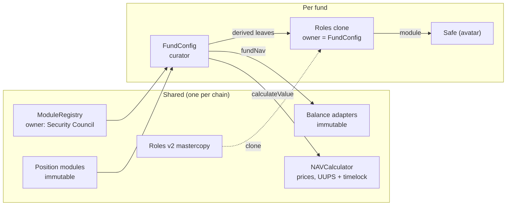

# FundConfig operating model

How a FundConfig fund would be run: who owns what, what is shared across funds and what is per fund, how positions are added, how dynamic positions work, how each component is upgraded, and where the design stops. Describes the POC in `poc/fundconfig/` as built; proposals are marked **Proposal**.

## Owners

| Actor | Holds | Can do | Cannot do |
|---|---|---|---|
| **Security Council** (Safe, behind timelock for NAV) | `ModuleRegistry.owner` (immutable); `NAVCalculator` admin / MANAGER roles (today's repo setup, `11_DeployTimelockController`) | Admit a new position module (write-once); register assets and price feeds; upgrade `NAVCalculator` | Change a registered module; touch a fund's Roles or positions |
| **Fund curator** (per fund; a Safe in production) | `FundConfig.CURATOR` (immutable) | `addPosition`, `removePosition`, `assignManager` | Write any Roles permission that no registered module derives; remove a position that still holds value |
| **Fund Safe owners** (the avatar's signers) | The fund Safe | Enable/disable modules (including the Roles clone), set a guard, move funds directly | Nothing on FundConfig itself; but their module/guard power is outside FundConfig's guarantee |
| **Manager / bot** | Role membership on the fund's Roles clone | Execute exactly the derived calls (`execTransactionWithRole`) | Anything not derived from a declared position |
| **Keeper** | `SUBMITTER_ROLE` on assisted/attested adapters (existing repo design, ADR 0030 / 0022) | Feed coordinates / proven amounts | Inflate value (under-report-only invariants) |
| **Anyone** | — | Read `fundNav`, `positions()`, `permissionSet()` | — |

`FundConfig` deploys the fund's Roles clone with itself as owner (`poc/fundconfig/FundConfig.sol:96`) and exposes no raw owner passthrough, so the curator's only lever on Roles is declaring positions.

## Shared vs per fund

| Change | Where | Who | Effect on existing funds |
|---|---|---|---|
| New position type | Shared: deploy module (+ adapter if none exists), `ModuleRegistry.register` | Security Council | None until a curator declares it |
| New asset / price feed | Shared: `NAVCalculator.registerAsset` | Security Council (MANAGER) | Lets positions in that asset be valued |
| Declare / remove a position | Per fund: `addPosition` / `removePosition` | Curator | That fund's Roles keys and NAV coverage |
| Add / remove a manager | Per fund: `assignManager` | Curator | That fund's Roles membership |
| Replace a module version | Shared deploy + per-fund migration | Security Council, then each curator | See Upgrades |

Per-instance accounting needs no global registration: meta-adapters value any instance passed to `getAdapterPositionsForInstances` (`src/balances/MetaBalanceAdapter.sol:308`). Pricing does: every asset a position reports must be registered in `NAVCalculator`, or `calculateValue` reverts.

## Lifecycle

**Launch a fund.** Deploy the Safe; deploy `FundConfig(registry, nav, factory, rolesMastercopy, safe, curator, roleKey, saltNonce)`, which deploys the Roles clone through the Zodiac ModuleProxyFactory with itself as owner and the Safe as avatar/target; Safe owners enable the clone as a module; curator calls `assignManager(bot, true)`.

**Add a position of an existing type.** Curator calls `addPosition(moduleId, instance)`. FundConfig asks the module to `validate(instance)`, reads `permissions(instance)` for every declared position, re-merges every touched `(target, selector)` key into one Or-tree, and writes it to Roles. Cost: ~0.5M gas for a fund's first position, ~110k per further position sharing keys (`gas-profile.json`). Preconditions: module registered; the position's assets priced in `NAVCalculator`.

**Add a new position type.** Write the module (`permissions`, `accounting`, `assets`, `validate`), reuse or write the balance adapter (repo conventions: immutable, unit + fork tests, ADR if it breaks the immutability rule), review, then Security Council registers it. Module ids are write-once.

**Remove a position.** Curator calls `removePosition`; reverts `PositionNotEmpty` while the position's adapter reports any balance, so accounting cannot be dropped while value remains. Keys only this position contributed are revoked; merged keys are rewritten without its branch.

## Dynamic positions

| Kind | Example | How it is handled | Re-declaration needed? |
|---|---|---|---|
| Runtime ids inside one instance | Uniswap V3 LP NFTs | `Custom` condition in the module: the Safe owns `tokenId` and it belongs to the declared pool; the meta-adapter values all the Safe's NFTs in that pool | No |
| Requests / tickets | EtherFi withdrawal NFTs, StakeWise exit tickets | Assisted adapter + delegatecall assistant (existing ADR 0015/0018); module permits only the assistant | No |
| New market or vault | A new Morpho vault, a new Aave reserve, a new Pendle maturity | New instance → curator `addPosition` | Yes, one tx per instance |
| Swap outputs | Uniswap V3 swap | Only into the declared pool's tokens; those are wallet assets of the position | No |
| Rewards that arrive without a call | CRV from the Minter, Merkl, airdrops | Valued only if some declared position lists the token in `assets()` (or via the Merkl attested adapter); otherwise held but not counted | Declare the reward token |

Under-counting is the failure mode for undeclared inflows, never over-counting: a token the Safe receives but no position declares is simply not in `fundNav`.

## Upgrades

| Component | Upgradeable? | How it changes | Gap |
|---|---|---|---|
| Position module | No (immutable; registry write-once) | Deploy v2 under a new `moduleId`; each fund declares v2 and removes v1 | Removing v1 hits `PositionNotEmpty` because v1 and v2 value the same position. **Proposal:** `replacePosition(oldModule, newModule, instance)` that swaps leaves and keeps accounting continuous, checked by both modules reporting the same balance |
| Compromised or too-loose module | Leaves already written stay in every fund's Roles until each curator removes the position | — | **Proposal:** a registry `deprecate(moduleId)` plus a permissionless `revokeDeprecated(fund, moduleId)` that strips its leaves (revoke-only guardian, as Morpho V2's sentinel / Centrifuge's Supervisor) |
| Balance adapter | No (repo convention) | New adapter → new module version (module pins the adapter) | Same as module |
| FundConfig | No (no proxy; Roles ownership never leaves it) | Deploy FundConfig v2 (deploys a new Roles clone); Safe owners swap modules in one Safe tx (enable new, disable old); curator re-declares positions | Re-declaration is per position; the swap is a Safe-owner action outside FundConfig |
| Roles mastercopy (v2 → v3) | Per clone | New FundConfig with the new mastercopy, same swap | v3 is BUSL-1.1 until 2030 and its Custom-condition ABI differs (`zodiac-roles-v2.md`) |
| NAVCalculator | Yes (UUPS behind timelock) | Existing repo process | `fundNav` relies on `calculateValue` and the adapter interfaces staying stable |

`FundConfig` re-reads every declared position's `permissions()` on each add/remove. A module whose permissions depend on live state (e.g. reading `vault.asset()`) could change keys of unrelated positions on the next write. Modules should derive leaves from the instance alone, or from immutable on-chain facts.

## Limitations

- **Safe-owner paths are outside the guarantee.** Owners can enable another module, set a guard, or disable Roles. FundConfig narrows the roles-vs-accounting gap to that path; it does not close it.
- **One accounting route per position.** Multi-leg products (pool + gauge) need two positions; the Aave borrow removal guard is per asset, so a co-declared supply of the same asset blocks removing the borrow.
- **No risk bounds in Roles.** Conditions pin targets, assets and recipients, not amounts, LTV or slippage (beyond the caller's `amountOutMinimum`).
- **NAV in a subscription tx.** Fits only small funds today (`nav-read-gas.md`); batching price calls would raise the ceiling (`fundconfig-poc.md` § Ideas to improve). Large funds need an async settlement or a pushed NAV.
- **`fundNav` has no per-position failure isolation** yet, unlike `NAVCalculator`.
- **Undeclared inflows are not counted** (see Dynamic positions).
- **Curator power.** The curator chooses which registered modules apply to the fund. Module admission is the Security Council's control; per-fund declarations have no timelock in the POC (**Proposal:** delay on `addPosition`, none on `removePosition`, mirroring timelocks only on risk-increasing changes).

## Validation of derived permissions

See [permission-validation.md](permission-validation.md) (behavioural check of every derived leaf against the live Roles v2 mastercopy) and [defikit-diff/defikit-diff.md](defikit-diff/defikit-diff.md) (diff against what DeFi Kit grants for the same positions).
