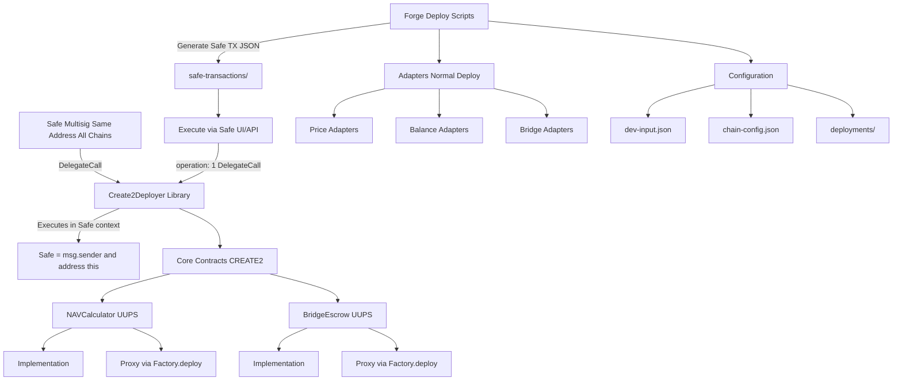

# Multi-Chain Deployment Architecture with CREATE2

## Architecture Overview

This plan creates a robust, **secure** deployment system for the onchain-accounting repo with:

- **Safe-controlled factory** for CREATE2 deployments (prevents address squatting)
- **Deterministic addresses** for NAVCalculator and BridgeEscrow proxies across all chains
- **UUPS upgradeable** contracts for both NAVCalculator and BridgeEscrow
- **Registry pattern** for Price, Balance, and Bridge adapters (non-upgradeable, swappable)
- **Multi-chain configuration** with a single config file
- **Safe transaction batching** for multisig execution
- **Dual verification** on Etherscan and Sourcify in parallel

### Key Security Features

🔐 **Safe Multisig Control**: All critical deployments go through your existing Safe multisig

🔒 **Factory Ownership**: Custom CREATE2 factory is owned by Safe, only it can deploy proxies

🛡️ **No Single Point of Failure**: Lose deployment keys? No problem - Safe controls everything

📝 **Transaction Batching**: Scripts output Safe transaction JSON for easy multisig execution



## Directory Structure

```
src/
└── deployment/
    └── Create2Deployer.sol                  # Stateless CREATE2 library for Safe delegatecall

script/
├── deploy/
│   ├── 00_DeployCreate2Deployer.s.sol   # Deploy Create2Deployer library (one-time per chain)
│   ├── 01_DeployNAVCalculator.s.sol     # Core NAV deployment via Safe delegatecall
│   ├── 02_DeployBridgeEscrow.s.sol      # Core Bridge deployment via Safe delegatecall
│   ├── 03_DeployPriceAdapters.s.sol     # Price adapter deployment
│   ├── 04_DeployBalanceAdapters.s.sol   # Balance adapter deployment
│   ├── 05_DeployBridgeAdapters.s.sol    # Bridge adapter deployment
│   └── 06_Configure.s.sol               # Post-deployment configuration
├── upgrade/
│   ├── UpgradeNAVCalculator.s.sol       # Upgrade NAV implementation
│   └── UpgradeBridgeEscrow.s.sol        # Upgrade Bridge implementation
├── manage/
│   ├── ManagePriceAdapters.s.sol        # Add/remove/swap price adapters
│   ├── ManageBalanceAdapters.s.sol      # Add/remove balance adapters
│   └── ManageBridgeAdapters.s.sol       # Add/remove/swap bridge adapters
├── verify/
│   ├── VerifyEtherscan.s.sol            # Etherscan verification
│   └── VerifySourcify.s.sol             # Sourcify verification
├── utils/
│   ├── BaseDeployScript.sol             # Base with Safe TX generation
│   ├── SafeTxBuilder.sol                # Build Safe transaction JSON
│   ├── ConfigReader.sol                 # Read JSON configs
│   └── Verification.sol                 # Verification helpers
└── test/
    └── DeploymentTest.t.sol             # Test deployment scripts

config/
├── chain-config.json                     # Chain-specific parameters
├── dev-input.json                        # User-provided values (Safe address, constructor params, roles)
└── salt-config.json                      # CREATE2 salts (auto-generated from contract names)

deployments/
├── 1-addresses.json                      # Mainnet deployments
├── 42161-addresses.json                  # Arbitrum
├── 10-addresses.json                     # Optimism
├── 8453-addresses.json                   # Base
└── 100-addresses.json                    # Gnosis Chain

safe-transactions/
├── 1-deploy-nav.json                     # Safe TX for NAV deployment on mainnet
├── 1-deploy-bridge.json                  # Safe TX for Bridge deployment
├── 42161-deploy-nav.json                 # Arbitrum NAV deployment
└── ...                                   # One JSON per Safe transaction
```

## Key Components

### 1. Safe DelegateCall CREATE2 Pattern

**Create2Deployer Library** ([src/deployment/Create2Deployer.sol](src/deployment/Create2Deployer.sol)):

```solidity
// Simple, stateless, immutable utility contract
// Safe delegatecalls to this, making Safe the deployer
contract Create2Deployer {
    event Deployed(address indexed deployed, bytes32 salt);
    
    function deploy(bytes32 salt, bytes memory bytecode) 
        external 
        returns (address deployed) 
    {
        assembly {
            deployed := create2(0, add(bytecode, 0x20), mload(bytecode), salt)
            if iszero(deployed) { revert(0, 0) }
        }
        emit Deployed(deployed, salt);
    }
    
    // Computes address using caller's address (Safe's address in delegatecall)
    function computeAddress(bytes32 salt, bytes memory bytecode) 
        external 
        view 
        returns (address) 
    {
        return address(uint160(uint256(keccak256(abi.encodePacked(
            bytes1(0xff),
            address(this),  // In delegatecall context = Safe's address
            salt,
            keccak256(bytecode)
        )))));
    }
}
```

**How It Works**:

- When Safe **delegatecalls** to Create2Deployer, the CREATE2 operation executes in Safe's context
- `address(this)` in the CREATE2 formula = **Safe's address**
- Same Safe address on all chains → same proxy addresses on all chains ✅
- No ownership needed - Safe's delegatecall guard prevents unauthorized use

**Security Benefits**:

- ✅ Safe's address is the deployer - only your Safe can deploy to those addresses
- ✅ No ownership transfers needed - simpler and safer
- ✅ Create2Deployer can be at different addresses per chain (doesn't matter!)
- ✅ Lose deployment keys? Safe still controls everything
- ✅ Multiple signers required for any deployment
- ✅ Safe's guard system can whitelist Create2Deployer for delegatecall

**Salt Generation**:

- Deterministic: `keccak256(abi.encodePacked(contractName, version))`
- Version increments only when you want a new address
- Same salt + bytecode + Safe address = same proxy address across chains

**Deployment Flow**:

1. **One-time setup** (per chain):

   - Deploy Create2Deployer library (can use any deployer key)
   - No ownership transfer needed - it's just a utility!

2. **Every core contract deployment**:

   - Script deploys implementation (normal deploy, address varies)
   - Script generates proxy bytecode with deterministic salt
   - Script computes expected address using Safe's address as deployer
   - Script outputs Safe transaction JSON with **operation: 1 (DelegateCall)**
   - Execute via Safe UI/API (multisig approval)
   - Safe delegatecalls Create2Deployer → proxy deployed at deterministic address
   - Script initializes proxy with chain-specific params (via Safe)

### 2. UUPS Upgrade Pattern

**NAVCalculator** (already UUPS):

- Proxy: Deterministic CREATE2 address
- Implementation: Can be upgraded via `upgradeToAndCall`
- Authorization: `DEFAULT_ADMIN_ROLE` required

**BridgeEscrow** (upgrade to UUPS):

- Convert to inherit `UUPSUpgradeable`
- Add `_authorizeUpgrade` with `DEFAULT_ADMIN_ROLE` check
- Maintain existing `Initializable` pattern
- **Note**: Requires modifying [src/bridge/BridgeEscrow.sol](src/bridge/BridgeEscrow.sol) to add UUPS

### 3. Configuration Files

**chain-config.json** (shared across chains):

```json
{
  "chains": {
    "1": {
      "name": "mainnet",
      "rpc": "$MAINNET_RPC_URL",
      "explorer": "https://etherscan.io",
      "explorerApiKey": "$ETHERSCAN_API_KEY",
      "chainlinkSequencerFeed": "0x0000000000000000000000000000000000000000",
      "nativeTokenSymbol": "ETH"
    },
    "42161": {
      "name": "arbitrum",
      "rpc": "$ARBITRUM_RPC_URL",
      "explorer": "https://arbiscan.io",
      "explorerApiKey": "$ARBISCAN_API_KEY",
      "chainlinkSequencerFeed": "0xFdB631F5EE196F0ed6FAa767959853A9F217697D",
      "nativeTokenSymbol": "ETH"
    }
  }
}
```

**dev-input.json** (user fills this):

```json
{
  "global": {
    "safeMultisigAddress": "0x...",
    "admin": "0x...",
    "assetRecoverer": "0x...",
    "manager": "0x..."
  },
  "navcalculator": {
    "initialAssets": [
      {
        "address": "",
        "priceFeed": "",
        "priceType": "Chainlink",
        "heartbeat": 86400
      }
    ]
  },
  "bridgeEscrow": {
    "initialAccounts": [],
    "initialAdapters": [],
    "assetSymbols": [
      {"symbol": "USDC", "address": ""}
    ]
  },
  "adapters": {
    "price": {
      "sDAI": {"enabled": true, "constructor": {}},
      "LDO": {"enabled": true, "constructor": {}}
    },
    "balance": {
      "AaveV3": {"enabled": true, "constructor": {"poolAddress": ""}},
      "CompoundV3": {"enabled": true, "constructor": {"cometAddress": ""}}
    },
    "bridge": {
      "CCIP": {"enabled": true, "constructor": {"router": ""}},
      "Across": {"enabled": true, "constructor": {"spokePool": ""}}
    }
  }
}
```

### 4. Adapter Management (Non-Upgradeable)

**Price Adapters**:

- Deploy new adapter contract
- Call `NAVCalculator.setPriceFeed(asset, newAdapter, priceType, heartbeat)` with `MANAGER` role
- Old adapter becomes inactive (no need to delete)

**Balance Adapters**:

- Deploy new adapter
- Call `NAVCalculator.addBalanceOracle(newAdapter)` with `MANAGER` role
- If replacing: call `NAVCalculator.removeBalanceOracle(oldAdapter)` first

**Bridge Adapters**:

- Deploy new adapter
- Call `BridgeEscrow.authorizeAdapter(newAdapter)` or `authorizeAdapterWithCallback` with `DEFAULT_ADMIN_ROLE`
- If replacing: call `BridgeEscrow.revokeAdapter(oldAdapter)`

### 5. Deployment Scripts

**Base Script** ([script/utils/BaseDeployScript.sol](script/utils/BaseDeployScript.sol)):

```solidity
// Key features:
- Safe transaction JSON generation
- Factory-based CREATE2 deployment
- Config reading utilities
- Deployment state tracking
- Verification queueing
```

**Core Deployment Flow**:

1. Read chain config and dev-input (including Safe address)
2. Compute CREATE2 salts for proxies
3. **Deploy implementations** (using deployer key - address doesn't matter)
4. **Generate Safe TX JSON**: Safe delegatecalls `Create2Deployer.deploy(salt, proxyBytecode)`
5. **Output to `safe-transactions/{chainId}-deploy-{contract}.json`**
6. **Human step**: Execute Safe transaction via Safe UI
7. **After execution**: Initialize proxy (via Safe TX)
8. **After execution**: Grant roles (via Safe TX)
9. Save addresses to `deployments/{chainId}-addresses.json`
10. Queue verification for both Etherscan and Sourcify

**Safe Transaction JSON Format**:

```json
{
  "version": "1.0",
  "chainId": "1",
  "meta": {
    "name": "Deploy NAVCalculator Proxy via DelegateCall",
    "description": "DelegateCall to Create2Deployer to deploy proxy with Safe as deployer"
  },
  "transactions": [
    {
      "to": "0x...",      // Create2Deployer library address
      "value": "0",
      "data": "0x...",    // abi.encodeCall(Create2Deployer.deploy, (salt, proxyBytecode))
      "operation": 1      // 1 = DelegateCall (Safe executes in its own context)
    }
  ]
}
```

**Key Point**: `operation: 1` means DelegateCall, so:

- Safe's storage is used
- `address(this)` = Safe's address
- CREATE2 deployer = Safe's address
- Result: Deterministic address based on Safe's address

**Upgrade Flow**:

1. Deploy new implementation
2. Call `upgradeToAndCall` on proxy as admin
3. Verify new implementation
4. Update deployment JSON with new impl address

### 6. Verification Strategy

**Parallel Verification**:

- Submit to Etherscan API immediately after deployment
- Submit to Sourcify API in parallel
- Retry logic for both (rate limits, network issues)
- Log success/failure for each contract on each platform

**Constructor Arguments**:

- Automatically tracked during deployment
- Saved to deployment JSON for re-verification
- Proxy verification uses ERC1967Proxy standard

## Implementation Tasks

**Phase 1: Create2Deployer & Infrastructure**

1. Create Create2Deployer library contract (stateless, delegatecall-friendly)
2. Create SafeTxBuilder utility for generating Safe transactions with delegatecall support
3. Implement ConfigReader for JSON parsing
4. Create BaseDeployScript with Safe TX output

**Phase 2: BridgeEscrow Upgrade**

5. Add UUPSUpgradeable to BridgeEscrow
6. Add _authorizeUpgrade function
7. Add storage gap for upgradeability
8. Update tests for upgradeable pattern

**Phase 3: Create2Deployer Deployment**

9. Create Create2Deployer deployment script
10. Deploy Create2Deployer on each chain (one-time, no ownership needed)

**Phase 4: Core Deployment Scripts**

11. Deploy NAVCalculator script (via Safe delegatecall, outputs Safe TX)
12. Deploy BridgeEscrow script (via Safe delegatecall, outputs Safe TX)
13. Deploy adapter scripts (normal deployment)
14. Configuration script (outputs Safe TX for batched config)

**Phase 5: Management Scripts**

16. Upgrade scripts for NAV and Bridge (outputs Safe TX)
17. Adapter management scripts (outputs Safe TX)
18. Verification scripts (Etherscan + Sourcify)

**Phase 6: Configuration & Testing**

19. Create chain-config.json template (with Safe address)
20. Create dev-input.json template with placeholders
21. Deployment tests (including Safe TX validation)
22. Documentation and README with Safe workflow

## Files Requiring User Input

You'll need to fill in these values in **config/dev-input.json**:

1. **Safe Multisig & Roles**:

   - `safeMultisigAddress`: Your Safe multisig address (same on all chains via CREATE2 Safe deployment)
   - `admin`: Address with DEFAULT_ADMIN_ROLE (can upgrade, authorize adapters) - **typically the Safe**
   - `manager`: Address with MANAGER role (can register assets, add oracles, cancel invoices, complete bridges, release assets)
   - `assetRecoverer`: Address that can recover wrongly sent funds from NAVCalculator

2. **NAVCalculator Initial Setup**:

   - Initial assets to register with their price feeds
   - Chainlink heartbeat values per asset

3. **BridgeEscrow Initial Setup**:

   - Initial authorized accounts (Safe addresses that can bridge)
   - Initial bridge adapters to authorize
   - Asset symbols to register (e.g., USDC, WETH, etc.) with their addresses

4. **Adapter-Specific Constructor Args**:

   - Protocol addresses (Aave pools, Compound markets, bridge routers, etc.)
   - These vary by chain

5. **Chain-Specific Values** (per chain in chain-config.json):

   - RPC URLs (use env vars like `$MAINNET_RPC_URL`)
   - Explorer API keys (use env vars like `$ETHERSCAN_API_KEY`)
   - Chainlink L2 sequencer feed addresses
   - Native token symbols

## Benefits of This Architecture

✅ **Same proxy addresses** across all chains via Safe delegatecall CREATE2

✅ **Safe-controlled deployments** - multisig approval required for every deployment

✅ **No single point of failure** - lose deployment keys? Safe still controls everything

✅ **Prevents address squatting** - only your Safe can deploy to those addresses

✅ **Simpler architecture** - no ownership, no transfers, just a stateless library

✅ **Upgrade flexibility** for core contracts (NAV, Bridge) via Safe

✅ **Swap adapters** easily without upgrades (just add/remove via Safe TX)

✅ **Multi-chain config** in single file with overrides

✅ **Dual verification** on Etherscan and Sourcify

✅ **Safe UI integration** via transaction JSON files

✅ **Validation** of constructor params and initialization

✅ **Reproducible** deployments via deterministic salts

✅ **Modular** script structure (deploy, upgrade, manage separately)

## Workflow Example

### Initial Setup (One-time per chain)

```bash
# 1. Deploy Create2Deployer library (using any deployer key)
forge script script/deploy/00_DeployCreate2Deployer.s.sol \
  --rpc-url $RPC_URL \
  --broadcast

# Output: Create2Deployer deployed at 0x...
# No ownership needed - it's just a stateless utility!
# Note: Address can differ per chain, doesn't matter

# 2. Save Create2Deployer address to chain-config.json
# {
#   "chains": {
#     "1": {
#       "create2DeployerAddress": "0x..."
#     }
#   }
# }
```

### Deploying NAVCalculator

```bash
# 1. Run deployment script - deploys implementation and generates Safe TX
forge script script/deploy/01_DeployNAVCalculator.s.sol \
  --rpc-url $RPC_URL \
  --broadcast

# Output:
# - Implementation deployed: 0xabc... (via standard deploy key)
# - Proxy bytecode generated with salt
# - Expected proxy address: 0xdef... (SAME on all chains!)
# - Safe TX generated: safe-transactions/1-deploy-navcalc-proxy.json
#
# Transaction details:
# {
#   "to": "0x..." (Create2Deployer address),
#   "value": "0",
#   "data": "deploy(salt, proxyBytecode)",
#   "operation": 1  // DelegateCall - Safe becomes deployer
# }

# 2. Go to Safe UI (https://app.safe.global)
# 3. "New Transaction" → "Transaction Builder" → Import JSON
# 4. Signers review:
#    - Delegatecalling to Create2Deployer
#    - Deploying proxy at address 0xdef...
# 5. Approve and execute
# 6. Proxy is now deployed at 0xdef... (same address on all chains!)

# 7. Initialize proxy (another Safe TX, standard call not delegatecall)
forge script script/deploy/01_DeployNAVCalculator.s.sol \
  --sig "postDeploy()" \
  --rpc-url $RPC_URL

# Output: safe-transactions/1-initialize-navcalc.json
# Execute via Safe UI (operation: 0 = Call)

# 8. Verify contracts
forge script script/verify/VerifyEtherscan.s.sol --rpc-url $RPC_URL
forge script script/verify/VerifySourcify.s.sol --rpc-url $RPC_URL
```

### Upgrading NAVCalculator

```bash
# 1. Deploy new implementation and generate upgrade TX
forge script script/upgrade/UpgradeNAVCalculator.s.sol \
  --rpc-url $RPC_URL \
  --broadcast

# Output:
# - New implementation deployed: 0x123...
# - Safe TX generated: safe-transactions/1-upgrade-navcalc.json
#
# Transaction details:
# {
#   "to": "0xdef..." (proxy address),
#   "value": "0",
#   "data": "upgradeToAndCall(0x123..., initData)",
#   "operation": 0  // Standard Call (not delegatecall)
# }

# 2. Execute upgrade via Safe UI
#    - Signers review new implementation address
#    - Approve and execute
# 3. Verify new implementation on Etherscan/Sourcify
```

### Why This Architecture is Secure

1. **Deployment Protection**:

   - Only your Safe can delegatecall Create2Deployer
   - CREATE2 uses Safe's address as deployer
   - Even if someone knows your salt and bytecode, they can't deploy to your addresses

2. **Key Loss Protection**:

   - Standard deployer key only used for implementations
   - Implementation addresses don't need to be deterministic
   - All proxy deployments require Safe multisig approval
   - Upgrades require Safe multisig approval

3. **Cross-Chain Consistency**:

   - Same Safe address + same salt + same bytecode = same proxy address
   - Works even if Create2Deployer library is at different addresses per chain
   - Predictable addresses make integration easier