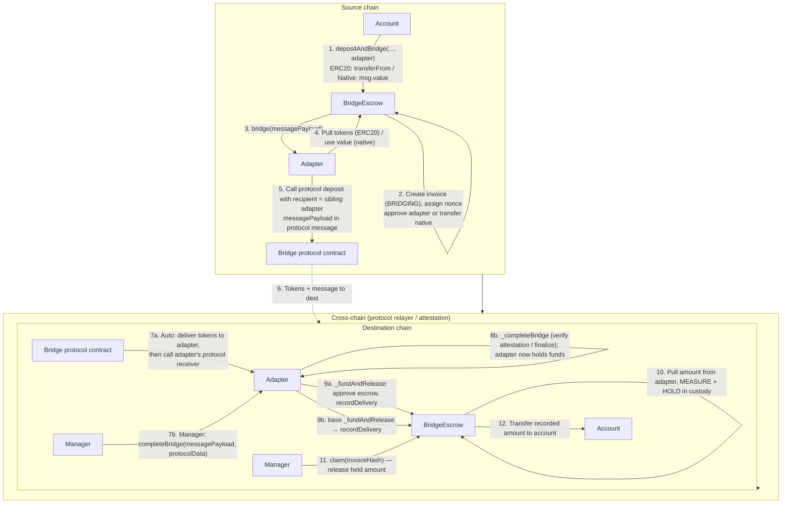

# Bridge Adapters: Architecture and Integration

This document describes the bridge escrow and adapter architecture as implemented (post [ADR 0012](../../docs/decisions/0012-bridge-provable-release-rearchitecture.md), as amended by [ADR 0027](../../docs/decisions/0027-bridge-destination-hold-then-claim.md) on the destination side): message format, flows, existing adapters, and how to implement and register a new adapter.

> **Destination model (ADR 0027 — hold-then-claim).** On the destination chain the escrow no longer forwards delivered funds straight to the account. Instead the authenticated adapter hands the escrow the delivered funds via **`recordDelivery`**, which **holds** them in a per-invoice custody record; a separate MANAGER-gated **`claim(invoiceHash)`** then releases the exact recorded amount to the recorded account. This makes destination completion **uniform** across every bridge (delivery may be auto or keeper-driven, but the release to the safe is always an explicit `claim`) and gives a **controlled block** for the held→safe transition so NAV is never briefly wrong. Held-but-unclaimed value is counted in NAV by the `BridgeHeldBalanceAdapter` (§11). The source side is unchanged.

---

## 1. Overview

The bridge system consists of:

- **BridgeEscrow:** Holds in-transit accounting on the source chain, creates invoices on deposit, and on the destination chain **records delivered assets into per-invoice custody** (holds them) for the account named by a validated payload, then releases them on a MANAGER `claim`. It is **not** the cross-chain message recipient — each adapter is. Only authorized accounts can deposit; `recordDelivery` is callable **only by an authorized adapter** (there is no public dispatcher); `claim` is **MANAGER-gated**.
- **Bridge adapters:** Contracts that implement `IBridgeAdapter`. Each adapter integrates with one bridge protocol (Across, CCIP, CCTP, etc.). The adapter is the **direct on-chain recipient** of the inbound protocol message on the destination chain; it authenticates the message (genuine protocol contract + source chain + source sender) before handing the funds to the escrow to hold.

All adapters use a single **message payload** format (invoice data). Destination delivery is a **funded record**: `BridgeEscrow.recordDelivery(messagePayload)` validates the payload and pulls the exact amount **from the calling adapter** (which holds the delivered funds), **measures** what actually arrived, and **holds** it under the invoice's custody record. A subsequent MANAGER **`claim(invoiceHash)`** transfers exactly the recorded amount to the recorded account. The held funds are always covered by the escrow's real balance and are keyed per invoice, so one invoice can never be funded by — or claimed against — another's tokens.

---

## 2. Token and data flow (depositAndBridge → completeBridge)

The diagram shows how tokens and the message payload move from an account on the source chain to delivery on the destination chain. Two **delivery** paths exist: **auto** (the genuine protocol contract calls the adapter's authenticated receiver, which funds the escrow's custody record) and **manager** (a manager calls `adapter.completeBridge`, e.g. for attestation/finalization protocols, which then funds the custody record). Either way the escrow **holds** the funds; a separate MANAGER **`claim`** (step 11) releases them to the account.

- **Steps 1–5 (source):** Account deposits; escrow records the effective received amount (fee-on-transfer safe), assigns a per-account nonce, creates the `BRIDGING` invoice, hands tokens to the adapter, and calls `adapter.bridge(messagePayload)`. The adapter initiates the bridge with the **sibling adapter on the destination chain** (same address via CREATE2) as the recipient.
- **Step 6:** The protocol moves tokens and (where applicable) the message to the destination chain.
- **Path 7a–10 (auto delivery):** The protocol delivers tokens to the adapter and calls the adapter's protocol receiver. The adapter authenticates `msg.sender == <real protocol contract>`, the source chain, and the source sender (`trustedRemoteAdapter`), then calls `_fundAndRelease`; the escrow pulls the amount from the adapter, measures what arrived, and **holds** it in the invoice's custody record.
- **Path 7b–10 (manager delivery):** For protocols whose provenance is an attestation/proof (CCTP, Superchain), a manager calls `adapter.completeBridge`. `_completeBridge` verifies the attestation/withdrawal so the adapter holds the funds; the base then funds the custody record the same way.
- **Steps 11–12 (claim):** A MANAGER calls `BridgeEscrow.claim(invoiceHash)` (single or batch). The escrow transfers **exactly the recorded amount** to the recorded account and marks the record claimed. This is the single, uniform release step for every bridge, and the controlled block at which held value becomes safe-wallet balance.

---

## 3. Invoice system

Invoices are created only on the **source chain** and track a single bridge operation from deposit until closure.

### 3.1 Invoice lifecycle

- **Creation:** When an authorized account calls `depositAndBridge`, the escrow assigns a **per-account nonce** (`bridgeNonce(account)`, monotonic) and creates an **invoice** with status `BRIDGING`. The invoice stores `invoiceId`, source/destination chain IDs, account, asset, amount, nonce, timestamp, adapter, and status. The invoice hash (storage key) is derived from the checksum (first 24 bytes of `keccak256(invoiceId, amount, timestamp, nonce)`). The nonce makes invoice identity unique per operation.
- **BRIDGING:** The invoice stays `BRIDGING` while in transit. The escrow maintains **in-transit** balance caches per account and asset (sum of `BRIDGING` invoice amounts). Decrements are unguarded — an underflow is an invariant breach and reverts rather than being silently swallowed. Active invoices for an account are in `_activeInvoices[account]`.
- **Delivery on the destination chain:** Delivery does **not** update the source-chain invoice. On the destination there is no stored *source* invoice; the escrow validates the payload in `recordDelivery` (checksum incl. nonce, timestamp, destination chain, authorized account, registered asset), sets `completedInvoices[invoiceHash] = true` (replay guard, also checked against any existing custody record), and writes a `destinationCustody[invoiceHash]` record holding the measured amount. A later MANAGER `claim(invoiceHash)` flips that record's `claimed` flag and pays the account; `claim` does not touch `completedInvoices`.
- **Closure on the source chain (markInvoiceCompleted):** Once a manager confirms destination completion, they call **`markInvoiceCompleted(invoiceHashes)`** on the **source** chain (MANAGER-gated). For each `BRIDGING` invoice it sets `COMPLETED`, sets `completedInvoices`, decrements in-transit caches, and removes the invoice from the active list. Missing/non-`BRIDGING` hashes are skipped and reported in `InvoiceCompletionFailed`.

### 3.2 Other outcomes

- **Cancellation:** A manager can call `cancelInvoice(invoiceHash)` on the source chain while the invoice is `BRIDGING` (full CEI, `nonReentrant`). The escrow returns the assets to the account, sets `CANCELLED`, decrements in-transit balances, and removes the invoice from the active list.

### 3.3 Operator notes & gotchas

- **`invoiceId` vs `invoiceHash`.** `invoiceId` is a **non-unique route/lane key** (`src｜dst｜account｜symbol`), reused by every transfer on that lane. `invoiceHash` (the checksum — includes amount + timestamp + nonce) is the **unique per-operation** identity and the key for `getInvoice`, `completedInvoices`, `isInvoiceCompleted`, `markInvoiceCompleted`, `cancelInvoice`. Querying any of those with an `invoiceId` returns empty/zero.
- **Statuses are source-only** (`BRIDGING=0`, `COMPLETED=1`, `CANCELLED=2`). `getInvoice` on a non-existent hash returns an all-zeros struct whose `status` reads `0` (`BRIDGING`) — so **existence is tested by `invoiceId != bytes32(0)`, never by `status`**.
- **No source `Invoice` struct on the destination.** `recordDelivery` never stores a source `Invoice` — it sets `completedInvoices[hash] = true`, writes a `destinationCustody[hash]` record, and emits `InvoiceCompleted` + `DeliveryRecorded`; `claim` emits `AssetsClaimed`. So `getInvoice` on the destination is **always** empty (not "cleared on finalize" — never written). **Enumerate** an account's held (delivered-but-unclaimed) invoice hashes with `getHeldInvoices(account)` (ADR 0025) — one call, no event reconstruction — then read each record with `destinationCustody(hash)`; per-asset totals via `getHeldBalanceForAsset` / `getHeldBalancesForAccount`; confirm a specific delivery with `isInvoiceCompleted(hash)`.
- **Source vs destination `invoiceHash` diverge for fee bridges** (Stargate — see §4.1). Use the **source** (gross-amount) hash for `markInvoiceCompleted`/`getInvoice` on the source, and the **post-fee** hash for `isInvoiceCompleted` on the destination.
- **Asset custody & rollback.** Funds flow: account → escrow → adapter → bridge protocol (source), then bridge protocol → adapter → account (destination). Everything inside `depositAndBridge` is **atomic** — if the bridge send reverts, the whole tx reverts and the account keeps its funds; a `BRIDGING` invoice exists only *after* the value has committed to the bridge. After that there is **no escrow-level rollback**: the source escrow holds 0 for that asset, and `cancelInvoice` refunds only from the **surplus over destination held custody** (`available = balance − _heldClaimableFor(asset)`, reverting if `available < amount`) — so it can never dip into funds backing a recorded delivery (I1), and in the normal flow (source holds 0 after dispatch) it cannot refund a still-live invoice at all. **Operator constraint (source↔destination has no on-chain interlock):** only `cancelInvoice` once the destination has provably *not* delivered and will not — cancelling a still-live invoice while the escrow happens to hold unrelated **surplus** (e.g. stray funds transferred straight to the escrow) could refund the source *and* let the destination later deliver, double-paying from that surplus. The escrow cannot read destination state from the source chain, so this is a MANAGER / settlement-keeper discipline, not a code guarantee; the surplus cap bounds the exposure to available surplus and never to held custody.
- **Mid-bridge (in-transit) recovery.** The escrow adds **no** in-transit recovery — if delivery stalls in the vendor layer, only the vendor's own mechanics apply (CCTP: complete the mint anytime with the attestation; CCIP: manual re-execution; Stargate/LZ: run `lzCompose`; Gnosis: AMB re-request; Superchain: canonical, effectively guaranteed). For lock/burn bridges, recovery = get the funds to the **destination adapter**, then `recoverStuckAssets`. **Across is the exception** — an unfilled deposit refunds on the **source** before ever reaching the destination.
- **Settlement is an operator/keeper duty.** Source invoices stay `BRIDGING` until a MANAGER runs `markInvoiceCompleted` after confirming destination delivery. **No keeper ships in this repo** — the escrow only exposes the function. Without a reconciler running it, source in-transit balances (`getInTransitBalanceForAsset`) never clear, so any NAV/accounting consumer would double-count delivered funds. Treat "run a settlement keeper/reconciler" as an operational requirement of operating the escrow.

---

## 4. Message Payload Format

Payloads are produced and consumed by `InvoiceDataLib` in `src/bridge/InvoiceDataLib.sol`.

### 4.1 Encoded form

`messagePayload` is `abi.encode(invoiceId, amount, nonce, meta)` (4 slots) where:

- **invoiceId** (bytes32): Packed as `sourceChainId` (3 bytes) | `destinationChainId` (3 bytes) | `account` (20 bytes) | `assetSymbol` (6 bytes). Chain IDs are `uint24`; asset symbol is right-padded bytes6 (e.g. `"USDC  "`).
- **amount** (uint256): Amount being bridged (the effective received amount on deposit).
- **nonce** (uint256): Per-account monotonic nonce, unique per bridge operation.
- **meta** (bytes32): High 8 bytes = `timestamp` (uint64); low 24 bytes = **checksum24** (first 24 bytes of `keccak256(abi.encodePacked(invoiceId, amount, timestamp, nonce))`).

The checksum is an **integrity + replay** key, not an authenticator (all inputs are public). Provenance is enforced by the adapter layer (§7). BridgeEscrow generates the payload in `depositAndBridge` and validates checksum + timestamp in `recordDelivery`. Most adapters do not alter the payload — they pass it through to the protocol and, on delivery, pass the **same** payload to `recordDelivery`, so the destination `invoiceHash` matches the source. **The exception is fee-taking bridges:** Stargate's OFT deducts a transfer fee, so `StargateBridgeAdapter` re-encodes the payload with the **post-fee** amount and recomputes the checksum — the destination `invoiceHash` therefore **differs** from the source one. This is immaterial to correctness: `invoiceId` excludes the amount (so route/account identity is unchanged), and `completedInvoices` replay protection is per-chain. See [ADR 0012](../../docs/decisions/0012-bridge-provable-release-rearchitecture.md) (post-fee model) and audit finding M-04.

### 4.2 Struct form

`InvoiceDataLib.InvoiceData` has: `invoiceId`, `sourceChainId`, `destinationChainId`, `account`, `assetSymbol`, `amount`, `nonce`, `timestamp`, `checksum24`. Use `InvoiceDataLib.decode(messagePayload)` / `InvoiceDataLib.encode(data)` to convert, and `InvoiceDataLib.calculateChecksum(invoiceId, amount, timestamp, nonce)` for the checksum (single source of truth).

---

## 5. BridgeEscrow

### 5.1 Roles and access

- **DEFAULT_ADMIN_ROLE:** Authorize/revoke accounts and adapters, pause/unpause, `emergencyWithdraw` (recipient-restricted to an authorized account, while paused), and authorize UUPS upgrades. (Asset register/unregister is MANAGER, not admin — see below.)
- **MANAGER:** `cancelInvoice`, `markInvoiceCompleted`, `registerAsset`/`unregisterAsset`, and the destination **`claim`** (single + batch). **MANAGER cannot call `recordDelivery`** — recording a delivery is adapter-only; `claim` can only ever pay the account already recorded by `recordDelivery`, so the MANAGER gate controls **timing only**.

### 5.2 Core flows

**Deposit and bridge (source chain)**

1. An authorized account calls `depositAndBridge(destinationChainId, assetSymbol, amount, adapter)` (payable for native; `msg.value` must be 0 for ERC20).
2. Escrow checks: account authorized, adapter authorized, asset registered, `destinationChainId != chainId`, `amount > 0`. For native, `msg.value == amount`; for ERC20 it pulls tokens and records the **effective received delta** (fee-on-transfer safe; rejects zero-delta).
3. Escrow assigns the per-account nonce, creates the invoice, updates in-transit balances, then transfers native to the adapter or approves the adapter for ERC20, and calls `IBridgeAdapter(adapter).bridge(messagePayload)`. `depositAndBridge` is `nonReentrant`.

**Record delivery (destination chain) — funded custody record**

1. `recordDelivery(messagePayload)` is callable **only by an authorized adapter** (`nonReentrant`, `whenNotPaused`, `payable`). There is no fallback dispatcher and MANAGER cannot call it, so the path is unreachable to an attacker.
2. Escrow decodes the payload; validates timestamp (future-skew tolerant), checksum (incl. nonce), `destinationChainId == chainId`, the account is authorized, the asset is registered, and the invoice hash is not already recorded/completed (replay guard on both `completedInvoices` and an existing custody record).
3. Escrow **pulls `amount` from the calling adapter** (ERC20: `safeTransferFrom(adapter, escrow)`, measuring the received delta; native: requires `msg.value == amount`), sets `completedInvoices[hash] = true`, writes a `destinationCustody[hash]` record for the **measured** amount, bumps the held aggregates (`_heldClaimable` + `_heldByAccount`), and emits `InvoiceCompleted` + `DeliveryRecorded`. **The funds are now held by the escrow, not the account.**

**Claim (destination chain) — MANAGER release**

1. `claim(invoiceHash)` / `claim(invoiceHash[])` is **MANAGER-gated** (`nonReentrant`, `whenNotPaused`).
2. Strict CEI: requires the record exists (`amount != 0`, else `InvoiceNotFound`) and is unclaimed (else `AlreadyClaimed`); flips `claimed`, decrements the held aggregates, then transfers **exactly the recorded amount** to the **recorded account** (ERC20 `safeTransfer`; native `call`), and emits `AssetsClaimed`. `claim` can pay no one but the recorded account, and each record pays at most once.

### 5.3 Adapter authorization

- **authorizeAdapter(adapter):** Adds the adapter to the authorized set (verified via ERC165 `supportsInterface(IBridgeAdapter)`). Required before the adapter can be used in `depositAndBridge` or call `recordDelivery`.
- **revokeAdapter(adapter):** Removes the adapter from the authorized set.
- **getAuthorizedAdapters():** Returns the authorized adapter set.

There is **no callback/selector registration** on the escrow (the old `authorizeAdapterWithCallback` / `updateAdapterConfig` / `_callbackAdapters` / `fallback()` mechanism was removed in ADR 0012). Adapters receive protocol callbacks directly and authenticate them.

Assets must be registered per symbol via `registerAsset(symbol, assetAddress)` (native uses `address(0)`; re-pointing a symbol with active invoices is rejected).

---

## 6. BridgeAdapter Base

Adapters inherit `BridgeAdapter` in `src/bridge/BridgeAdapter.sol`.

### 6.1 Entry points (inherited)

- **bridge(messagePayload):** Only callable by `bridgeEscrow`. Decodes the payload, calls `_bridge(data)`, emits `BridgeInitiated`.
- **completeBridge(messagePayload, protocolData):** Only callable by `MANAGER`. Calls `_completeBridge(...)` (protocol verification; adapter must end holding the delivered funds), then resolves the asset via `escrow.assetRegistry(symbol)` and calls `_fundAndRelease` (which records the delivery into escrow custody — it does not pay the account), then emits `BridgeCompleted`. The account is paid later by a separate MANAGER `escrow.claim`.

### 6.2 Provenance config + funding helper

- **trustedRemoteAdapter[uint64 sourceKey] → bytes32** + **setTrustedRemoteAdapter(sourceKey, remote)** (admin): the allowlist of trusted sibling adapters on remote chains. The `sourceKey` is the remote chain's **standard chain id** for every adapter that consults this map — each translates its protocol-specific source identifier (CCIP selector, LZ eid, AMB/OP xDomain sender) back to the standard chain id internally before this lookup, so callers always key by the plain chain id. The value is the remote adapter identity (use `_toBytes32(addr)`; with CREATE2 same-address this equals the adapter's own address). `CctpBridgeAdapter` is the exception: it never reads `trustedRemoteAdapter` — its provenance is the Circle attestation plus the message-body binding (which does map `domainToChainId[sourceDomain]` back to the invoice's source chain id).
- **_fundAndRelease(messagePayload, asset, amount):** Hands the escrow exactly `amount` of `asset` and records the delivery into escrow custody (it no longer forwards to the account — name kept for a minimal diff, since all six adapters funnel every completion route through this one helper). ERC20: `forceApprove(escrow, amount)` → `recordDelivery` (escrow pulls) → reset approval to 0. Native: `recordDelivery{value: amount}`. The adapter must already hold the delivered funds.

### 6.3 What adapters implement

- **_bridge(InvoiceDataLib.InvoiceData memory data):** Initiate the transfer. Encode the payload, pull ERC20 from the escrow (already approved in `depositAndBridge`), and set the protocol's destination recipient to **`address(this)`** (the sibling adapter). Carry the payload in the protocol message.
- **_completeBridge(messagePayload, protocolData):** Manager-path protocol verification (e.g. CCTP attestation, Superchain finalize). Do not call `recordDelivery`/`_fundAndRelease` directly — the base funds the custody record after `_completeBridge` returns. The auto path (the protocol receiver below) calls `_fundAndRelease` itself.
- **The protocol receiver** (e.g. `ccipReceive`, `handleV3AcrossMessage`, `lzCompose`, `onTokenTransfer`): authenticate `msg.sender == <real protocol contract>` + source chain + `trustedRemoteAdapter`, verify the delivered token/amount match the invoice, then `_fundAndRelease` (records into escrow custody). Mark it `nonReentrant`.

### 6.4 Roles

- **DEFAULT_ADMIN_ROLE:** Adapter configuration (protocol contracts, mappings, `setTrustedRemoteAdapter`).
- **MANAGER:** `completeBridge`, `recoverStuckAssets` (recipient restricted to the escrow or an authorized account). Granted to the security council at deploy by `07`.

### 6.5 Native tokens

`_isNativeToken(token)` returns true for `address(0)` and `NATIVE_ADDRESS_ERC7528` (0xEeee…).

---

## 7. Completion Flows: per-protocol provenance

On the source chain every adapter sets the protocol's destination recipient to its **sibling adapter** (`address(this)`, same address across chains via CREATE2). On the destination chain the adapter authenticates the inbound message before releasing.

| Protocol | Authentic destination entry | Authenticated `msg.sender` | Source authentication |
|---|---|---|---|
| **CCIP** | `ccipReceive(Any2EVMMessage)` | `== router` | `selectorToChainId[sourceChainSelector]` + `message.sender == trustedRemoteAdapter` |
| **Across (V3)** | `handleV3AcrossMessage(tokenSent, amount, relayer, message)` | `== spokePool` | `tokenSent`/`amount` bound to the invoice. **No source-sender binding:** Across's callback exposes no depositor, so `_authenticateSource` only confirms the payload's claimed source chain is *configured* (`trustedRemoteAdapter[chain] == address(this)`) — it does **not** prove the source caller was the sibling adapter. Inherent-provenance residual — see §7.1 |
| **Stargate (V2)** | `lzCompose(from, guid, message, …)` | `== endpoint` | `srcEid` + `composeFrom == trustedRemoteAdapter` |
| **Gnosis** | `onTokenBridged(token, value, data)` (IERC20Receiver — the multi-token Omnibridge mediator's `relayTokensAndCall` path; the legacy ERC677 `onTokenTransfer` is also handled but not the primary path) | `== omnibridge` | `amb.messageSender() == trustedMediator[srcChainId]` (the SOURCE Omnibridge mediator, NOT the sibling adapter) + `amb.messageSourceChainId()`; the delivered token must equal the invoice asset **or** — only when a `usdcTransmuter` is configured — the transmuter's legacy `USDC_ON_XDAI` for a `USDC_E` invoice, which is swapped 1:1 to `USDC_E` before release. The auto path records `authenticatedInvoice` **before** the swap and does swap+release in a try/catch, so a transmuter failure leaves a recorded, MANAGER-recoverable invoice; the MANAGER fallback completes only recorded invoices and performs the same swap (see [ADR 0021](../../docs/decisions/0021-bridge-adapter-provenance-and-deploy-hardening.md)) |
| **CCTP** | manager `completeBridge`; `messageTransmitter.receiveMessage` | n/a (Circle attestation) | body mintRecipient (bytes 184-216) == adapter; header recipient (bytes 76-108) == configured TokenMessenger (NOT the adapter); burnToken/amount/sourceDomain bound to invoice; nonce dedup |
| **Superchain** | L1→L2 via the per-L2 `L1StandardBridge` + an authenticated `completeDeposit` message through the per-L2 `l1MessengerForL2`; L2→L1 via the **fault-proof (OP2)** `OptimismPortal` (all **per destination/source L2 chain id** — one L1 adapter serves OP+Base, ADR 0021) | `== l2Messenger` (+ `xDomainMessageSender == trustedRemoteAdapter`); withdrawals proof-gated | **L1→L2:** the deposit funds are ordered ahead of the `completeDeposit` message on L2, so the authenticated path (not just a MANAGER attestation) records the delivery. **L2→L1 (fault-proof OP2):** `proveWithdrawal` takes a **dispute-game index** and the invoice **`messagePayload`** (both the route `invoiceId` and the per-op `invoiceHash` are **derived on-chain** from the payload — no operator-supplied key to mis-set/overwrite; selector `0x98011b26`); proven-ness is `provenWithdrawals(hash, address(this)).disputeGameProxy != 0` (keyed by the adapter as proof submitter). Completion reads the stored `WithdrawalTransaction` by invoice hash (ADR 0025), finalizes **idempotently** (skips a permissionless front-run finalize) and binds the amount by the adapter's balance **delta** (native + ERC20); for an already-finalized (front-run) withdrawal it binds `withdrawalTx.target` to the configured `l1MessengerForL2` and requires that messenger's `successfulMessages` to confirm delivery, plus (ETH) `withdrawalTx.value >= amount`, before settling; a per-withdrawal-hash consumption guard makes settlement one-shot, and `proveWithdrawal` rejects zero invoice keys |

In all cases the protocol delivers the tokens to the adapter, the adapter authenticates, and `_fundAndRelease` hands the escrow the exact amount, which the escrow **holds** in the invoice's custody record; a MANAGER `claim` later releases it to the account. The checksum + `completedInvoices` replay guard remain as defense-in-depth.

> **Stargate deploy note:** the `lzCompose` auto-release only fires if each destination lane's `composeOptions[dstEid]` carries an lzCompose executor gas option — `_bridge` forwards it as the send's `extraOptions`. `06_Configure._wireStargateComposeOptions` sets this per configured remote lane; if it is empty the OFT still delivers the tokens but the executor is never paid to run `lzCompose`, so the delivery is never auto-recorded (the delivered tokens sit in the adapter until a manual `endpoint.lzCompose` or MANAGER `completeBridge`).

### 7.1 Inherent cross-chain provenance residual (Across, Gnosis, CCTP)

**The permissionless-entrypoint lanes cannot bind the source-chain *sender*.** Across (`depositV3`), Gnosis Omnibridge (`relayTokensAndCall`), and CCTP (Circle `depositForBurn`) are all **public** on the source chain, and none surfaces the original depositor to the destination callback/attestation: Across's `handleV3AcrossMessage` carries no depositor, Gnosis's AMB exposes only the source **mediator** (not the sibling adapter), and CCTP's attestation binds `sourceDomain`/`nonce`/`mintRecipient`/`amount` but **not** the invoice's `account`/`invoiceId`. So for these three lanes an adapter authenticates the genuine protocol contract + source chain (+ delivered token/amount), but **cannot prove the message originated from the sibling adapter.** The `_authenticateSource`/`trustedRemoteAdapter` check on Across/Gnosis therefore only confirms the *chain* is configured, not the *caller* — it is not source-sender authentication. (Superchain and CCIP are the exceptions: the OP `xDomainMessageSender()` and the CCIP `message.sender` **do** reveal the source caller, checked against `trustedRemoteAdapter`.)

**Impact — griefing/DoS, no theft.** Any unprivileged address can self-fund a *real* bridge transfer to the adapter carrying a crafted payload (a configured source chain, an authorized account, a registered asset, a self-consistent checksum) and force `recordDelivery` to accept it. But the [ADR 0027](../../docs/decisions/0027-bridge-destination-hold-then-claim.md) hold-then-claim model defuses this: the funds land in per-invoice **custody for an authorized account** (they accrue to the fund, not the attacker), and only a MANAGER can `claim`/route them. The only realizable harm is attacker-funded griefing — front-running a genuine in-flight invoice's checksum to strand it (recoverable via `recoverStuckAssets`; the account still receives the attacker's like-amount funds), or inflating an account's held-set (claims are by-hash so never bricked; each entry costs the attacker a real bridged amount). No path yields theft, over-crediting (measured delta binds the amount), or replay (duplicate `invoiceHash` reverts `InvoiceAlreadyExists`).

**Mitigations already in place:** authorized-account-only custody, checksum integrity + `completedInvoices` replay guard, measured-delta amount binding, MANAGER-gated `claim`, `recoverStuckAssets`, and (Gnosis) the authenticate-then-pending-release ordering so a failed transmuter swap leaves a MANAGER-recoverable record.

**Disposition:** accepted, documented residual — **identical in class to the CCTP residual already accepted and in production.** It is *inherent*: no source-sender check can be added because the protocols do not expose the sender. The only design that would raise the bar is **promote-after-verify** (record to a pending bucket on the callback, MANAGER promotes to live custody only after confirming the matching source `InvoiceCreated` exists) — which would have to be applied **uniformly to all three permissionless lanes, CCTP included**, is a bridge-wide trust-model change, and does not alter the no-theft property that already holds. Tracked as a future option, not a merge/deploy blocker.

---

## 8. Implemented Adapters

| Adapter | Protocol | Dest recipient | Auto receiver | Provenance |
|---|---|---|---|---|
| AcrossBridgeAdapter | Across V3 | adapter (self) | `handleV3AcrossMessage` | spokePool + token/amount binding + source-chain-configured (no source-sender binding — §7.1) |
| CcipBridgeAdapter | CCIP | adapter (self) | `ccipReceive` | router + selector + source sender |
| StargateBridgeAdapter | Stargate V2 | adapter (self) | `lzCompose` | endpoint + srcEid + composeFrom |
| GnosisBridgeAdapter | Gnosis Omnibridge | adapter (self) | `onTokenBridged` (IERC20Receiver; legacy `onTokenTransfer` also handled) | omnibridge + AMB source **mediator** (`trustedMediator`) + source chain + delivered-token match (or legacy→`USDC_E` transmuter swap when `usdcTransmuter` set); record-gated MANAGER fallback |
| CctpBridgeAdapter | CCTP (Circle) | adapter (self) | — (manager) | Circle attestation; body mintRecipient == adapter + header == TokenMessenger; nonce dedup |
| SuperchainBridgeAdapter | Optimism/Base L1↔L2 | adapter (self) | `completeDeposit` (L1→L2) | xDomainMessageSender; per-L2 `optimismPortalForL2` proof + real OP hash (L2→L1) |

All adapters take a single `expectedInitializer` constructor arg (baked into `creationCode` by `05`, identical per chain so the CREATE2 address is preserved) that pins who may call `initialize` — closing the deploy→initialize front-run window (ADR 0021).

Each adapter's `trustedRemoteAdapter` must be configured per source chain so inbound messages are authenticated — except `CctpBridgeAdapter`, which never reads it (provenance is the Circle attestation + message-body binding).

---

## 9. How to Create a New Adapter

1. Inherit `BridgeAdapter` and (optionally) a protocol-specific interface. Add storage for protocol contracts and correlation mappings.
2. Implement `initialize(...)` that calls `super._initializeBridgeAdapter(admin_, bridgeEscrow_, providerName_, version_)`, sets protocol contracts, and configures chain mappings.
3. Implement **`_bridge(InvoiceDataLib.InvoiceData memory data)`:** encode the payload (`InvoiceDataLib.encode`), resolve the asset (`IBridgeEscrow(bridgeEscrow).assetRegistry(InvoiceDataLib.bytes6ToStr(data.assetSymbol))`), pull ERC20 from the escrow, set the protocol recipient to **`address(this)`**, and call the protocol with the payload in its message.
4. Implement the **protocol receiver** (auto path): authenticate `msg.sender == <protocol contract>` + source chain + `trustedRemoteAdapter`, verify delivered token/amount vs the invoice, then `_fundAndRelease(messagePayload, asset, amount)`. Mark it `nonReentrant`. Override `supportsInterface` if you implement a protocol receiver interface.
5. Implement **`_completeBridge(messagePayload, protocolData)`** (manager path) for attestation/proof protocols: verify and ensure the adapter holds the funds; do **not** call release (the base funds + releases after).
6. Expose view functions your UI/managers need (e.g. `getMessagePayload`). Use shared errors/constants from `src/errors.sol` / `src/constants.sol`.

Adapters are **non-upgradeable**: deployed via the canonical CREATE2 deployer (`0x4e59…4956C`) in `05_DeployBridgeAdapters.s.sol`, so each adapter's address is **identical on every chain** (ADR 0012 D7 — the same-address guarantee `trustedRemoteAdapter` relies on); the script asserts the on-chain address equals the predicted deterministic address. They are initialized once via the base `_initialized` boolean guard (args passed to `initialize`, so the creation bytecode carries no per-chain data). No constructor `_disableInitializers` / `initializer` modifier. (BridgeEscrow itself is UUPS-upgradeable, `_authorizeUpgrade` gated by `DEFAULT_ADMIN_ROLE`.)

---

## 10. How to Configure an Adapter in BridgeEscrow

> Per-chain bridge-adapter deploy config (`enabled`, `initialize` args) lives in `script/config/contracts-deployment-config/bridge-adapters/<chainId>.json`, read by `05_DeployBridgeAdapters.s.sol`. In the numbered deploy flow, steps 2 (authorize adapter + wire trusted remotes) and 4 (register assets) below, plus account authorization, are done by `06_Configure.s.sol` from `bridge-adapters/<chainId>.json` (`remoteChains`) and `bridge-escrow/<chainId>.json` (`accounts[]` → `authorizeAccount`, `assets.<symbol>` → `registerAsset`) — the manual steps here describe the underlying calls.

1. **Deploy the adapter** and run `initialize(...)`.
2. **Authorize on the escrow:** `BridgeEscrow.authorizeAdapter(adapter)` (admin) — enables `depositAndBridge` and lets the adapter call `recordDelivery`.
3. **Configure trusted remotes:** for each source chain, `adapter.setTrustedRemoteAdapter(sourceKey, remoteAdapterIdentity)` (admin) so inbound messages are authenticated. With CREATE2 same-address deployment the remote identity is the adapter's own address. **Skip this for `CctpBridgeAdapter`** — it never reads `trustedRemoteAdapter` (see §6.2); its provenance is the Circle attestation plus the message-body binding.
4. **Register assets** on both source and destination escrows: `BridgeEscrow.registerAsset(symbol, assetAddress)`.
5. **Roles:** `07_TransferAdminToSecurityCouncil` hands each adapter's `DEFAULT_ADMIN_ROLE` + `MANAGER` to the security council and renounces the deployer. The council's adapter `MANAGER` gates `completeBridge`, `recoverStuckAssets`, and (Superchain) `proveWithdrawal` — withdrawal finalization has no separate entry point of its own; it runs inside `completeBridge`.

After this, accounts call `depositAndBridge(..., adapter)`; on the destination chain either the authenticated protocol receiver (auto) or a manager calling `adapter.completeBridge(messagePayload, protocolData)` records the delivery into escrow custody, and a MANAGER `BridgeEscrow.claim(invoiceHash)` releases it to the account.

### 10.1 Route availability rules (a route can silently strand funds if these are violated)

A route `(srcChain → dstChain, asset, adapter)` is only *completable* when all of the following hold. `06_Configure._validateBridgeRoutes` enforces the symbol rule at deploy time (fail-fast); the token/vendor rules are not machine-checkable and are enforced by config discipline + these docs.

- **Same logical symbol on both ends.** The invoice carries the **source chain's** logical symbol (e.g. `"USDC"`) unchanged; the destination escrow resolves that *same* symbol via `assetRegistry`. So both escrows must register the symbol under the **identical string**, each mapped to its own local token. The symbol is a routing label, **not** the token's on-chain ticker — a token whose `symbol()` is `"USDC.e"` is still registered under the logical `"USDC"` if that's the lane's symbol. (This is why Gnosis registers its bridged-USDC token `0x2a22f9c3` under `"USDC"`, not `"USDCe"`.)
- **The vendor must deliver the exact token the destination registers** — *or* the adapter must reconcile the delivered token to it. A bridge that delivers a *different* token than `assetRegistry[symbol]` will otherwise fail the adapter's delivered-token check and strand the funds on the destination adapter (MANAGER-recoverable). This bites when a chain has multiple representations of the "same" asset. The one adapter that reconciles rather than rejects is the Gnosis omnibridge USDC route (transmuter-swap, below).
- **Gnosis USD works over both Stargate and the omnibridge.** On Gnosis, `"USDC"` is ambiguous: **Stargate delivers `USDC.e` (`0x2a22f9c3`)**, the **Gnosis omnibridge delivers the legacy `USD//C on xDai` (`0xDDAfbb50`)**, and **CCIP has no Gnosis USD token pool** (its lane reverts at `ccipSend`, so CCIP stays disabled on Gnosis). The escrow registers `"USDC" → 0x2a22f9c3` (USDC.e), and **both** supported bridges land that token, so the operator may pick either per transfer (it is a whitelisted client-configs route):
  - **Stargate** delivers `USDC.e` directly (authenticated `lzCompose`).
  - **Omnibridge (Gnosis adapter)** delivers the legacy `0xDDAfbb50`, then swaps it **1:1** to/from `USDC.e` through the immutable **USDCTransmuter (`0x0392A2F5…`)** — inbound `deposit` (legacy→USDC.e), outbound `withdraw` (USDC.e→legacy) — so it also lands the registered `USDC.e`. Wired only on Gnosis via the `usdcTransmuter` config (`setUsdcTransmuter`, DEFAULT_ADMIN; unset/`address(0)` on the Ethereum side, which bridges native USDC directly). WETH is a single token across all bridges, so WETH↔Gnosis is unambiguous and needs no swap.

**Roles note (deploy window):** `07` grants the security council adapter MANAGER for steady state, but a canary/validation run *before* `07` needs the deploy EOA to hold adapter MANAGER to exercise CCTP/Superchain `completeBridge`. `06._ensureAdapterManager` grants that during `06`; `07` later revokes the deployer and grants the council.

### 10.2 Completion keeper — some lanes are not hands-off

A cross-chain transfer is only finished when the assets are released to the account on the destination. Under hold-then-claim (ADR 0027) this is **two destination steps**: (1) **delivery** — the funds reach the adapter and are recorded into escrow custody; (2) **claim** — a MANAGER `BridgeEscrow.claim(invoiceHash)` releases the held amount to the account. **Step 2 is a MANAGER call on every lane** (the uniform completion Santi asked for). The table below is about **step 1 only**: for some adapters/directions delivery happens **automatically** (the vendor's own relayer/executor delivers and the adapter's auto-receiver records it); for others it requires an **off-chain action on the destination chain**. The escrow/adapters cannot perform those destination actions from the source side, so production needs a **completion keeper** — an off-chain agent (a bot, or a service like Gelato / OpenZeppelin Defender / Chainlink Automation) that watches the escrow's outbound `BRIDGING` invoices, performs the destination delivery for each keeper-required path, **and then calls `claim`**. (Delivery paths empirically verified on the 2026-07 rehearsal canaries.)

| Adapter / direction | Destination delivery (step 1; step 2 `claim` is always MANAGER) | Delivery hands-off? |
|---|---|---|
| CCIP (both) | `ccipReceive` — the CCIP DON delivers + calls it | ✅ auto |
| Stargate (both) | `lzCompose` — the LayerZero executor runs it (needs `composeOptions` wired) | ✅ auto |
| Superchain **L1→L2** | the L1 adapter sends an authenticated `completeDeposit` message via the per-L2 `l1MessengerForL2`; the L2 messenger auto-relays it after the deposit funds land | ✅ auto |
| Gnosis **ETH→GC** | the AMB auto-affirms on Gnosis (cheap gas) | ✅ auto |
| **CCTP** (both) | fetch Circle's attestation for the burn, then MANAGER `completeBridge` (`messageTransmitter.receiveMessage`) | 🔧 **keeper** |
| **Superchain L2→L1** | `proveWithdrawal` (fault-proof OP2: pass a dispute-game index), then `completeBridge` (finalizes inside it) once the portal's dispute-game resolution + finality air-gap elapse | 🔧 **keeper** |
| **Gnosis GC→ETH** | `executeSignatures(msg, sigs)` on the ETH foreign AMB (`0x4C36d291…`) — the OmniBridge "CLAIM" (an AMB affirmation, distinct from the escrow's `claim`); home→foreign is not auto-executed because it costs Ethereum L1 gas. It fires `onTokenBridged`, so the adapter records the delivery into escrow custody in the same tx. | 🔧 **keeper** |
| **Across** (both) | a relayer must `fillV3Relay` on the destination; our delivery is **zero-margin** (`outputAmount == inputAmount`), so third-party relayers have no incentive — a **designated relayer** must fill | 🔧 **keeper** |

For the vendor delivery call the keeper is stateless with respect to the escrow (it only submits the vendor's own completion call) and needs the destination-chain gas token plus, for Across, the output-token liquidity to front the fill (repaid by Across); it then submits the MANAGER `claim` (single or batch) to release the held funds. One agent can cover all four delivery paths plus the claim step. This is the same class of operational duty as source-side settlement (`markInvoiceCompleted`) — none of it is shipped in this repo; all of it is the operator's responsibility.

---

## 11. NAV integration: held funds (BridgeHeldBalanceAdapter)

Under hold-then-claim a bridged transfer's value passes through **three accounting windows**, each read by a different reader:

1. **Source in-transit** — `BRIDGING` on the source escrow, read via `getInTransitBalanceForAsset` / `getInTransitBalancesForAccount`, cleared by `markInvoiceCompleted`.
2. **Destination held** — recorded but not yet claimed on the destination escrow, read via `getHeldBalanceForAsset(asset, account)` / `getHeldBalancesForAccount(account)` / `destinationCustody(hash)`, cleared by `claim`.
3. **Safe balance** — after `claim`, ordinary ERC20/native balance in the account's wallet, counted by the normal balance adapters.

Window 2 is counted in NAV by **`BridgeHeldBalanceAdapter`** (`src/balances/BalanceAdapters/BridgeHeldBalanceAdapter.sol`) — a plain immutable balance adapter (constructor `(navCalculator, bridgeEscrow)`) that reads the destination escrow's per-account held custody and emits **one credit `PositionBalance` per held asset that is registered on NAVCalculator**, as `PositionKind.Supplied` with `isLocked = true` (the account owns the value but cannot use it until `claim`), `positionId = abi.encode(bridgeEscrow, token)` (the canonical `bridge-escrow` decode schema), and the `bridge-escrow` protocol taxonomy (`ProtocolIds.BRIDGE_ESCROW` for brand/id/subId). The escrow keys native custody at `address(0)`; the adapter maps that to NAV's ERC-7528 native sentinel so a held ETH delivery is not dropped. The held amount is the escrow's measured balance-delta, so it can never over-report. Register one instance per chain that runs a destination escrow.

**Disjointness — important caveat.** Windows **2 → 3** are disjoint *on the destination chain*: `claim` is the single block that moves value from held to safe balance. Window **1 (source in-transit) is NOT disjoint from window 2**: `recordDelivery` starts the destination-held position, but source in-transit clears only at the *separate, later* `markInvoiceCompleted` on the source chain — so between delivery and source settlement a **cross-chain NAV that sums both escrows double-counts** the transfer (indefinitely if settlement is missed). Hold-then-claim does **not** by itself remove that overlap; it is the same source-side settlement gap the pass-through model had. Closing it requires **read-time netting** (source `getActiveInvoices` × dest `isInvoiceCompleted`, so a delivered-but-unsettled invoice is counted once) or a prompt settlement keeper running `markInvoiceCompleted` — both are operational requirements not shipped in this repo (see §3.3 "Settlement is an operator/keeper duty"). **⚠️ Stargate caveat:** the `isInvoiceCompleted(invoiceHash)` half of the netting recipe only fires when the destination hash equals the source hash — true for 5 of 6 bridges, but **Stargate re-encodes a post-fee payload so its destination `invoiceHash` differs from the source's** (§4.1). `dest.isInvoiceCompleted(sourceHash)` therefore stays `false` forever for a Stargate lane, so a keeper implementing the literal recipe would **double-count every Stargate transfer** for the whole settlement window. Net Stargate lanes on the source-only signal instead — clear the source leg via the on-chain `markInvoiceCompleted(sourceHash)` (the authoritative settlement), not by hash-matching against the destination.
