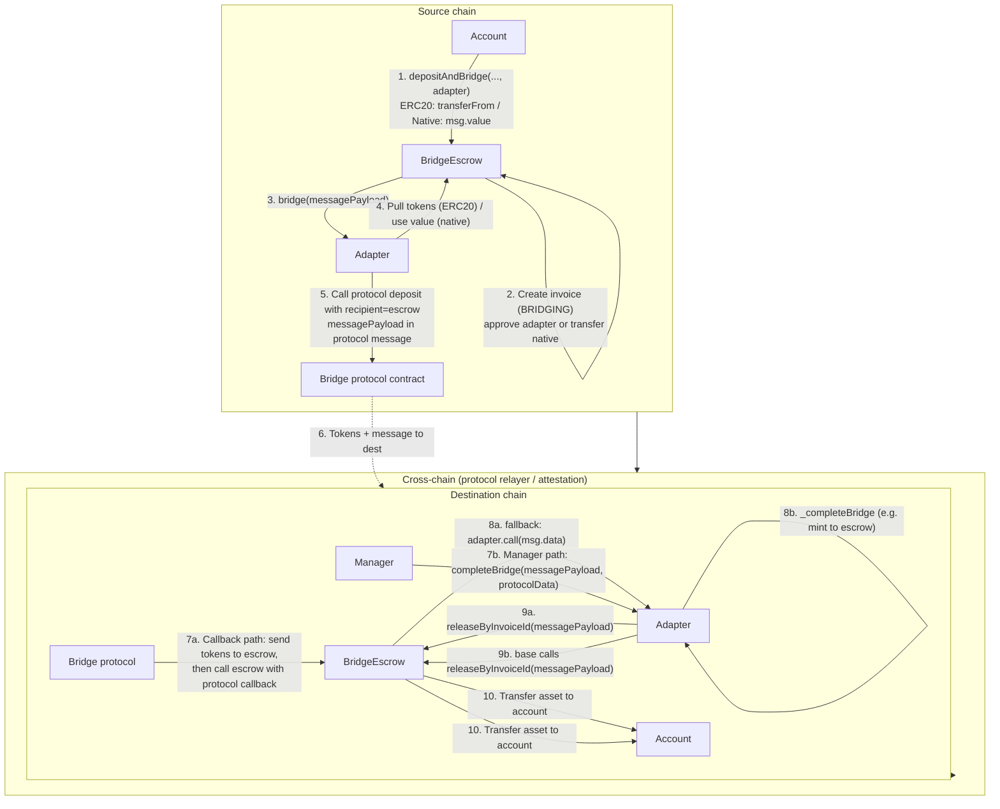

# Bridge Adapters: Architecture and Integration

> ⚠️ **OUT OF DATE as of this PR (ADR 0012).** This PR removes the escrow `fallback()` dispatcher and the
> `authorizeAdapterWithCallback` / `updateAdapterConfig` / `getCallbackAdapter` callback-registration APIs.
> The sections below that describe the **fallback selector dispatcher** and **callback registration** (§5.3,
> §5.4, the "callback path" in §7, and §10) no longer reflect the code:
> - Adapters are authorized with **`authorizeAdapter(address)`** only — there is no callback selector to register.
> - Completion in this PR is the **MANAGER path**: `adapter.completeBridge(messagePayload, protocolData)` →
>   base calls `BridgeEscrow.releaseByInvoiceId(messagePayload)` (release pays from the escrow balance and is
>   callable only by an authorized adapter; never via a public fallback, never by MANAGER directly).
> - The trust-minimized **direct-receiver provenance** model (each adapter authenticates the real protocol
>   contract + source sender, funded per-invoice pass-through) and the full rewrite of this document land in
>   the follow-up adapter-provenance PR. See [ADR 0012](../../docs/decisions/0012-bridge-provable-release-rearchitecture.md).

This document describes the bridge escrow and adapter architecture: message format, flows, existing adapters, and how to implement and register a new adapter.

---

## 1. Overview

The bridge system consists of:

- **BridgeEscrow:** Holds assets, creates invoices on deposit, and releases assets on the destination chain when a valid payload is presented. It is the single recipient address for all callback-based bridges. Only authorized accounts can deposit; only authorized adapters (or escrow managers) can trigger release.
- **Bridge adapters:** Contracts that implement `IBridgeAdapter`. Each adapter integrates with one bridge protocol (Across, CCIP, CCTP, etc.). Adapters initiate transfers on the source chain and complete them on the destination chain; for some protocols the destination “completion” is automatic via a callback.

All adapters use a single **message payload** format (invoice data). Release is always performed by `BridgeEscrow.releaseByInvoiceId(messagePayload)`, which validates the payload and sends assets to the account encoded in it.

---

## 2. Token and data flow (depositAndBridge → completeBridge)

The diagram below describes how tokens and the message payload move from an account on the source chain until completion on the destination chain. Two completion paths are shown: **callback-based** (protocol calls the escrow, escrow forwards to adapter, adapter calls `releaseByInvoiceId`) and **manager-only** (manager calls `adapter.completeBridge`, base calls `releaseByInvoiceId`).

- **Steps 1–5 (source):** Account deposits into the escrow; escrow creates the invoice, passes tokens to the adapter, and calls `adapter.bridge(messagePayload)`. The adapter sends the payload and initiates the bridge with the protocol, using the **escrow** as the recipient on the destination chain.
- **Step 6:** The protocol moves tokens and (where applicable) the message to the destination chain.
- **Path 7a–10 (callback):** The protocol sends tokens to the escrow and invokes the escrow with its callback. The escrow fallback forwards the call to the adapter; the adapter extracts the payload and calls `releaseByInvoiceId`; the escrow transfers the asset to the account.
- **Path 7b–10 (manager):** A manager calls `adapter.completeBridge(messagePayload, protocolData)`. The adapter runs `_completeBridge` (e.g. mint to escrow); the base then calls `releaseByInvoiceId`; the escrow transfers the asset to the account.

---

## 3. Invoice system

Invoices are created only on the **source chain** and track a single bridge operation from deposit until closure.

### 3.1 Invoice lifecycle

- **Creation:** When an authorized account calls `depositAndBridge`, the escrow creates an **invoice** with status `BRIDGING`. The invoice stores `invoiceId`, source/destination chain IDs, account, asset, amount, timestamp, adapter, and status. The invoice hash used as the storage key is derived from the checksum (first 24 bytes of `keccak256(invoiceId, amount, timestamp)`).
- **BRIDGING:** The invoice remains in `BRIDGING` status while the transfer is in progress. The escrow maintains **in-transit** balance caches per safe and asset; these reflect the sum of amounts of all invoices in `BRIDGING` for that safe and asset. Active invoices for a safe are stored in `_activeInvoices[safe]` so UIs and bookkeeping can list them.
- **Completion on the destination chain:** Completion does **not** update the source-chain invoice. On the destination chain there is no stored invoice; the escrow only validates the message payload in `releaseByInvoiceId` (checksum, timestamp, destination chain, authorized safe, registered asset) and marks `completedInvoices[invoiceHash] = true` on the **destination** escrow to prevent double-spend. The **source** chain invoice is still `BRIDGING` at this point.
- **Closure on the source chain (markInvoiceCompleted):** Once a manager has confirmed that the transfer completed on the destination (e.g. assets were released to the account), a manager should call **`BridgeEscrow.markInvoiceCompleted(invoiceHashes)`** on the **source** chain. This function:
  - Requires `MANAGER` role on the escrow.
  - For each provided `invoiceHash`: if the invoice exists and its status is `BRIDGING`, it sets status to `COMPLETED`, sets `completedInvoices[invoiceHash] = true`, decrements the in-transit balance caches, and removes the invoice from the safe’s active list. If the invoice is missing or not in `BRIDGING`, that hash is skipped and reported in `InvoiceCompletionFailed`.
  - This closes the invoice on the source chain and updates bookkeeping (in-transit balances, active invoice list) so the source ledger reflects that the bridge is done.

So the full closure of an invoice is: (1) **destination:** `releaseByInvoiceId` (or the callback/completeBridge path that triggers it) releases the assets and marks completion on the destination escrow; (2) **source:** a manager calls `markInvoiceCompleted(invoiceHashes)` on the source escrow to move the invoice from `BRIDGING` to `COMPLETED` and update in-transit state.

### 3.2 Other outcomes

- **Cancellation:** A manager can call `cancelInvoice(invoiceHash)` on the source chain when the invoice is still in `BRIDGING`. The escrow returns the assets (if still held) to the account, sets status to `CANCELLED`, updates in-transit balances, and removes the invoice from the active list.

---

## 4. Message Payload Format

Payloads are produced and consumed by `InvoiceDataLib` in `src/bridge/InvoiceDataLib.sol`.

### 4.1 Encoded form

`messagePayload` is `abi.encode(invoiceId, amount, meta)` where:

- **invoiceId** (bytes32): Packed as `sourceChainId` (3 bytes) | `destinationChainId` (3 bytes) | `account` (20 bytes) | `assetSymbol` (6 bytes). Chain IDs are `uint24`; asset symbol is right-padded bytes6 (e.g. `"USDC  "`).
- **amount** (uint256): Amount being bridged.
- **meta** (bytes32): High 8 bytes = `timestamp` (uint64); low 24 bytes = **checksum24** (first 24 bytes of `keccak256(abi.encodePacked(invoiceId, amount, timestamp))`).

BridgeEscrow generates this payload in `depositAndBridge` and validates checksum and timestamp in `releaseByInvoiceId`. Adapters must not alter the payload; they pass it through to the bridge protocol and, on completion, pass the same payload to `releaseByInvoiceId`.

### 4.2 Struct form

`InvoiceDataLib.InvoiceData` has: `invoiceId`, `sourceChainId`, `destinationChainId`, `account`, `assetSymbol`, `amount`, `timestamp`, `checksum24`. Use `InvoiceDataLib.decode(messagePayload)` and `InvoiceDataLib.encode(data)` to convert to and from bytes.

---

## 5. BridgeEscrow

### 5.1 Roles and access

- **DEFAULT_ADMIN_ROLE:** Authorize/revoke accounts and adapters, configure adapter callbacks, pause, emergency withdraw, authorize upgrades.
- **MANAGER:** Call `releaseByInvoiceId` (and thus complete bridges when the adapter forwards to the escrow), cancel invoices, `markInvoiceCompleted`, register/unregister assets.

### 5.2 Core flows

**Deposit and bridge (source chain)**

1. An authorized account calls `depositAndBridge(destinationChainId, assetSymbol, amount, adapter)` (payable if the asset is native).
2. Escrow checks: safe authorized, adapter authorized, asset registered, `destinationChainId != chainId`, `amount > 0`. For native asset, `msg.value == amount`; for ERC20, it pulls tokens from the safe.
3. Escrow creates an invoice, updates in-transit balances, then either transfers native to the adapter or approves the adapter for ERC20, and calls `IBridgeAdapter(adapter).bridge(messagePayload)`.
4. The adapter initiates the cross-chain transfer (see section 7).

**Release (destination chain)**

1. Someone must call `releaseByInvoiceId(messagePayload)`. Caller must be an authorized adapter or an account with MANAGER role.
2. Escrow decodes the payload, validates timestamp (must be in the past), validates checksum, ensures `destinationChainId == chainId`, ensures the decoded account is authorized, ensures the asset symbol is registered, and that the invoice hash has not already been completed.
3. Escrow marks the invoice completed, transfers the asset (native or ERC20) to the account from the payload, and emits events.

So on the destination chain the escrow must hold the assets (or receive them during the same call, e.g. CCTP mint) before `releaseByInvoiceId` is called.

### 5.3 Callback dispatch (fallback)

BridgeEscrow has a **fallback** that forwards any call to a registered adapter:

- Storage: `_callbackAdapters[selector] = adapter` (one adapter per function selector).
- On an unknown selector, the fallback looks up `adapter = _callbackAdapters[msg.sig]`. If zero, it reverts. Otherwise it executes `adapter.call(msg.data)` and bubbles up revert data on failure.

So the **recipient** of callback-based bridges is always the BridgeEscrow. When the protocol (e.g. Across, CCIP) calls the escrow with its callback (e.g. `handleAcrossMessage`, `ccipReceive`), the escrow forwards the same calldata to the adapter registered for that selector. The adapter must then validate the caller is the escrow, extract the message payload, and call `releaseByInvoiceId(messagePayload)` (and optionally store payloads, emit events, etc.).

### 5.4 Adapter registration and callback config

- **authorizeAdapter(adapter):** Adds the adapter to the authorized set. Required before the adapter can be used in `depositAndBridge` or as a caller to `releaseByInvoiceId`.
- **authorizeAdapterWithCallback(adapter, selector):** Authorizes the adapter and sets `_callbackAdapters[selector] = adapter`. Use when the adapter is the one that implements the protocol callback for that selector. Cannot be used if the adapter is already authorized (use `updateAdapterConfig` for that).
- **updateAdapterConfig(adapter, selector):** For an already-authorized adapter, sets or clears its callback: if `selector != 0`, registers this adapter for that selector (and clears any previous selector for this adapter); if `selector == 0`, clears the adapter’s callback registration.
- **revokeAdapter(adapter):** Removes the adapter from the authorized set and clears its callback registration if any.
- **getCallbackAdapter(selector):** Returns the adapter address registered for a given callback selector.

Assets must be registered per symbol via `registerAsset(symbol, assetAddress)`. Native tokens use `address(0)`; the escrow still distinguishes “registered native” from “unregistered” via `registeredAssets()`.

---

## 6. BridgeAdapter Base

Adapters inherit `BridgeAdapter` in `src/bridge/BridgeAdapter.sol` and implement the abstract logic.

### 6.1 Entry points (inherited)

- **bridge(messagePayload):** Only callable by `bridgeEscrow`. Decodes payload with `InvoiceDataLib.decode`, calls `_bridge(data)`, emits `BridgeInitiated`.
- **completeBridge(messagePayload, protocolData):** Only callable by accounts with `MANAGER` role. Requires non-empty `messagePayload`. Calls `_completeBridge(messagePayload, protocolData)`, then always calls `IBridgeEscrow(bridgeEscrow).releaseByInvoiceId(messagePayload)`, then emits `BridgeCompleted`.

So `releaseByInvoiceId` is always invoked by the base `completeBridge`. Adapters must not call `releaseByInvoiceId` from `_completeBridge`; they only perform protocol-specific completion (e.g. pull attestation, mint, or transfer tokens to escrow). For callback-based flows, the adapter’s protocol callback calls `releaseByInvoiceId` directly (see below).

### 6.2 What adapters implement

- **_bridge(InvoiceDataLib.InvoiceData memory data):** Initiate the cross-chain transfer. Use `data` to encode the message payload for the protocol. Set the protocol's recipient to `bridgeEscrow` so that on the destination chain the escrow receives tokens and/or the callback. For ERC20, the escrow has already approved the adapter in `depositAndBridge`, so the adapter pulls from the escrow and then interacts with the bridge (e.g. approves and calls the bridge contract).
- **_completeBridge(messagePayload, protocolData):** Protocol-specific completion when a manager calls `completeBridge`. For example: validate and apply attestation, mint to escrow, or record state. Do not call `releaseByInvoiceId` here; the base does it after `_completeBridge` returns.

Optional helper:

- **_transferTokensToEscrow(invoiceId, asset, amount):** Transfers tokens (native or ERC20) from the adapter to the escrow and emits `TokensTransferredToEscrow`. Use in `_completeBridge` when the protocol delivers tokens to the adapter and the manager completes via `completeBridge`; then the base will call `releaseByInvoiceId`, and the escrow will already hold the tokens.

### 6.3 Roles

- **DEFAULT_ADMIN_ROLE:** Typically granted to the deployer; used for adapter configuration (e.g. set bridge contract, fee, chain mappings).
- **MANAGER:** Required to call `completeBridge` and `recoverStuckAssets`. Should be granted to the same manager set that NAVCalculator and BridgeEscrow use for operational management.

### 6.4 Native tokens

The base provides `_isNativeToken(token)` which returns true for `address(0)` and for `NATIVE_ADDRESS_ERC7528` (0xEeee...). Use it when deciding whether to pull ERC20 from the escrow or use `msg.value` / escrow’s native transfer.

---

## 7. Completion Flows: Callback-Based vs Manager-Only

### 7.1 Callback-based (Across, CCIP, Stargate, Gnosis)

- On the source chain the adapter sets the protocol’s recipient to **BridgeEscrow** (e.g. Across `recipient`, CCIP `receiver`, Stargate `toAddress`, Gnosis `receiver`).
- On the destination chain the protocol sends tokens to the escrow and then calls the escrow with a protocol-specific function (e.g. `handleAcrossMessage`, `ccipReceive`, `lzReceive`, `onTokenTransfer`).
- BridgeEscrow has no functions with those selectors, so the **fallback** runs and forwards the call to the adapter registered for that selector (via `updateAdapterConfig` or `authorizeAdapterWithCallback`).
- The adapter’s implementation of that function must:
  1. Require `msg.sender == bridgeEscrow`.
  2. Extract the message payload from the protocol-specific arguments.
  3. Optionally store the payload (e.g. in `messagePayloads[invoiceId]`).
  4. Call `IBridgeEscrow(bridgeEscrow).releaseByInvoiceId(messagePayload)`.

So the adapter implements the protocol callback, but when the bridge calls the escrow, the escrow forwards to the adapter; the adapter then triggers release. Tokens are already at the escrow when the callback runs. The same adapter also implements `_completeBridge` for the manager path (e.g. manual relay or missing callback); in that case tokens are usually already at the escrow and `_completeBridge` only updates state and/or emits events before the base calls `releaseByInvoiceId`.

### 7.2 Manager-only (CCTP, Superchain)

- No protocol callback is registered on the escrow for these adapters.
- On the destination chain, a manager calls `adapter.completeBridge(messagePayload, protocolData)`.
- In `_completeBridge` the adapter does protocol-specific work (e.g. CCTP: receive message and mint to escrow; Superchain: finalize withdrawal so escrow receives funds). The base then calls `releaseByInvoiceId(messagePayload)`.

For CCTP, the escrow is typically the mint recipient, so tokens land at the escrow and the adapter only triggers mint + release. For Superchain L1↔L2, the escrow is the receiver; completion may involve proving/finalizing a withdrawal so the escrow receives funds before release.

---

## 8. Implemented Adapters

| Adapter                  | Protocol       | Recipient   | Callback (selector → adapter)        | Completion path(s) |
|--------------------------|----------------|------------|--------------------------------------|--------------------|
| AcrossBridgeAdapter      | Across         | BridgeEscrow | handleAcrossMessage → adapter        | Callback or manager completeBridge |
| CcipBridgeAdapter        | CCIP           | BridgeEscrow | ccipReceive → adapter                | Callback or manager completeBridge |
| StargateBridgeAdapter    | Stargate       | BridgeEscrow | lzReceive → adapter                  | Callback or manager completeBridge |
| GnosisBridgeAdapter      | Gnosis Omnibridge | BridgeEscrow | onTokenTransfer → adapter         | Callback or manager completeBridge |
| CctpBridgeAdapter        | CCTP (Circle)  | BridgeEscrow | —                                   | Manager completeBridge (mint to escrow then release) |
| SuperchainBridgeAdapter  | Optimism L1/L2 | BridgeEscrow | —                                   | Manager completeBridge (and prove/finalize for L2→L1) |

Across, CCIP, Stargate, and Gnosis must be registered with the escrow callback config for their respective selectors so the fallback forwards to the correct adapter.

---

## 9. How to Create a New Adapter

### 9.1 Contract layout

1. Create a new contract that inherits `BridgeAdapter` and (optionally) a protocol-specific interface.
2. Add storage for protocol contracts and any mappings you need (e.g. message ID → invoice ID).
3. Implement a custom `initialize(...)` that:
   - Calls `super._initializeBridgeAdapter(admin_, bridgeEscrow_, providerName_, version_)` (the base initializer, which grants `DEFAULT_ADMIN_ROLE` to `admin_` and pins the escrow, provider name, and version),
   - Sets protocol contracts and config,
   - Grants `MANAGER` role to the intended manager(s).

4. Implement **`_bridge(InvoiceDataLib.InvoiceData memory data)`:**
   - Encode payload: `bytes memory messagePayload = InvoiceDataLib.encode(data)`.
   - Get asset: `address asset = IBridgeEscrow(bridgeEscrow).assetRegistry(InvoiceDataLib.bytes6ToStr(data.assetSymbol))` (`assetRegistry` takes a `string` symbol, so convert the `bytes6` symbol first).
   - If not native, pull tokens from escrow (it has already approved the adapter in `depositAndBridge`): `IERC20(asset).safeTransferFrom(bridgeEscrow, address(this), data.amount)`.
   - Set the protocol’s recipient to `bridgeEscrow` so the escrow receives funds and/or the callback on the destination chain.
   - Call the protocol’s deposit/transfer function with the message payload (or its encoded form).
   - Store any IDs you need for correlation (e.g. deposit ID, nonce) and optionally `messagePayloads[data.invoiceId] = messagePayload`.

5. Implement **`_completeBridge(bytes calldata messagePayload, bytes calldata protocolData)`:**
   - Decode `messagePayload` if you need invoice fields.
   - Perform protocol-specific completion (e.g. receiveMessage + mint for CCTP, or just validate and store if tokens are already at the escrow).
   - If tokens land at the adapter, call `_transferTokensToEscrow(data.invoiceId, asset, data.amount)` so the escrow holds them before the base calls `releaseByInvoiceId`.
   - Do not call `releaseByInvoiceId`; the base does that after `_completeBridge` returns.

6. **If your protocol has a destination callback** (e.g. `myProtocolReceive(...)`):
   - Implement that function on the adapter.
   - In it: require `msg.sender == bridgeEscrow`, extract the message payload from the args, optionally store it, then call `IBridgeEscrow(bridgeEscrow).releaseByInvoiceId(messagePayload)`.
   - You will register this function’s selector with the escrow so the fallback forwards to your adapter (see section 10).

7. Expose any view functions your UI or managers need (e.g. `getMessagePayload(invoiceId)`). Override `supportsInterface` if you implement a protocol interface (e.g. ERC165 for the protocol's receiver interface).

8. Use the shared errors and constants from `src/errors.sol` and `src/constants.sol` where applicable.

### 9.2 Initialization and upgradeability

Adapters are **non-upgradeable**. They are deployed with plain `new ...` (see `05_DeployBridgeAdapters.s.sol`) and initialized once: `BridgeAdapter._initializeBridgeAdapter` uses a simple boolean guard (`_initialized`) rather than OpenZeppelin `Initializable`, so a second call reverts. Do not add a constructor, `_disableInitializers()`, or the `initializer` modifier — none are needed. (BridgeEscrow itself **is** UUPS-upgradeable, with `_authorizeUpgrade` gated by `DEFAULT_ADMIN_ROLE`; the adapters are not.)

---

## 10. How to Configure an Adapter in BridgeEscrow

> **Where bridge-adapter deploy config lives.** Per-chain bridge-adapter config — `enabled`, the `initialize` args, and the optional `callbackSelector` — lives in `script/config/contracts-deployment-config/bridge-adapters/<chainId>.json`, keyed by adapter name. It is read by `05_DeployBridgeAdapters.s.sol`. (It is no longer carried in a `bridgeAdapters` block in `script/config/chains/<chainId>.json`.)

1. **Deploy the adapter** (plain `new ...`, no proxy — adapters are non-upgradeable) and run your adapter's `initialize(...)` with admin, escrow address, protocol contracts, and version (from `contracts-deployment-config/bridge-adapters/<chainId>.json`). Grant `MANAGER` role to the manager address(es) that will call `completeBridge` when needed.

2. **Authorize the adapter on the escrow:**  
   As admin, call `BridgeEscrow.authorizeAdapter(adapter)` so the adapter can be used in `depositAndBridge` and can call `releaseByInvoiceId`.

3. **If the adapter implements a protocol callback** (e.g. Across, CCIP, Stargate, Gnosis):
   - Either call `BridgeEscrow.authorizeAdapterWithCallback(adapter, callbackSelector)` when first authorizing (e.g. `AcrossBridgeAdapter.handleAcrossMessage.selector`),  
   - Or, if the adapter was already authorized, call `BridgeEscrow.updateAdapterConfig(adapter, callbackSelector)` to register that selector → adapter.
   - The callback selector must be the one the bridge protocol uses when it calls the escrow (e.g. `ccipReceive`, `lzReceive`, `onTokenTransfer`). Use `bytes4(0)` in `updateAdapterConfig` to clear the callback for that adapter.

4. **Ensure assets are registered** on both source and destination escrows: `BridgeEscrow.registerAsset(symbol, assetAddress)` (use `address(0)` for native on chains where the escrow supports it).

5. **Manager role:** The same or a separate manager that will call `adapter.completeBridge(...)` on the destination chain must have `MANAGER` role on the **adapter**. The escrow's `MANAGER` role is used for `releaseByInvoiceId` when called directly (e.g. by a backend) and for cancel/mark-completed; typically the adapter is the one that calls `releaseByInvoiceId` (either from its callback or from the base `completeBridge`), so the adapter's `MANAGER` role is what gates `completeBridge`.

After this, accounts can call `depositAndBridge(..., adapter)` and, on the destination chain, either the protocol callback path (for callback-based adapters with registered selector) or the manager calling `adapter.completeBridge(messagePayload, protocolData)` will trigger release.
