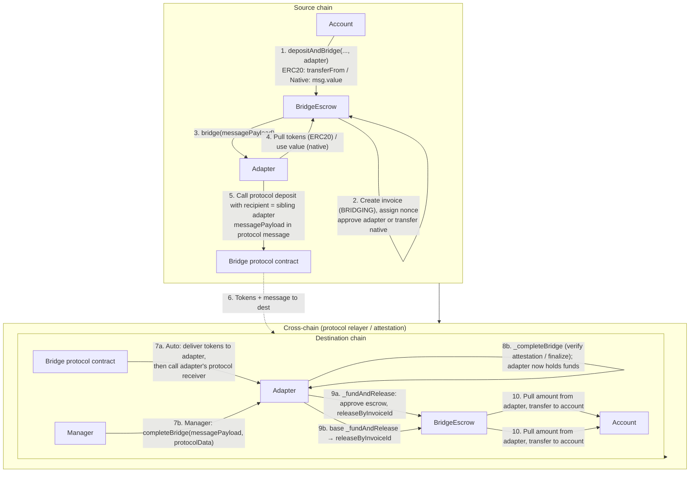

# Bridge Adapters: Architecture and Integration

This document describes the bridge escrow and adapter architecture as implemented (post [ADR 0012](../../docs/decisions/0012-bridge-provable-release-rearchitecture.md)): message format, flows, existing adapters, and how to implement and register a new adapter.

---

## 1. Overview

The bridge system consists of:

- **BridgeEscrow:** Holds in-transit accounting on the source chain, creates invoices on deposit, and on the destination chain releases assets to the account named by a validated payload. It is **not** the cross-chain message recipient — each adapter is. Only authorized accounts can deposit; release is callable **only by an authorized adapter** (there is no public dispatcher, and MANAGER cannot call release directly).
- **Bridge adapters:** Contracts that implement `IBridgeAdapter`. Each adapter integrates with one bridge protocol (Across, CCIP, CCTP, etc.). The adapter is the **direct on-chain recipient** of the inbound protocol message on the destination chain; it authenticates the message (genuine protocol contract + source chain + source sender) before releasing.

All adapters use a single **message payload** format (invoice data). Destination release is a **funded pass-through**: `BridgeEscrow.releaseByInvoiceId(messagePayload)` validates the payload and pulls the exact amount **from the calling adapter** (which holds the delivered funds), forwarding it to the account. The escrow never pays release from a standing balance, so one invoice can never be funded by another's tokens.

---

## 2. Token and data flow (depositAndBridge → completeBridge)

The diagram shows how tokens and the message payload move from an account on the source chain to completion on the destination chain. Two completion paths exist: **auto** (the genuine protocol contract calls the adapter's authenticated receiver, which funds + releases) and **manager** (a manager calls `adapter.completeBridge`, e.g. for attestation/finalization protocols, which then funds + releases).

- **Steps 1–5 (source):** Account deposits; escrow records the effective received amount (fee-on-transfer safe), assigns a per-account nonce, creates the `BRIDGING` invoice, hands tokens to the adapter, and calls `adapter.bridge(messagePayload)`. The adapter initiates the bridge with the **sibling adapter on the destination chain** (same address via CREATE2) as the recipient.
- **Step 6:** The protocol moves tokens and (where applicable) the message to the destination chain.
- **Path 7a–10 (auto):** The protocol delivers tokens to the adapter and calls the adapter's protocol receiver. The adapter authenticates `msg.sender == <real protocol contract>`, the source chain, and the source sender (`trustedRemoteAdapter`), then calls `_fundAndRelease`; the escrow pulls the amount from the adapter and transfers it to the account.
- **Path 7b–10 (manager):** For protocols whose provenance is an attestation/proof (CCTP, Superchain), a manager calls `adapter.completeBridge`. `_completeBridge` verifies the attestation/withdrawal so the adapter holds the funds; the base then funds + releases.

---

## 3. Invoice system

Invoices are created only on the **source chain** and track a single bridge operation from deposit until closure.

### 3.1 Invoice lifecycle

- **Creation:** When an authorized account calls `depositAndBridge`, the escrow assigns a **per-account nonce** (`bridgeNonce(account)`, monotonic) and creates an **invoice** with status `BRIDGING`. The invoice stores `invoiceId`, source/destination chain IDs, account, asset, amount, nonce, timestamp, adapter, and status. The invoice hash (storage key) is derived from the checksum (first 24 bytes of `keccak256(invoiceId, amount, timestamp, nonce)`). The nonce makes invoice identity unique per operation.
- **BRIDGING:** The invoice stays `BRIDGING` while in transit. The escrow maintains **in-transit** balance caches per account and asset (sum of `BRIDGING` invoice amounts). Decrements are unguarded — an underflow is an invariant breach and reverts rather than being silently swallowed. Active invoices for an account are in `_activeInvoices[account]`.
- **Completion on the destination chain:** Completion does **not** update the source-chain invoice. On the destination there is no stored invoice; the escrow validates the payload in `releaseByInvoiceId` (checksum incl. nonce, timestamp, destination chain, authorized account, registered asset) and sets `completedInvoices[invoiceHash] = true` on the **destination** escrow to prevent replay.
- **Closure on the source chain (markInvoiceCompleted):** Once a manager confirms destination completion, they call **`markInvoiceCompleted(invoiceHashes)`** on the **source** chain (MANAGER-gated). For each `BRIDGING` invoice it sets `COMPLETED`, sets `completedInvoices`, decrements in-transit caches, and removes the invoice from the active list. Missing/non-`BRIDGING` hashes are skipped and reported in `InvoiceCompletionFailed`.

### 3.2 Other outcomes

- **Cancellation:** A manager can call `cancelInvoice(invoiceHash)` on the source chain while the invoice is `BRIDGING` (full CEI, `nonReentrant`). The escrow returns the assets to the account, sets `CANCELLED`, decrements in-transit balances, and removes the invoice from the active list.

---

## 4. Message Payload Format

Payloads are produced and consumed by `InvoiceDataLib` in `src/bridge/InvoiceDataLib.sol`.

### 4.1 Encoded form

`messagePayload` is `abi.encode(invoiceId, amount, nonce, meta)` (4 slots) where:

- **invoiceId** (bytes32): Packed as `sourceChainId` (3 bytes) | `destinationChainId` (3 bytes) | `account` (20 bytes) | `assetSymbol` (6 bytes). Chain IDs are `uint24`; asset symbol is right-padded bytes6 (e.g. `"USDC  "`).
- **amount** (uint256): Amount being bridged (the effective received amount on deposit).
- **nonce** (uint256): Per-account monotonic nonce, unique per bridge operation.
- **meta** (bytes32): High 8 bytes = `timestamp` (uint64); low 24 bytes = **checksum24** (first 24 bytes of `keccak256(abi.encodePacked(invoiceId, amount, timestamp, nonce))`).

The checksum is an **integrity + replay** key, not an authenticator (all inputs are public). Provenance is enforced by the adapter layer (§7). BridgeEscrow generates the payload in `depositAndBridge` and validates checksum + timestamp in `releaseByInvoiceId`. Adapters must not alter the payload; they pass it through to the protocol and, on completion, pass the same payload to `releaseByInvoiceId`.

### 4.2 Struct form

`InvoiceDataLib.InvoiceData` has: `invoiceId`, `sourceChainId`, `destinationChainId`, `account`, `assetSymbol`, `amount`, `nonce`, `timestamp`, `checksum24`. Use `InvoiceDataLib.decode(messagePayload)` / `InvoiceDataLib.encode(data)` to convert, and `InvoiceDataLib.calculateChecksum(invoiceId, amount, timestamp, nonce)` for the checksum (single source of truth).

---

## 5. BridgeEscrow

### 5.1 Roles and access

- **DEFAULT_ADMIN_ROLE:** Authorize/revoke accounts and adapters, pause/unpause, `emergencyWithdraw` (recipient-restricted to an authorized account, while paused), and authorize UUPS upgrades. (Asset register/unregister is MANAGER, not admin — see below.)
- **MANAGER:** `cancelInvoice`, `markInvoiceCompleted`, `registerAsset`/`unregisterAsset`. **MANAGER cannot call `releaseByInvoiceId`** — release is adapter-only.

### 5.2 Core flows

**Deposit and bridge (source chain)**

1. An authorized account calls `depositAndBridge(destinationChainId, assetSymbol, amount, adapter)` (payable for native; `msg.value` must be 0 for ERC20).
2. Escrow checks: account authorized, adapter authorized, asset registered, `destinationChainId != chainId`, `amount > 0`. For native, `msg.value == amount`; for ERC20 it pulls tokens and records the **effective received delta** (fee-on-transfer safe; rejects zero-delta).
3. Escrow assigns the per-account nonce, creates the invoice, updates in-transit balances, then transfers native to the adapter or approves the adapter for ERC20, and calls `IBridgeAdapter(adapter).bridge(messagePayload)`. `depositAndBridge` is `nonReentrant`.

**Release (destination chain) — funded pass-through**

1. Callable **only by an authorized adapter** (`nonReentrant`, `payable`). There is no fallback dispatcher and MANAGER cannot call it, so the path is unreachable to an attacker.
2. Escrow decodes the payload; validates timestamp (past), checksum (incl. nonce), `destinationChainId == chainId`, the account is authorized, the asset is registered, and the invoice hash is not already completed.
3. Escrow marks the invoice completed, then **pulls `amount` from the calling adapter** (ERC20: `safeTransferFrom(adapter, account)`; native: requires `msg.value == amount`, forwards to the account) and emits events. The escrow holds no standing pool for release.

### 5.3 Adapter authorization

- **authorizeAdapter(adapter):** Adds the adapter to the authorized set (verified via ERC165 `supportsInterface(IBridgeAdapter)`). Required before the adapter can be used in `depositAndBridge` or call `releaseByInvoiceId`.
- **revokeAdapter(adapter):** Removes the adapter from the authorized set.
- **getAuthorizedAdapters():** Returns the authorized adapter set.

There is **no callback/selector registration** on the escrow (the old `authorizeAdapterWithCallback` / `updateAdapterConfig` / `_callbackAdapters` / `fallback()` mechanism was removed in ADR 0012). Adapters receive protocol callbacks directly and authenticate them.

Assets must be registered per symbol via `registerAsset(symbol, assetAddress)` (native uses `address(0)`; re-pointing a symbol with active invoices is rejected).

---

## 6. BridgeAdapter Base

Adapters inherit `BridgeAdapter` in `src/bridge/BridgeAdapter.sol`.

### 6.1 Entry points (inherited)

- **bridge(messagePayload):** Only callable by `bridgeEscrow`. Decodes the payload, calls `_bridge(data)`, emits `BridgeInitiated`.
- **completeBridge(messagePayload, protocolData):** Only callable by `MANAGER`. Calls `_completeBridge(...)` (protocol verification; adapter must end holding the delivered funds), then resolves the asset via `escrow.assetRegistry(symbol)` and calls `_fundAndRelease`, then emits `BridgeCompleted`.

### 6.2 Provenance config + funding helper

- **trustedRemoteAdapter[uint64 sourceKey] → bytes32** + **setTrustedRemoteAdapter(sourceKey, remote)** (admin): the allowlist of trusted sibling adapters on remote chains. The `sourceKey` is the remote chain's **standard chain id** for every adapter that consults this map — each translates its protocol-specific source identifier (CCIP selector, LZ eid, AMB/OP xDomain sender) back to the standard chain id internally before this lookup, so callers always key by the plain chain id. The value is the remote adapter identity (use `_toBytes32(addr)`; with CREATE2 same-address this equals the adapter's own address). `CctpBridgeAdapter` is the exception: it never reads `trustedRemoteAdapter` — its provenance is the Circle attestation plus the message-body binding (which does map `domainToChainId[sourceDomain]` back to the invoice's source chain id).
- **_fundAndRelease(messagePayload, asset, amount):** Hands the escrow exactly `amount` of `asset` and triggers release. ERC20: `forceApprove(escrow, amount)` → `releaseByInvoiceId` (escrow pulls) → reset approval to 0. Native: `releaseByInvoiceId{value: amount}`. The adapter must already hold the delivered funds.

### 6.3 What adapters implement

- **_bridge(InvoiceDataLib.InvoiceData memory data):** Initiate the transfer. Encode the payload, pull ERC20 from the escrow (already approved in `depositAndBridge`), and set the protocol's destination recipient to **`address(this)`** (the sibling adapter). Carry the payload in the protocol message.
- **_completeBridge(messagePayload, protocolData):** Manager-path protocol verification (e.g. CCTP attestation, Superchain finalize). Do not call `releaseByInvoiceId`/`_fundAndRelease` directly — the base funds + releases after `_completeBridge` returns. The auto path (the protocol receiver below) calls `_fundAndRelease` itself.
- **The protocol receiver** (e.g. `ccipReceive`, `handleV3AcrossMessage`, `lzCompose`, `onTokenTransfer`): authenticate `msg.sender == <real protocol contract>` + source chain + `trustedRemoteAdapter`, verify the delivered token/amount match the invoice, then `_fundAndRelease`. Mark it `nonReentrant`.

### 6.4 Roles

- **DEFAULT_ADMIN_ROLE:** Adapter configuration (protocol contracts, mappings, `setTrustedRemoteAdapter`).
- **MANAGER:** `completeBridge`, `recoverStuckAssets` (recipient restricted to the escrow or an authorized account). Granted to the security council at deploy by `07`.

### 6.5 Native tokens

`_isNativeToken(token)` returns true for `address(0)` and `NATIVE_ADDRESS_ERC7528` (0xEeee…).

---

## 7. Completion Flows: per-protocol provenance

On the source chain every adapter sets the protocol's destination recipient to its **sibling adapter** (`address(this)`, same address across chains via CREATE2). On the destination chain the adapter authenticates the inbound message before releasing.

| Protocol | Authentic destination entry | Authenticated `msg.sender` | Source authentication |
|---|---|---|---|
| **CCIP** | `ccipReceive(Any2EVMMessage)` | `== router` | `selectorToChainId[sourceChainSelector]` + `message.sender == trustedRemoteAdapter` |
| **Across (V3)** | `handleV3AcrossMessage(tokenSent, amount, relayer, message)` | `== spokePool` | `tokenSent`/`amount` bound to the invoice; `trustedRemoteAdapter` per source chain |
| **Stargate (V2)** | `lzCompose(from, guid, message, …)` | `== endpoint` | `srcEid` + `composeFrom == trustedRemoteAdapter` |
| **Gnosis** | `onTokenTransfer(from, value, data)` (ERC677) | `== omnibridge` | `amb.messageSender() == trustedRemoteAdapter` + `amb.messageSourceChainId()` |
| **CCTP** | manager `completeBridge`; `messageTransmitter.receiveMessage` | n/a (Circle attestation) | CCTP message body (burnToken/amount/mintRecipient/sourceDomain) bound to invoice; nonce dedup |
| **Superchain** | L1→L2 via `L2CrossDomainMessenger`; L2→L1 via `OptimismPortal` | `== l2Messenger` (+ `xDomainMessageSender == trustedRemoteAdapter`); withdrawals proof-gated | messenger xDomain sender; portal Merkle proof + real OP withdrawal hash |

In all cases the protocol delivers the tokens to the adapter, the adapter authenticates, and `_fundAndRelease` hands the escrow the exact amount and releases to the account. The checksum + `completedInvoices` replay guard remain as defense-in-depth.

---

## 8. Implemented Adapters

| Adapter | Protocol | Dest recipient | Auto receiver | Provenance |
|---|---|---|---|---|
| AcrossBridgeAdapter | Across V3 | adapter (self) | `handleV3AcrossMessage` | spokePool + token/amount binding |
| CcipBridgeAdapter | CCIP | adapter (self) | `ccipReceive` | router + selector + source sender |
| StargateBridgeAdapter | Stargate V2 | adapter (self) | `lzCompose` | endpoint + srcEid + composeFrom |
| GnosisBridgeAdapter | Gnosis Omnibridge | adapter (self) | `onTokenTransfer` (ERC677) | omnibridge + AMB sender/source chain |
| CctpBridgeAdapter | CCTP (Circle) | adapter (self) | — (manager) | Circle attestation + message-body binding + nonce dedup |
| SuperchainBridgeAdapter | Optimism L1/L2 | adapter (self) | `completeDeposit` (L1→L2) | xDomainMessageSender; portal proof + real OP hash (L2→L1) |

Each adapter's `trustedRemoteAdapter` must be configured per source chain so inbound messages are authenticated — except `CctpBridgeAdapter`, which never reads it (provenance is the Circle attestation + message-body binding).

---

## 9. How to Create a New Adapter

1. Inherit `BridgeAdapter` and (optionally) a protocol-specific interface. Add storage for protocol contracts and correlation mappings.
2. Implement `initialize(...)` that calls `super._initializeBridgeAdapter(admin_, bridgeEscrow_, providerName_, version_)`, sets protocol contracts, and configures chain mappings.
3. Implement **`_bridge(InvoiceDataLib.InvoiceData memory data)`:** encode the payload (`InvoiceDataLib.encode`), resolve the asset (`IBridgeEscrow(bridgeEscrow).assetRegistry(InvoiceDataLib.bytes6ToStr(data.assetSymbol))`), pull ERC20 from the escrow, set the protocol recipient to **`address(this)`**, and call the protocol with the payload in its message.
4. Implement the **protocol receiver** (auto path): authenticate `msg.sender == <protocol contract>` + source chain + `trustedRemoteAdapter`, verify delivered token/amount vs the invoice, then `_fundAndRelease(messagePayload, asset, amount)`. Mark it `nonReentrant`. Override `supportsInterface` if you implement a protocol receiver interface.
5. Implement **`_completeBridge(messagePayload, protocolData)`** (manager path) for attestation/proof protocols: verify and ensure the adapter holds the funds; do **not** call release (the base funds + releases after).
6. Expose view functions your UI/managers need (e.g. `getMessagePayload`). Use shared errors/constants from `src/errors.sol` / `src/constants.sol`.

Adapters are **non-upgradeable**: deployed via the canonical CREATE2 deployer (`0x4e59…4956C`) in `05_DeployBridgeAdapters.s.sol`, so each adapter's address is **identical on every chain** (ADR 0012 D7 — the same-address guarantee `trustedRemoteAdapter` relies on); the script asserts the on-chain address equals the predicted deterministic address. They are initialized once via the base `_initialized` boolean guard (args passed to `initialize`, so the creation bytecode carries no per-chain data). No constructor `_disableInitializers` / `initializer` modifier. (BridgeEscrow itself is UUPS-upgradeable, `_authorizeUpgrade` gated by `DEFAULT_ADMIN_ROLE`.)

---

## 10. How to Configure an Adapter in BridgeEscrow

> Per-chain bridge-adapter deploy config (`enabled`, `initialize` args) lives in `script/config/contracts-deployment-config/bridge-adapters/<chainId>.json`, read by `05_DeployBridgeAdapters.s.sol`. In the numbered deploy flow, steps 2 (authorize adapter + wire trusted remotes) and 4 (register assets) below, plus account authorization, are done by `06_Configure.s.sol` from `bridge-adapters/<chainId>.json` (`remoteChains`) and `bridge-escrow/<chainId>.json` (`accounts[]` → `authorizeAccount`, `assets.<symbol>` → `registerAsset`) — the manual steps here describe the underlying calls.

1. **Deploy the adapter** and run `initialize(...)`.
2. **Authorize on the escrow:** `BridgeEscrow.authorizeAdapter(adapter)` (admin) — enables `depositAndBridge` and lets the adapter call `releaseByInvoiceId`.
3. **Configure trusted remotes:** for each source chain, `adapter.setTrustedRemoteAdapter(sourceKey, remoteAdapterIdentity)` (admin) so inbound messages are authenticated. With CREATE2 same-address deployment the remote identity is the adapter's own address. **Skip this for `CctpBridgeAdapter`** — it never reads `trustedRemoteAdapter` (see §6.2); its provenance is the Circle attestation plus the message-body binding.
4. **Register assets** on both source and destination escrows: `BridgeEscrow.registerAsset(symbol, assetAddress)`.
5. **Roles:** `07_TransferAdminToSecurityCouncil` hands each adapter's `DEFAULT_ADMIN_ROLE` + `MANAGER` to the security council and renounces the deployer. The council's adapter `MANAGER` gates `completeBridge`, `recoverStuckAssets`, and (Superchain) `proveWithdrawal` — withdrawal finalization has no separate entry point of its own; it runs inside `completeBridge`.

After this, accounts call `depositAndBridge(..., adapter)`; on the destination chain either the authenticated protocol receiver (auto) or a manager calling `adapter.completeBridge(messagePayload, protocolData)` triggers the funded release.
