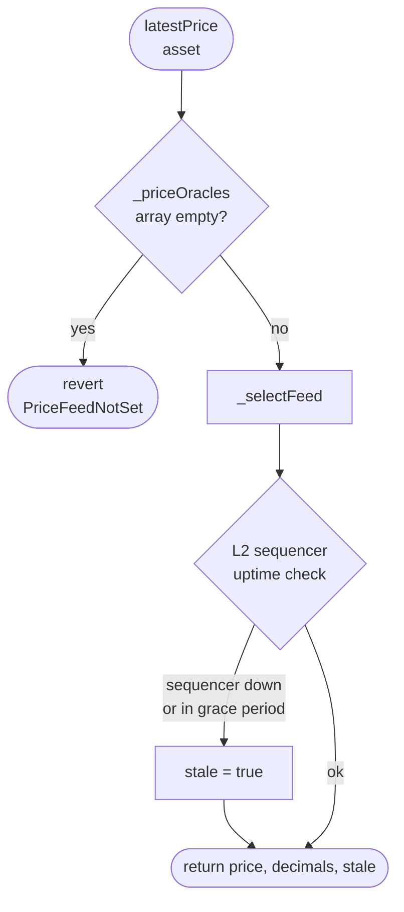
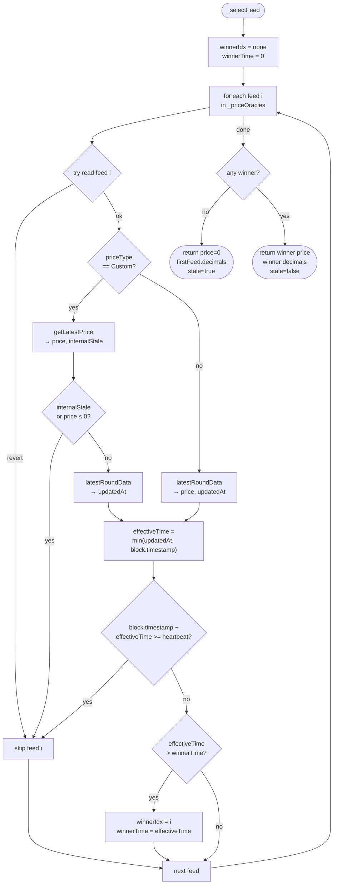

# Price Adapters: Architecture and Integration

This is the price-side counterpart to [`src/balances/BALANCE_ADAPTERS.md`](../balances/BALANCE_ADAPTERS.md). It describes the `Prices` abstract registry, the `IPriceFeedCustom` interface, the existing per-asset custom adapters, and how to add a new one.

---

## 1. Overview

The price system gives `NAVCalculator` a price for any asset, in some "USD-like" unit. Each asset can have **multiple registered feeds** for redundancy; on every read, `Prices` picks the **freshest non-stale feed** (freshest-wins selector). Stale is only returned when every feed has failed.

Four `PriceType` variants are supported:

| `PriceType` | Read path | Notes |
|---|---|---|
| `Chainlink` | `AggregatorV3Interface.latestRoundData()` | On-chain push feed. |
| `Custom` | `IPriceFeedCustom.getLatestPrice()` for price + stale; `latestRoundData()` for freshness timestamp | Custom adapters encode per-feed heartbeat logic internally. |
| `Redstone` | `AggregatorV3Interface.latestRoundData()` | Redstone Classic Push; same read path as Chainlink. |
| `API3` | `AggregatorV3Interface.latestRoundData()` | `Api3ReaderProxyV1` implements `AggregatorV2V3Interface`; only `latestRoundData` is used. |

All are subject to the **L2 sequencer uptime** check when a sequencer feed is set on `Prices`.

**`Prices` is the registry; per-asset custom contracts are the building blocks.**

---

## 2. Price flow: from asset to price

On every `latestPrice(asset)` call, `Prices._selectFeed` iterates all registered feeds for the asset and selects the **freshest non-stale survivor**:

1. **Lookup** — `_priceOracles[asset]` is a `PriceFeedConfig[]` array. Reverts with `PriceFeedNotSet` if empty.
2. **Per-feed read** — non-Custom types call `AggregatorV3Interface.latestRoundData()`. Custom feeds call `IPriceFeedCustom.getLatestPrice()` for `(price, internalStale)` (skip if stale or price ≤ 0), then `latestRoundData()` for `updatedAt`. All calls are wrapped in try/catch; a reverting feed is skipped rather than propagating.
3. **Clock-skew normalisation** — `effectiveTime = min(updatedAt, block.timestamp)`. Any feed reporting a future timestamp is clamped to prevent it from systematically winning the freshness race.
4. **Staleness gate** — skip feed if `block.timestamp - effectiveTime >= cfg.chainlinkHeartbeat`.
5. **Freshest-wins** — among survivors, select the one with the largest `effectiveTime`. Ties go to the feed at the lowest array index.
6. **All-stale fallback** — if no feed survives, return `(0, firstFeed.decimals, true)`.
7. **L2 sequencer** — top-level `latestPrice()` ORs in `checkL2SequencerUptime()`: stale if the sequencer is down or within the grace period.
8. **Return** — `(int256 price, uint8 decimals, bool stale)`.

Special case for Custom `updatedAt == 0`: treated as `block.timestamp - 1` (no trackable oracle — feed survives the staleness gate but yields to any feed with a real timestamp). See ADR 0009 for rationale.

### 2.1 `latestPrice(asset)` — top-level flow



### 2.2 `_selectFeed` — per-feed iteration and freshest-wins selection



---

## 3. Data structures

### 3.1 PriceFeedConfig (registered config)

Defined in `IPrices`.

| Field | Type | Description |
|---|---|---|
| `priceFeed` | `address` | Chainlink aggregator, API3/Redstone feed address, or custom contract (`IPriceFeedCustom`). |
| `decimals` | `uint8` | Decimals of the returned price. Pinned at registration from the feed itself. |
| `chainlinkHeartbeat` | `uint256` | Staleness window in seconds. Required non-zero for all feed types. For **Chainlink / Redstone / API3** feeds: `Prices.sol` checks `block.timestamp − effectiveUpdatedAt >= heartbeat`. For **Custom** feeds: `getLatestPrice().stale` is the primary gate; `latestRoundData().updatedAt` then applies the same heartbeat gate (`updatedAt == 0` is treated as `block.timestamp - 1` so rate-only feeds participate but yield to feeds with a real push timestamp). |
| `priceType` | `PriceType` | Enum `{ Chainlink, Custom, Redstone, API3 }`. |

### 3.2 Custom feed return shape

`IPriceFeedCustom.getLatestPrice()` returns `(uint256 price, bool stale)`. `Prices.sol` uses the `stale` bool as the primary gate: if `internalStale = true` or `price == 0`, the feed is skipped entirely. Among surviving custom feeds, `latestRoundData().updatedAt` is also read for the heartbeat gate and freshness ranking in the freshest-wins selection (see §2). The convention of returning `(0, true)` on any failure still applies.

---

## 4. Prices contract (registry behavior)

`Prices` is an abstract contract used by NAVCalculator. It maintains:

- **Per-asset feed configs:** `mapping(address => PriceFeedConfig[]) internal _priceOracles`. Each asset has a dynamic array of feeds.
- **L2 sequencer state:** `chainlinkL2SequencerUptimeFeed` and `chainlinkL2SequencerGracePeriod` (default 1 hour). Set once via `__Prices_init` at NAV initialization.

Internal API (used by NAVCalculator):

- `_addPriceFeed(asset, priceFeed, heartbeat, priceType)` — checks support via `checkPriceOracleSupport`, reads decimals from the feed, appends `PriceFeedConfig` to the array. Rejects duplicates (`PriceFeedAlreadyRegistered`). Heartbeat must be non-zero.
- `_removePriceFeedAt(asset, index)` — swap-with-last + pop. Reverts with `CannotRemoveLastFeed` when only one feed remains.
- `_removePriceFeed(asset, priceFeed)` — locates feed by address, calls `_removePriceFeedAt`. Reverts with `PriceFeedNotFound` if not registered.
- `_removeAllPriceFeeds(asset)` — `delete _priceOracles[asset]`, used by `unregisterAsset` only.
- `_priceFeedCount(asset)` — returns array length.
- `checkPriceOracleSupport(asset, priceFeed, priceType)` — public; ERC165 check for Custom; for Chainlink/Redstone/API3: rejects `IPriceFeedCustom`-shaped feeds and calls `latestRoundData()` as a sanity check.

External view API:

- `getPriceFeedCount(asset)` — number of registered feeds.
- `getPriceFeedAt(asset, index)` — `PriceFeedConfig` at that index (reverts with `PriceFeedIndexOutOfBounds`).
- `getPriceFeeds(asset)` — full array.

`NAVCalculator` exposes `registerAsset(asset, oracle, priceType, heartbeat)` (MANAGER) which combines `_addPriceFeed` with adding the asset to the Balances asset registry. Additional feeds are registered via `addPriceFeed(asset, oracle, priceType, heartbeat)`.

---

## 5. IPriceFeedCustom

Every custom feed must implement this interface (and ERC165).

| Method | Purpose |
|---|---|
| `getLatestPrice()` | Returns `(uint256 price, bool stale)`. Price is in `decimals()` precision. Return `(0, true)` on any failure or uncertainty. |
| `latestRoundData()` | Returns `(roundId, answer, startedAt, updatedAt, answeredInRound)` — same shape as Chainlink's `AggregatorV3Interface`. **`Prices.sol` calls this** to obtain `updatedAt` for the heartbeat gate and freshness ranking among surviving Custom feeds. See §5.1 for what to return. |
| `decimals()` | Returns the number of decimals the price is expressed in. Pinned at construction. |
| `underlyingAssetSupported()` | Returns the asset address this feed prices. Single asset per feed (1:1 contract-to-asset). |
| `supportsInterface(bytes4)` | Must return `true` for `type(IPriceFeedCustom).interfaceId` and `IERC165`. |

Conventions:

- **Always favor an existing Chainlink feed for the dollar leg** of the price (e.g., DAI/USD, stETH/USD, USDC/USD). Don't roll your own dollar oracle.
- **Read on-chain rates directly** (sDAI's `chi`, wstETH's `stEthPerToken`, rETH's `getExchangeRate`, etc.) rather than going through an off-chain oracle when the rate is canonical and cheap.
- **Return `(0, true)` on any failure or staleness path.** Don't revert.
- **All inputs are immutable, including heartbeats.** Pin every Chainlink heartbeat in the constructor as an immutable. New feed = redeploy. No setter, no MANAGER call needed after deployment.

### 5.1 Staleness design for custom feeds

#### How `Prices.sol` uses Custom feeds in the multi-feed model

`Prices.sol` uses the `bool stale` returned by `getLatestPrice()` as the **primary gate** — if `internalStale = true` or `price == 0`, the feed is skipped. For surviving custom feeds, `latestRoundData()` is then called to obtain `updatedAt`; the same heartbeat gate and freshest-wins logic that applies to Chainlink/Redstone/API3 feeds is applied (`effectiveTime = min(updatedAt, block.timestamp); skip if block.timestamp - effectiveTime >= heartbeat`). A custom feed returning `updatedAt == 0` is treated as `block.timestamp - 1` so it participates but yields to any feed with a real push timestamp (ADR 0009 §rationale).

#### Why `getLatestPrice().stale` is the primary staleness signal

**Multi-feed adapters have multiple Chainlink feeds, each with its own heartbeat.** The correct staleness condition is:

```
stale = block.timestamp − u1 > H1  OR  block.timestamp − u2 > H2
```

`Prices.sol` stores only a single `chainlinkHeartbeat` per asset. There is no single threshold `H` such that `block.timestamp − min(u1, u2) > H` is exactly equivalent to the OR above when `H1 ≠ H2`:

- `H = max(H1, H2)` — misses the faster feed going stale (false negative).
- `H = min(H1, H2)` — flags the slower feed as stale too early (false positive).

Encoding the check inside each adapter's `getLatestPrice()` is the only approach that works correctly for all heartbeat combinations. Each adapter has both heartbeats as immutables and does the OR check directly.

Single-Chainlink-feed adapters (e.g. `wstETH_Price`, `rETH_Price`, `sDAI_Price`) benefit from the same pattern: the on-chain exchange rate (wstETH ratio, DSR chi, rETH exchange rate) has no heartbeat of its own — it updates from protocol interactions. The single Chainlink feed is the only staleness source, and checking it in `getLatestPrice()` is natural.

#### Heartbeat in `getLatestPrice()`

Every Chainlink heartbeat used in an adapter's staleness check is pinned as an immutable constructor argument and should match the official value published in the Chainlink registry. Look up heartbeat values at:
- https://data.chain.link/ (UI — search by feed name)
- JSON registry per chain (machine-readable; `heartbeat` field):

| Chain | ChainId | URL |
|---|---|---|
| Ethereum | 1 | https://reference-data-directory.vercel.app/feeds-mainnet.json |
| Arbitrum One | 42161 | https://reference-data-directory.vercel.app/feeds-ethereum-mainnet-arbitrum-1.json |
| Base | 8453 | https://reference-data-directory.vercel.app/feeds-ethereum-mainnet-base-1.json |
| Optimism | 10 | https://reference-data-directory.vercel.app/feeds-ethereum-mainnet-optimism-1.json |
| Polygon | 137 | https://reference-data-directory.vercel.app/feeds-matic-mainnet.json |
| Gnosis | 100 | https://reference-data-directory.vercel.app/feeds-xdai-mainnet.json |
| BNB Chain | 56 | https://reference-data-directory.vercel.app/feeds-bsc-mainnet.json |

#### What `latestRoundData()` must return

`latestRoundData()` is called by `Prices.sol` for `updatedAt` (heartbeat gate + freshness ranking) and is also available to external monitoring tools via the standard Chainlink interface.

| Feed type | `updatedAt` | `answer` |
|---|---|---|
| Single Chainlink feed + on-chain rate | Pass through the Chainlink feed's `updatedAt` directly. The on-chain rate (exchange ratio, DSR chi, etc.) has no heartbeat — it updates with protocol interactions and is never the staleness bottleneck. | Computed price from `getLatestPrice()`. |
| Multiple Chainlink feeds | `min(updatedAt_1, updatedAt_2, …)` — the oldest timestamp across all constituent feeds. This reflects worst-case freshness. | Computed price from `getLatestPrice()`. |
| Indirect oracle (e.g. ETHPlus via Reserve Protocol) | `min(IAsset.lastSave())` across prime basket components — the Reserve Protocol equivalent of `updatedAt`. | Computed price from `getLatestPrice()`. |
| No trackable oracle dependency | `0` (return `(0, 0, 0, 0, 0)`). `Prices.sol` treats this as `block.timestamp - 1` so the feed participates but yields to any feed with a real timestamp. | — |

**Threshold for external callers of multi-feed adapters**: an external caller checking `block.timestamp − updatedAt > H` should use `H = min(H1, H2, …)` — the smallest heartbeat among constituent feeds. Using a larger value can silently miss the faster feed going stale.

**`answer` field**: always the current computed price, even when stale. This follows Chainlink convention — callers use `updatedAt` to decide freshness, not a zero `answer`. The only time `answer = 0` is when the underlying prices are invalid (non-positive), which signals "do not use this price" independently of staleness.

#### The registered `chainlinkHeartbeat` for custom feeds

`_addPriceFeed()` requires a non-zero heartbeat for all feed types. For custom feeds this value is used by `Prices.sol` as the heartbeat gate on `latestRoundData().updatedAt` (after the primary `getLatestPrice().stale` gate). Set it to the slowest constituent Chainlink heartbeat for the adapter — i.e. `max(H1, H2, …)` — so the external heartbeat gate does not fire before the internal staleness check would.

For feeds backed by Reserve Protocol (ETHPlus): set this to the slowest Chainlink heartbeat among the basket's underlying feeds — 86 400 s for the current ETH+ basket. Re-evaluate if basket composition changes.

---

## 7. How NAVCalculator uses prices

For each `PositionBalance` returned by an oracle, NAVCalculator:

1. Calls `latestPrice(asset)` on the price registry.
2. Gets `(price, decimals, stale)`. If stale, the asset is added to `NAV.stalePriceAssets`; the position still contributes to NAV using the last-known price (consumers decide what to do with stale).
3. Computes `value = amount × price` (sign by `isDebt`).
4. If `quoteAsset != address(0)`, divides by `latestPrice(quoteAsset)` so NAV is denominated in the quote currency.

So custom feeds are **building blocks** for value computation. Their staleness flags propagate into `NAV.stalePriceAssets` so callers can decide the right policy.

---

## 8. Implemented custom feeds

All in `src/prices/protocols/`. Pattern is one file per asset; L2-specific variants get a `_L2_` infix.

### Yield-bearing stable wrappers (rate × USD-feed)

| Feed | Asset | Underlying inputs |
|---|---|---|
| `sDAI_Price` | sDAI | DAI/USD Chainlink × DSR `pot.chi()` (RAY-scaled) |
| `sUSDS_Price` | sUSDS | USDS/USD Chainlink × Sky savings rate |
| `sUSDe_Price` | sUSDe | USDe/USD Chainlink × Ethena vault share rate |
| `sXDAI_Price` | sXDAI | xDAI/USD Chainlink × Gnosis savings rate (Gnosis Chain only) |
| `syrupUSDC_Price`, `syrupUSDC_L2_Price` | syrupUSDC | USDC/USD Chainlink × Maple syrup rate |

### Liquid (re)staking tokens

| Feed | Asset | Underlying inputs |
|---|---|---|
| `cbETH_Price`, `cbETH_L2_Price` | cbETH | cbETH-per-ETH rate × ETH/USD |
| `wstETH_Price`, `wstETH_L2_Price` | wstETH | `stEthPerToken` × stETH/USD |
| `rETH_Price` | rETH | `getExchangeRate` × ETH/USD |
| `rsETH_Price`, `rsETH_L2_Price` | rsETH | rsETH-per-ETH rate × ETH/USD |
| `eETH_Price` | eETH | eETH-per-ETH × ETH/USD |
| `weETH_Price`, `weETH_L2_Price` | weETH | weETH-per-eETH × eETH/USD chain |
| `ezETH_Price`, `ezETH_L2_Price` | ezETH | Renzo reporter rate × ETH/USD |
| `ETHx_Price` | ETHx | Stader `StakePoolsManager.getExchangeRate` × ETH/USD |

### Other derived

| Feed | Asset | Notes |
|---|---|---|
| `LDO_Price` | LDO | Composite (cross-rate) |
| `ETHPlus_Price` | ETH+ | Reserve Protocol RToken. Price = (basketsNeeded / totalSupply) × basketPrice(low). Returns stale if `IBasketHandler.status() != SOUND` (catches IFFY — lagging oracle — as well as DISABLED) or if `block.timestamp − min(IAsset.lastSave()) > RESERVE_PROTOCOL_HEARTBEAT`. `latestRoundData()` returns `updatedAt = min(IAsset.lastSave())` across prime basket components for external observability. |
| `CrossRate_Price` | generic | Generic helper: A/B × B/C from two Chainlink feeds (used when no direct A/USD feed exists) |

`_L2_` variants exist for assets where the canonical rate lives on L1. They typically read a Chainlink-secured rate feed on the L2 (rather than calling the L1 rate-provider directly) and inherit the L2 sequencer check via `Prices`.

---

## 9. How to create a new custom price feed

Detailed walkthrough lives at [`docs/howto/add-price-feed.md`](../../docs/howto/add-price-feed.md). Quick checklist:

### 9.1 Contract layout

1. Create `src/prices/protocols/<Asset>_Price.sol` (suffix `_L2_Price` for L2-specific variants).
2. Implement `IPriceFeedCustom` and `IERC165`.
3. Pin every input as `immutable` in the constructor: token address, dollar-leg Chainlink feed, rate provider, heartbeats.
4. Use `OracleArgumentChecks` (`src/utils/OracleArgumentChecks.sol`) for constructor validation: `assertERC20Address`, `assertChainlinkOracle`, `assertNotZeroNumber`, `assertNonZeroAddress`.
5. In `getLatestPrice`:
   - Read Chainlink leg first; bail out with `(0, true)` if `price <= 0`.
   - Apply heartbeat: if `block.timestamp - updatedAt > heartbeat`, set `stale = true`.
   - Read on-chain rate. If non-positive or out-of-range, return `(0, true)`.
   - Combine and rescale to the target decimals (use `RATIO_DECIMALS` constants when the rate has its own scale).
6. Implement `latestRoundData()` — see §5.1 for what to return. For a single Chainlink dependency: pass through that feed's round data, substituting `answer` with the computed price. For multiple Chainlink feeds: return the tuple with the lowest `updatedAt`, again substituting `answer`.
7. `decimals()` returns the pinned decimals (typically the Chainlink feed's decimals).
8. `underlyingAssetSupported()` returns the token address.

### 9.2 Tests

- Unit test under `test/prices/protocols/<Asset>_Price.t.sol` with mocked Chainlink + rate provider:
  - Happy path: known inputs → expected output.
  - Negative Chainlink price → `(0, true)`.
  - Stale heartbeat → `(0, true)` — return zero price when stale (security invariant I-1).
  - Zero or negative rate → `(0, true)`.
- Fork test under `test/prices/protocols/fork/<Asset>_Price.fork.t.sol` against the real feed at a pinned block — assert the price is within a reasonable range and not stale.

### 9.3 Registration

Once deployed, register via `NAVCalculator.registerAsset(asset, customFeed, PriceType.Custom, heartbeat)` (MANAGER role). The chain config under `script/config/chains/<chainId>.json` should hold the asset entry; `script/deploy/03_RegisterAssets.s.sol` reads it and calls `registerAsset`.

---

## 10. Configuration and use

### 10.1 Asset registration

Per-chain config lives at `script/config/chains/<chainId>.json` under the `assets` and `priceFeeds` blocks (see [`script/config/CONFIG_GUIDE.md`](../../script/config/CONFIG_GUIDE.md) for the schema). For a custom feed, the entry typically looks like:

```json
{
  "address": "0x...sDAI",
  "symbol": "sDAI",
  "priceFeed": "0x...sDAI_PriceOracle",
  "priceType": "Custom",
  "chainlinkHeartbeat": 86400
}
```

`03_RegisterAssets.s.sol` reads these and calls `NAVCalculator.registerAsset`.

### 10.2 Adding the same asset on multiple chains

Each chain has its own `priceFeed` deployment. L2 variants use `*_L2_Price` so the L1 rate provider isn't called from the wrong chain. Pick the right variant based on where the rate canonically lives.

### 10.3 Updating a feed / adding redundancy

Custom feeds are immutable. To change inputs (e.g., new Chainlink feed address), redeploy the adapter, add it with `NAVCalculator.addPriceFeed(asset, newFeed, priceType, heartbeat)` (MANAGER), and remove the old one with `NAVCalculator.removePriceFeed(asset, oldFeed)`. Removal reverts if it would leave the asset with no feeds — add first, then remove.

To add a second (or third) feed for redundancy without removing the existing one, just call `addPriceFeed`. Both feeds participate in the freshest-wins selection from that point on.

---

## 11. Quick reference

- **Interface:** `src/prices/IPriceFeedCustom.sol`
- **Registry:** `src/prices/Prices.sol` and `src/prices/IPrices.sol`
- **Feed configs:** `_priceOracles[asset]` → `PriceFeedConfig[]` (use `getPriceFeedAt`, `getPriceFeedCount`, `getPriceFeeds` to read)
- **Existing feeds:** `src/prices/protocols/`
- **Walkthrough:** [`docs/howto/add-price-feed.md`](../../docs/howto/add-price-feed.md)
- **Design rationale:** [`docs/decisions/0009-multi-feed-price-redundancy.md`](../../docs/decisions/0009-multi-feed-price-redundancy.md)
- **Cross-reference:** [`src/balances/BALANCE_ADAPTERS.md`](../balances/BALANCE_ADAPTERS.md) (balance side of the same architecture)
